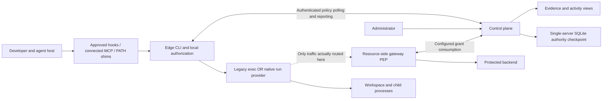

# BAP architecture and technical design

Reviewed against the working tree on **2026-11-14**. This document replaces the accumulated epic-by-epic architecture narrative; git history preserves that narrative. It describes the current implementation and its limits, rather than treating the roadmap as delivered behavior.

The checkout contains unreleased changes. In particular, daemon policy polling, nonce-bound server-directed policy version recovery, hooks-first prompt arbitration, session-separated uploads and explicit-state cleanup fixes require matching builds/deployment. Restarting an older installed binary does not install them.

## 1. Evidence and scope

| Term | Meaning |
|---|---|
| Implemented in source | A code path exists in this checkout. |
| Tested | A named fixture exercised a bounded behavior. It does not establish every integration or platform. |
| Native evidence | The selected OS/client actually ran the boundary test, rather than only rendering or cross-compiling it. |
| Operationally qualified | A particular installed bundle, identity flow, service configuration, storage and acceptance run were verified together. |

The current product is a Windows pilot candidate. Windows AppContainer tests provide native boundary evidence. The checkout does not establish complete enterprise fleet coverage, native non-Windows parity, individual administrator SSO or a qualified multi-replica authority service. [The backlog](JIRA_STORIES.md) and [operator qualification](docs/MAINTAINER_PILOT_QUALIFICATION.md) retain those gates.

The security boundary is the component that actually receives and checks an operation. A prompt, task description, source label, hostname or process observation is evidence/context, not executable authority.

## 2. Components and trust boundaries

The four planes are conceptual ownership boundaries, not proof of isolation:

| Plane | Code | Actual responsibility |
|---|---|---|
| Edge execution | [CLI](bap-edge/cmd/), [authorization](bap-edge/internal/authz/), [legacy sandbox](bap-edge/internal/sandbox/), [native runner](bap-edge/cmd/boundary.go) | Local checks, selected command execution, native-provider launch and reporting |
| Control | [server startup](bap-controlplane/cmd/server/main.go), [API](bap-controlplane/internal/api/), [policy](bap-controlplane/internal/policy/) | Enrollment, policy ownership, grant lifecycle, administration and checkpoint coordination |
| Resource enforcement | [gateway](bap-gateway/main.go) | Derive/check protected operations from requests reaching the gateway; configured central consumption |
| Observability | [edge audit](bap-edge/internal/audit/), [central audit](bap-controlplane/internal/audit/), [sessions](bap-controlplane/internal/session/) | Received events, ownership/correlation, retained-chain integrity and derived views |

An outbound destination allowlist proxy used by the native runner is separate from the resource gateway. Neither is a host-wide packet filter.

## 3. Identity and authority are separate protocols

Enrollment through OTC or a configured identity-provider flow establishes a workstation identity, enrolled origin and policy trust anchor. Lifecycle/reporting calls use the enrolled bearer credential. The server verifies proof and stored session ownership rather than accepting the owner asserted in a request body.

SPIFFE-shaped identifiers and local agent-principal signing code exist. Those identifiers alone do not establish a deployment of a SPIFFE CA, universal mTLS, device-held proof of possession or automatic certificate rotation. Development/simulated login flows are not evidence that corporate SSO was qualified.

There are distinct cryptographic uses:

| Object | Implementation | Limit |
|---|---|---|
| Managed policy bundle | Ed25519 signature over canonical policy/enforcement fields and asset identity | Public-key enrollment and rotation must remain trustworthy |
| Live policy-sync proof | Signed random request nonce, directive and exact bundle signature | Requires upgraded client/server; proves a fresh response rather than cached-bundle origin alone |
| Local task envelope | Agent-principal Ed25519 request signature | Does not authorize itself or prove a human approved the request |
| Local TaskGrant/proof | Local authority HMAC and use/revocation state | Not interchangeable with a remote resource grant or an OS capability |
| Remote execution grant | Control-plane HMAC-signed claims and configured consumption ledger | Central mutable use state and process epoch matter; multi-replica consumption is not qualified |
| Telemetry | Enrolled transport identity and retained hash-chain links | Does not prove completeness, device possession or independent execution attestation |

Local paths: [ZSP engine](bap-edge/internal/authz/zsp_engine.go), [principal/store handling](bap-edge/internal/authz/zsp_store.go). Remote paths: [grant minter](bap-controlplane/internal/authz/grants.go), [gateway verifier](bap-gateway/main.go).

No blanket claim of zero task-grant exemptions is correct: signed read exemptions, per-machine approved effects, configured operating modes and human-activated development overrides affect the local grant gate. Credential/boundary rules are separate checks. Agents must not activate overrides; official release behavior and a development build must be distinguished.

## 4. Execution paths

| Path | What happens | What it cannot establish |
|---|---|---|
| Native callback | Client supplies a callback; adapter checks or rewrites supported calls | A decision-only check does not execute or contain the original native operation |
| MCP tool | BAP receives a structured call and performs that tool's supported checks/action | Calls to other MCP servers or host built-in tools are not automatically intercepted |
| Terminal shim | PATH resolution forwards a command into BAP | Absolute paths and other execution routes can bypass PATH shims |
| `bap exec` | Local classification, grant/policy checks, child execution, output/result reporting | Complete shell semantics, a filesystem jail on every OS, or global network closure |
| `bap run` | Launch executable/argv through the selected native provider | Automatic conversion of every grant into least-privilege OS permissions |
| Gateway | Independently check requests reaching its protected route | Requests to an unprotected backend or another network route |

The legacy broker uses parsing/classification. Encoded command handoff reduces quoting ambiguity; it does not eliminate parsing bugs, false denials or every shell side effect.

The newer capability converter intentionally separates an effect-level Set from the runner Profile. A read-only grant must not silently become a workspace read/write profile. Signature/session verification and use consumption remain the caller's responsibility; the Set is not yet the active grant-to-runner authority path. See [capability design](docs/CAPABILITY_MODEL.md).

| Platform/path | Source and evidence | Remaining boundary |
|---|---|---|
| Windows legacy `exec` | Restricted token / Job Object code and tests | Reduced privilege and process lifetime are not a complete file/network policy |
| Windows native `run` | AppContainer code and native workspace/outside-file/network boundary tests | ACL lifecycle, tool compatibility, whole-agent-session acceptance and credential completeness need qualification |
| Linux legacy `exec` | Namespace configuration | Namespace creation is not a configured path allowlist; host configuration can prevent startup |
| Linux native `run` | bubblewrap arguments and relay plumbing | Native execution/escape acceptance remains pending; unprivileged namespace availability is a deployment dependency |
| macOS legacy `exec` | Process-group configuration | No filesystem/network sandbox is established by that path |
| macOS native `run` | Seatbelt (native execution unverified) profile rendering / `sandbox-exec` launch path | Native acceptance and tool compatibility remain pending |

Landlock (not implemented), eBPF (simulation only), WFP (not implemented), Endpoint Security (not implemented) and NetworkExtension (not implemented) must not be advertised as delivered endpoint enforcement. Elevation does not install a sensor or packet filter.

## 5. Policy ownership, distribution and cache

[Control-plane policy store](bap-controlplane/internal/policy/store.go), [signer](bap-controlplane/internal/policy/signer.go), [edge store](bap-edge/internal/policystore/store.go) and [trust handling](bap-edge/internal/policystore/trust.go) define the wire contract.

The control plane signs asset-bound bundles covering content digest and enforcement fields, including kill state, read exemptions, prompt capture and approved effects. Enrollment provides a public-key/asset pin. Rotation chains authorize key changes from an already trusted key. A legacy first-contact public-key endpoint remains a weaker compatibility path.

The server owns the live policy version in either direction. An upgraded edge accepts a lower version only through a fresh nonce-bound signed sync response plus normal bundle verification. Local/cache acceptance and older servers without that proof retain rollback rejection. A signed old bundle alone is replayable origin evidence, not fresh authority. There is no automatic client-directed counter bump.

Policy files and JSON state are **plaintext**. Ed25519 signature/digest checks provide tamper evidence; they do not encrypt content. The local pin is not a hardware-protected root of trust. A same-user attacker, deletion of trust/state, and host compromise are separate limitations.

Current source publishes complete cache files through unique staging names and replacement, with bounded Windows sharing retries. This reduces truncation and shared temporary-file collisions. It is not a transaction across Cedar/schema/state files or a cross-process compare-and-swap protocol.

A managed edge rejects missing/unverifiable signed authority rather than silently trusting an editable local policy. Unmanaged bootstrap/legacy fallback is a separate mode. Human development overrides can deliberately expose degraded behavior; do not present an override session as production enforcement acceptance.

## 6. Freshness, offline behavior and kill switches

| Mechanism | Configured/default interval | Qualification |
|---|---|---|
| Watcher and current-source daemon policy polling | Immediately, then 3 seconds | Online, authenticated, active and matching components required |
| Short-lived stale-policy refresh | 5-second cache-age threshold | May perform synchronous network work; failure is handled through cache validity |
| Daemon workstation/session heartbeats | 4 seconds | Public health is not authenticated reporting |
| Watcher heartbeat | 2 seconds | Only for a running watcher and its associated workload |
| Named-process observation | 10 seconds | Presence only; recognized names, PID and birth identity |
| Spool retry worker | 5 seconds | Upload, authentication and ownership failures can delay delivery |

These are intervals, not maximum end-to-end latencies or an all-workstation SLA. Startup, TLS, parsing, signature checks, file access, server cold starts, grants, retries and network calls contribute to elapsed command time. No current fleet-wide sub-millisecond overhead or sub-second kill-switch guarantee is established.

A disconnected workstation cannot receive a new freeze. A configured signed lease bounds cached-policy lifetime; production startup requires an explicit offline budget. Without that lease, a signed cache does not by itself cap staleness. Cache validity does not imply a new central grant can be issued offline.

Receiving a kill switch blocks subsequent protected edge decisions. Terminating an existing workload depends on a running watcher/provider and the applicable process path. It is not equivalent to stopping every unmanaged process on the host.

## 7. Reporting and prompt arbitration

Each layer reports only evidence it receives. Discovery is metadata-only presence; it does not read arbitrary chat transcripts, agent memory or environments. Hook installation does not prove approval or receipt of a prompt callback.

Current source exposes MCP request reporting by default and supplies cooperative per-turn instructions. The client/model must actually call the tool. A model-written summary is labeled `self_reported`; it is not independently verified prompt capture or authorization.

All received prompt sources feed session/turn correlation. Hooks have the highest prompt priority. MCP, broker, shim, SDK or launcher evidence can fill a gap; later hook evidence supersedes fallback text/classification without another logical prompt. Raw corroborating audit records remain immutable; the transcript presents a canonical prompt. Counters and correlation survive tested SQLite/checkpoint restoration.

Exact correlation requires the same session and native turn ID across layers/retries. Distinct IDs preserve identical text submitted in separate turns. Legacy content hashes cannot reliably distinguish repeated identical turns or differently worded summaries. A tool-hook heartbeat is not evidence that a prompt callback succeeded, so it must not suppress a received fallback.

Gateway evidence is a separate resource observation, not a substitute for a user prompt or local tool result. Operation deduplication heuristics and prompt-turn correlation must not be described as universal exactly-once execution.

Design and source map: [reporting boundaries](docs/INDEPENDENT_LAYER_REPORTING.md), [fallback design](docs/LAYERED_FALLBACK_REPORTING_DESIGN.md), [session observation](bap-controlplane/internal/session/prompt_observation.go), [canonical prompt view](bap-controlplane/internal/session/prompt_view.go).

## 8. Privacy, retained evidence and recovery

Generic Go telemetry defaults to metadata minimization for command bodies, arguments, responses and free text on covered routes. **Prompt text follows the separate signed administrator capture setting**, whose default is `required`; `off` withholds prompt content. Generic metadata mode does not promise prompt confidentiality.

Redacted-content mode can contain code and secrets missed by pattern matching. IDs, paths, hashes and intent metadata can identify people/projects. Not every producer or auxiliary route is covered by the same filter. Local retry/journal files are not established as encrypted storage. See [privacy contract](docs/TELEMETRY_PRIVACY.md).

Audit links establish integrity of retained records under the implemented hash format. The structure is a sequential hash chain, not evidence of a Merkle-tree transparency service, collection completeness, independent notarization or legal non-repudiation. Deletion, omitted events, same-privilege host tampering and key custody remain relevant.

A verified acknowledgment and `durable:true` are different claims. Non-durable server acknowledgments cause the edge to retain recovery evidence for later replay. Historical session-ownership refusals remain attributed to their original identity; they must not be reassigned to a new login to make a dashboard green. Session-separated batches let unrelated live sessions proceed while refused evidence is retained.

Reporting-only recovery can reconstruct presence after server state loss using valid workstation proof. It does not mint execution grants, clear a freeze or promote recovered registry identity. Fresh enrollment may be required. No agent can complete the account owner's real identity-provider authentication.

## 9. Persistence and administration

The production startup path requires stable signing configuration, an absolute SQLite path, an explicit signed-policy lease and durable authority. The operator must provision and verify persistent storage; an absolute path alone does not prove that a deployment volume survives replacement. A new authority requires explicit initialization; a missing/corrupt checkpoint is not an invitation to initialize a replacement fleet.

[Durability coordinator](bap-controlplane/internal/api/durability.go) and component checkpoints support a **single server** committing authority and canonical audit state before acknowledging mutations. Qualification must demonstrate actual volume survival and backup restoration. The explicit acknowledged ephemeral mode permits state loss for demos; it does not provide production resilience.

Execution-grant epoch/usage state intentionally fails closed across process restart. A restored reporting/session record is not proof that an old execution grant is live.

A shared administrator credential is used for the current pilot boundary. Individual administrator SSO, separation of duties, device proof of possession, PostgreSQL authority and multi-replica leadership/consumption remain outstanding. Recommendations that add signed per-machine effect exemptions are distinct from temporary browser-to-edge ZSP approval/resume, which remains incomplete.

## 10. Source and acceptance map

| Contract | Main implementation | Bounded verification |
|---|---|---|
| Policy signatures, pins, rotation, leases, live version recovery | `bap-controlplane/internal/policy`, `bap-edge/internal/policystore` | Their signing, trust, lease and live-sync fixtures |
| Daemon polling and pending prompt replay | `bap-edge/cmd/daemon.go`, `daemon_heartbeat.go` | `daemon_policy_sync_test.go`; not a fleet timing trial |
| Prompt priority and restart correlation | `bap-controlplane/internal/session/prompt_observation.go` | `prompt_observation_test.go`, API `prompt_fallback_test.go` |
| MCP fallback | `bap-edge/internal/mcp/report_request.go` | Local persistence/retry and per-turn reporting fixtures |
| Native Windows boundary | `bap-edge/internal/appcontainer`, `cmd/boundary.go` | Native provider/boundary fixtures; not every agent/tool |
| Grant-to-capability conversion | `bap-edge/internal/capability/grants.go` | Converter tests; active runner binding remains open |
| Per-session upload isolation | `bap-edge/internal/audit/transmitter.go` | `session_batches_test.go`; retained refusals require reconciliation |
| Authority persistence | `bap-controlplane/internal/api/durability.go` and checkpoints | Restart/failure fixtures; deployed storage/backup acceptance still required |
| Activity and discovery | `bap-controlplane/internal/api/activity.go`, edge discovery workers | Received evidence/metrics contracts, not workforce productivity |

Latest work in this session exercised edge command, policy/state, MCP/audit, control-plane session/API/registry and native-hook suites. That record is scoped to the changed source and Windows execution environment. Cross-compilation, a source test pass or a version string does not establish native acceptance or that an installed binary contains these changes.

Use [maintainer qualification](docs/MAINTAINER_PILOT_QUALIFICATION.md) for a reviewed bundle, clean isolated workstation, actual IdP/client approval, signed sync, offline expiry, independent freeze behavior, matching hook copies, storage restart/restore and measured latency/backlog. Do not execute destructive test cleanup against live enrollment.

## 11. Roadmap boundaries

The native runner/capability path is the direction for stronger containment, but it has not replaced the legacy parser-based broker. Complete credential brokering/masking, generic automatic prompt capture, verified operation/result identity, non-Windows native acceptance, individual reviewer identity, distributed authority and comprehensive retention remain separate deliverables.

Design principles are requirements, not proof: intent must not grant authority; protected resources must check bounded authority independently; reporting must not imply execution; and administration itself must be authenticated and audited. Release acceptance must show where those requirements are actually enforced.
