# Architecture & Technical Design: Bounded Authority Plane (BAP)

This document specifies the technical architecture, security model, component design, cryptographic protocols, and operational state machines of the **Bounded Authority Plane (BAP)**.

### Leadership pilot delivery boundary

P1b qualification tools now provide [matched release integrity and a correlated native reporting probe](docs/RELEASE_AND_NATIVE_PROBE.md). Component hashes/build metadata identify the supplied bundle without claiming publisher authenticity. The probe compares fresh ordered callback session references with workstation-scoped central prompt/policy evidence; it does not grant authority or verify execution success. Real native-client/SSO, release-trust and OS qualification remain explicit gates.

The [expected pilot roster](docs/PILOT_ROSTER_COVERAGE.md) is operator configuration loaded once at startup. Its admin-only V3 snapshot compares exact workstation/owner identities against server registry check-ins within explicit windows. It exposes stale/missing/conflicting evidence and does not infer complete agent capture from liveness. Lookup is indexed and separate from command evaluation; historical observations and team-scoped reporting remain pending.

Live activity measurement now follows [metrics contract v2](docs/ACTIVITY_METRICS_CONTRACT.md): retained session counters and bounded activity observations are separate datasets; unsupported work completion, hours/FTE, governance coverage and historical trends are explicitly unavailable. Testing commands are valid evidence across immediate delivery, offline flush and restart replay. Legacy test-mode flags cannot suppress enrolled/managed reporting. Hash-chain verification asserts only retained-chain integrity, not collection completeness or regulatory certification. Cross-layer operation identity and verified deliverables remain P2/P4.

Independent workstation discovery and v3 inventory/coverage are implemented as documented in [Discovery v3 implementation plan](docs/DISCOVERY_V3_IMPLEMENTATION_PLAN.md). A separate daemon worker collects bounded known MCP configuration and named-process metadata without requiring hooks or an agent session. It persists reports locally, uses master enrollment proof, validates acknowledgments and retains recovery copies while the server advertises `durable:false`. Native Claude MCP hooks add correlated attempt/outcome metadata when approved. Configuration, process presence and invocation remain distinct evidence; discovery never grants authority or proves resource enforcement. Assets, latest scans, directives and dispositions use the existing SQLite session pool; PostgreSQL and deployment-backed durable history remain deferred under P3. The public API no longer scans the server filesystem or accepts environment values/client-supplied owners.

The current delivery goal is defined in the [20-person Claude leadership pilot plan](docs/LEADERSHIP_PILOT_PLAN.md). It requires a validated collection baseline, canonical operation identity, durable authoritative history and work/result evidence before leadership claims. Existing action lifecycle/TaskID primitives are reusable correlation inputs; they are not yet a complete business-progress model. The target production persistence is one transactional PostgreSQL store behind the existing repository interfaces. This is planned architecture, not a declaration that the database migration or leadership reporting gates have shipped.

### Workstation enrollment and independent reporting

The per-user reporting runtime now includes [startup/supervision and onboarding diagnostics](docs/STARTUP_AND_ONBOARDING.md). Windows logon starts a supervisor that restarts crashed daemons with bounded backoff while honoring intentional pauses. Runtime locks and process-birth/readiness checks prevent duplicate or stale-PID liveness claims. Native hooks write minimal callback-health metadata; doctor distinguishes those observations from file installation, public connectivity and authenticated reporting. This supplies P1a runtime support, not a completed SSO/native-client/roster qualification or mandatory OS enforcement.

`bap install` provisions the workstation and daemon; `bap login` establishes its shared identity and control-plane destination. Enrollment is the master destination for edge telemetry and native-hook lifecycle reporting, subject to administrator endpoint locks. Conflicting managed configuration queues evidence until enrollment is corrected. A repository setting or unapproved hook must not redirect or disable the other reporting paths.

The implemented contract and boundary matrix are in [Independent Layer Reporting](docs/INDEPENDENT_LAYER_REPORTING.md). Hooks, MCP, terminal shims, broker and gateway report their own available evidence; prompt text is optional. Passive named-process observation adds reporting-only presence on Windows/Linux, with installation/PID/birth-bound fallback IDs. Observation never becomes an execution grant. Each enforcing boundary must actually receive the operation; no serial hook-to-kernel fallback or universal interception is implied.

The dashboard separates evidence coverage from liveness. Elevated privilege alone no longer claims an installed kernel sensor or packet filter. Eight bounded daemon delivery workers and a persistent spool decouple uploads from command execution; existing heartbeat/recovery authorization and cached restrictions remain in force. New central audit links bind reporting-layer metadata using hash version 3 without rewriting legacy links.

### Authenticated lifecycle and restart recovery

Launcher distribution is part of the tested lifecycle contract: wheel staging selects repository-root launchers and copies them into package and `launchers/` paths. Regression checks exercise those staged artifacts, including the shared engine. Exact CLI version queries return metadata without creating sessions or changing workspace settings; normal workload startup retains its governance preflight.

The implemented lifecycle/identity contract is defined in [ADR-006](docs/adr/ADR-006-Authenticated-Lifecycle-And-Recovery.md) and the [session recovery design](docs/SESSION_IDENTITY_AND_RECOVERY.md). HTTPS alone does not authenticate a workstation. Lifecycle and telemetry writes validate enrolled proof and stored session ownership; hostnames, email addresses and session IDs cannot establish ownership. Gateway collection uses a separate ingestion-only identity.

Deployment recovery re-announces live sessions under their original IDs. It restores reporting metadata without issuing execution grants, clearing cached denials, or reopening ended/revoked sessions. Reconstructed registry records are reporting-only; old bounded grants cannot survive loss of the in-memory authority epoch/usage ledger. Local enforcement remains independent of reporting availability.

Until central audit storage is durable, verified acknowledgements identify the server instance and explicitly report non-durability. The edge retains acknowledged evidence in a synchronized recovery journal and replays after instance changes using a bounded batch and persistent cursor. This protects edge-originated evidence; it does not replace a durable database for central administrative decisions or distributed grant consumption.

---

## 1. Executive Architecture & Invariants Core

The Bounded Authority Plane (BAP) enforces zero-trust execution boundaries, cryptographic attestation, and least-privilege authority over AI developer agents (such as Claude Code, GitHub Copilot CLI, and autonomous worker agents).

### 1.1. The Five Foundational Invariants (Frozen Baseline)

The entire BAP architecture is anchored on seven inviolable architectural invariants:

> **I1 — Intent is context, never authority.**  
> An agent declaring intent to "update customer 123" does not grant executable privilege to write, cancel, or modify resources. Intent provides context for policy evaluation and audit evidence, never executable permission.

> **I2 — `bap-edge` determines what authority an agent may obtain; it is not assumed to execute every resulting operation.**  
> `bap-edge` evaluates local policy and brokers requests, but cannot be assumed to observe or execute every downstream HTTP/RPC call. Local intent or policy approval alone is never proof that an actual operation was authorized.

> **I3 — Actual protected operations are independently enforced at a resource-side PEP against bounded authority.**  
> Business APIs and microservices are protected by gateway Policy Enforcement Points (PEP) that derive actual actions from trusted request characteristics (HTTP method, route, parameters), validating bounded cryptographically signed grants.

> **I4 — Control Plane owns master policy, lifecycle, and centralized state; ordinary authorization must not unnecessarily depend on a synchronous Control Plane round-trip.**  
> The Control Plane distributes signed, immutable policy bundles. High-throughput edge decisions evaluate locally cached policies in sub-2ms; only operations requiring mutable state (e.g. single-use atomic consumption) hit central state.

> **I5 — Observability establishes causality and evidence across Runtime → Authority → PEP → Execution, but telemetry itself is never treated as authorization.**  
> The Observability Plane reconstructs the end-to-end timeline for forensic integrity, but telemetry reporting or health signals never substitute for cryptographic authorization tokens.

> **I6 — Zero Standing Privileges (ZSP) and the Atomic 4-Tuple Task Contract.**  
> The agent's starting permission set is strictly ZERO ($\emptyset$). Identity tells *who you are*; authorization determines *what you are eligible to do*. To execute work, an agent must submit an atomic 4-tuple task authorization envelope $(Who, AuthorizedBy, Intent, PermissionAsk)$ signed with an ephemeral Ed25519 key. Broad permissions are monotonically attenuated by deterministic Cedar policy, issuing a single-use JIT `TaskGrant` burned atomically upon execution.

> **I7 — Developer Override & Agent Immunity.**  
> Autonomous agents are strictly forbidden from activating developer overrides (`bapedge dev-override on`), granting themselves trust, or bypassing boundary checks. Overrides require interactive, authenticated human developer authorization.

---

## 2. System Topology: The Four Operating Planes

BAP is architected into four decoupled, resilient operational planes:

```mermaid
graph TD
    subgraph Central_Control ["1. Control Plane (bapcontrolplane)"]
        CP["bapcontrolplane Core"]
        REG["Agent Registry & SPIFFE SVID Engine"]
        ATTEST["Binary Hash Attestation Store"]
        MINTER["Cryptographic Grant Minter (HMAC-SHA256)"]
        BUNDLE["Authoritative Cedar Policy Store & Sync"]
        BURNER["Atomic Grant Burner (max_uses=1)"]
        AUDIT_CHAIN["Tamper-Evident Sequential Hash Chain (SHA-256)"]
        SESS["Session Lifecycle & Live Radar"]
        
        CP --> REG
        CP --> ATTEST
        CP --> MINTER
        CP --> BUNDLE
        CP --> BURNER
        CP --> AUDIT_CHAIN
        CP --> SESS
    end

    subgraph Edge_Brokerage ["2. Edge Execution Plane (bapedge / Launchers / Hooks)"]
        subgraph Agents ["AI Agent Runtimes"]
            CLAUDE["Claude Code CLI"]
            COPILOT["GitHub Copilot CLI (Standalone v1.0.97+ / gh)"]
            ANTIGRAV["Google Antigravity (IDE Electron & agy CLI)"]
            WORKER["Autonomous Worker Agent (Python SDK)"]
        end

        subgraph Interceptors ["Managed Interception & Lifecycle Layer"]
            CCHOOK["Claude Code Hook (cchook/interceptor.exe)"]
            COPSHIM["Copilot Streamer & Interceptor (run_copilot_cli_bap)"]
            AGYHOOK["Antigravity Lifecycle & Transcript Streamer (run_antigravity_ide/cli)"]
            SUBAGENT_ROUTER["Subagent & Inspection Tool Classifier (cchook)"]
        end

        subgraph Edge_Daemon ["bapedge - Local Execution Broker (LTD)"]
            EDGE_PEP["Local Policy Enforcement Point (PEP)"]
            CEDAR_LOCAL["In-Process Cedar Engine (<2ms)"]
            STORE_LOCAL["PolicyStore Cache (~/.ltd/policy/)"]
            AUDIT_LOCAL["Append-Only Local Logger (ltd-audit.jsonl)"]
            CLASSIFIER["Deterministic Intent Classifier (11 Rules)"]
        end

        CLAUDE -->|PreToolUse / UserPromptSubmit| CCHOOK
        COPILOT -->|events.jsonl Tailing & CLI Intercept| COPSHIM
        ANTIGRAV -->|transcript.jsonl Tailing & Process Guard| AGYHOOK
        WORKER -->|bap_sdk API| EDGE_PEP

        CCHOOK --> SUBAGENT_ROUTER
        SUBAGENT_ROUTER --> EDGE_PEP
        COPSHIM --> EDGE_PEP
        AGYHOOK --> EDGE_PEP
        EDGE_PEP --> CEDAR_LOCAL
        CEDAR_LOCAL --> STORE_LOCAL
        EDGE_PEP --> AUDIT_LOCAL
        CCHOOK --> CLASSIFIER
    end

    subgraph Resource_PEP ["3. Resource Enforcement Plane (bapgateway)"]
        GW_PEP["bapgateway (Zero-Trust Gateway PEP)"]
        EXT_AUTHZ["Envoy / Istio ext_authz Proxy Semantics"]
        DERIVE["Authoritative Operation Derivation (deriveOperation)"]
        BACKEND_API["Protected Microservices (Financial Records, Banking, DB)"]

        GW_PEP --> DERIVE
        GW_PEP --> EXT_AUTHZ
        EXT_AUTHZ -->|Verified 200 OK| BACKEND_API
    end

    subgraph Observability_Plane ["4. Observability & Forensic Plane"]
        COCKPIT["CIO Fleet Command Cockpit (Live Radar)"]
        TIMELINE["Causal Evidence Reconstruction Engine"]
        COLLECTOR["Audit Log Aggregator"]
        
        COCKPIT --> TIMELINE
        TIMELINE --> COLLECTOR
    end

    %% Cross-Plane Comms
    EDGE_PEP <-->|Sub-2ms Local Policy Sync| BUNDLE
    EDGE_PEP -->|Ingest Prompt & Tool Events| AUDIT_CHAIN
    EDGE_PEP <-->|Acquire Bounded Grant Token| MINTER
    
    Agents -->|HTTP Requests with Grant Bearer Token| GW_PEP
    GW_PEP <-->|POST /api/v1/grants/consume (Atomic Burn)| BURNER
    GW_PEP -->|Audit Decision Telemetry| AUDIT_CHAIN
    AUDIT_CHAIN --> COLLECTOR
```

---

## 3. Component Deep Dive

### 3.1. Plane 1: Control Plane (`bapcontrolplane`)

`bapcontrolplane` is the authoritative root of trust for policy, identity, and lifecycle state:

1. **Central Policy Master (BAP-401):**
   - Authoritative source for all Cedar policies. Policies receive immutable version IDs (e.g. `v1-digest`, `v2-digest`).
   - Distributes cryptographically signed bundles. Edge runtimes verify signatures and reject unauthenticated or tampered policy files.
   - Supports zero-downtime policy distribution and instantaneous rollback without restarting agent processes.
2. **Workload Identity & SPIFFE SVID (BAP-403, BAP-404):**
   - Issues cryptographically verified SPIFFE IDs formatted as:
     $$\text{spiffe://}\{\text{trust\_domain}\}/\text{app}/\{\text{app\_id}\}/\text{instance}/\{\text{instance\_id}\}$$
   - Rotates credentials every 5 minutes over mutual TLS (mTLS). SVID rotation does not terminate active healthy sessions.
3. **Cryptographic Bounded Grant Minter (BAP-407, BAP-408):**
   - Issues short-lived, cryptographically bounded tokens encapsulating:
     - `jti`: Unique UUID grant identifier.
     - `sub`: Agent SPIFFE workload identity.
     - `session_id`: Unique developer session identifier.
     - `human_id`: Authenticated user email/ID on whose behalf the agent acts.
     - `action`: Specific allowed operation (e.g. `customer.address.update`).
     - `resource`: Specific canonical resource URI (e.g. `customer/123`).
     - `constraints`: `max_uses: 1`, `max_amount`, cumulative limits.
     - `exp`: Strict ephemeral TTL (default: 30–60 seconds for single actions).
     - `policy_version`: Policy bundle hash active when granted.
4. **Atomic Mutable State Burning (BAP-417, BAP-419):**
   - Houses the centralized mutex-locked consumption store (`consumeActiveGrantWithDetails`).
   - Guarantees that ten simultaneous parallel requests against a `max_uses=1` grant result in **at most one** successful consumption; nine requests are rejected.
5. **Tamper-Evident Merkle Hash Chain (BAP-221, BAP-433):**
   - Every ingested event is hashed with the prior block's hash:
     $$H_n = \text{SHA256}(H_{n-1} \parallel \text{EventJSON})$$
   - Any manual edit to historical database rows breaks the chain, causing `/api/v1/control/chain/verify` to report `valid: false`.

---

### 3.2. Plane 2: Edge Execution Broker (`bapedge` & Hooks)

`bapedge` enforces local execution boundaries directly on developer workstations or CI containers:

1. **Sole Executor Pattern (BAP-200, BAP-421):**
   - Agents are deprived of unmediated shell execution. Command execution occurs exclusively via broker-owned wrappers:
     ```bash
     bapedge exec --source claude-code --session-id <sess_id> --cmd-b64 <base64_payload>
     ```
   - Agent-authored lookalikes or direct process-spawning bypasses are strictly rejected.
2. **In-Process Cedar Policy Engine (BAP-101, BAP-402):**
   - Evaluates AWS Cedar policies in-process in **$<1.5\text{ms}$**, completely eliminating remote RPC latency during coding tasks.
   - Evaluates principal, action, resource, and context locally using cached policy bundles.
3. **Offline Fail-Secure Architecture (BAP-102, BAP-434):**
   - If the Control Plane is offline or partitioned, `bapedge` continues enforcing verified cached policies in `~/.ltd/policy/`.
   - If no valid policy cache exists, it fails secure (`exit code 1`). It **never fails open**.
4. **Deterministic Intent Classifier (BAP-218, BAP-405, BAP-406):**
   - Evaluates user prompts against 11 canonical CIO categories:
     `BUG_FIX`, `DATABASE_CHANGE`, `FEATURE_ENHANCEMENT`, `INVESTIGATION`, `REFACTOR`, `TEST_VERIFICATION`, `DOCUMENTATION`, `MIGRATION`, `DEPLOYMENT_RELEASE`, `WORK_MANAGEMENT`, `SECURITY_REMEDIATION`.
   - Ambiguous or unclassified prompts fail safely to `UNKNOWN` ($0.0$ confidence), which explicitly forces human approval or restricted execution rather than silent privilege escalation.
5. **Anti-Tampering Asset Guard (BAP-200A, BAP-425):**
   - Blocks any agent attempt to read credentials (`.env`, `.aws`, `.ssh`), tamper with BAP assets (`policy.cedar`, `bap-config.json`, `interceptor.exe`), or perform directory traversal outside the authorized workspace.
6. **Subagent & Inspection Tool Classification (`cchook/interceptor.go`):**
   - Distinguishes shell execution tools (`Bash`, `Terminal`, `Shell`) requiring command validation from read-only search/inspection tools and subagents (`search_code_subagent`, `Glob`, `Grep`, `Agent`, `Task`, `LS`, `bap_*`).
   - Prevents false-positive denials on empty command fields for non-shell inspection payloads, while strictly maintaining filesystem jail and credential boundary checks across all tool types.
7. **Direct Broker Command Unwrapping (`unwrapBrokerCommand`):**
   - Governing rules (`AGENTS.md`, `GEMINI.md`) instruct advanced agents to directly call `bapedge.exe exec "<cmd>"`.
   - The interceptor dynamically unwraps nested invocations, preserving source attribution (`copilot`, `antigravity`, `claude-code`) and evaluating the inner command against Cedar policy without recursion or double-wrapping.
8. **Multi-Agent Launchers & Lifecycle Supervision (`scripts/bap_launcher_engine.ps1`):**
   - **Google Antigravity IDE & CLI (`run_antigravity_ide_bap.bat`, `run_antigravity_cli_bap.bat`)**:
     - *GUI Electron Lifecycle Guard*: Overcomes asynchronous process-return where Electron GUI launches immediately detach; holds the BAP session `active` in the Control Plane, monitors the entire process tree, and allows clean console termination.
     - *Live Transcript Streaming*: Fast polling (120ms) of `transcript.jsonl` streams user mission prompts to `/api/v1/sessions/prompt` in real-time.
     - *MCP Governance*: Automates mounting of `bapmcp.exe` in `.antigravity/mcp_config.json`.
   - **GitHub Copilot CLI Standalone v1.0.97+ (`run_copilot_cli_bap.bat`)**:
     - *Native Standalone Prioritization*: Prioritizes standalone `copilot.exe` over `gh copilot` extension.
     - *Live Event Streaming*: Tails `~/.copilot/session-state/*/events.jsonl`, ingesting prompts (`user.message`), assistant answers (`assistant.message`), and token metrics (`session.usage_record`) to the Control Plane.
     - *Audit Accounting Snapshot*: Extracts final `accountingSnapshot` upon session exit, recording tokens (input, cached, output), AI credits (nanoAIU), and API duration directly into the Merkle audit chain (`/api/v1/audit/ingest`).

8. **PowerShell AST Semantic Classification & Variable Tracking (BAP-816):**
   - Deconstructs complex multi-command PowerShell pipelines (`|`, `&&`, `||`, `;`) and classifies built-in pipeline cmdlets (`Out-Null`, `Out-Default`, `Out-Host`, `Join-Path`, `Split-Path`, `ConvertTo-Json`, `ConvertFrom-Json`, `Tee-Object`, `Start-Sleep`, `Measure-Command`, `Get-Date`) as permitted utilities in Cedar Policy 1.
   - Recognizes variable property expressions (`$p.Path`, `$_.Length`) as in-memory language expressions rather than external binaries.
   - Tracks variable assignments (`$p = '...'`, `$p = Join-Path ...`) via `ResolveVariablePaths`, resolving concrete targets and substituting them into downstream command arguments (`New-Item -Path $p`, `Set-Content -Path "$p\config.json"`) so cross-folder write mutations reliably trigger Policy 2 step-up evaluation.
9. **Cross-Platform Child Console Attachment for Interactive HITL (BAP-816):**
   - Solves stdin/stdout detachment when AI agent platforms (e.g. Claude Code) launch lifecycle hooks as child processes with stdio redirected to JSON-RPC pipes.
   - On Windows, hooks invoke Win32 `kernel32.AttachConsole(ATTACH_PARENT_PROCESS)` and open direct `CONIN$` / `CONOUT$` handles to present interactive human step-up prompts (`[O/S/P/G/D]`).
   - On Unix/macOS, binds to `/dev/tty`. Modularized with `//go:build` tags across `bap-edge/cmd` and `cchook`.
10. **Dogwood Temporal & Stateful Policy Architecture Roadmap:**
    - Evaluates AWS Dogwood (Cedar's temporal extension with Metric First-Order Temporal Logic) for the Control Plane policy distribution engine.
    - Bridges point-in-time stateless Cedar evaluation with session-level cumulative denial counters, time-bounded step-up authorizations, and cross-tool execution sequences without requiring ad-hoc edge JSON state synchronization.

---

### 3.3. Plane 3: Resource Enforcement Plane (`bapgateway`)

`bapgateway` acts as the independent Zero-Trust Policy Enforcement Point (PEP) guarding enterprise business APIs:

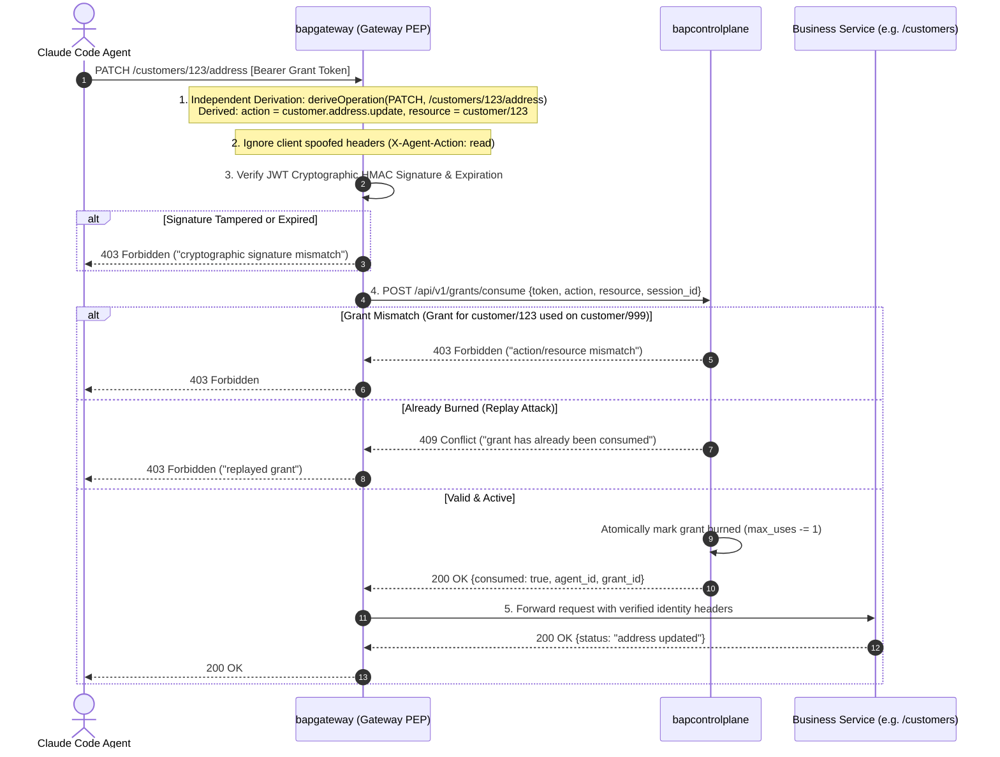

#### Key Gateway PEP Invariants:
1. **Independent Operation Derivation (`deriveOperation`):**
   The gateway inspects the HTTP verb and path to derive authoritative actions and resources:
   ```go
   func deriveOperation(method, path string) (action, resource string) {
       cleanPath := strings.TrimRight(path, "/")
       if strings.HasPrefix(cleanPath, "/api/v1/financial-records") {
           if method == http.MethodGet {
               return "financial.records.read", "/api/v1/financial-records"
           }
           return "financial.records.write", "/api/v1/financial-records"
       }
       if strings.HasPrefix(cleanPath, "/api/v1/core-banking") {
           if method == http.MethodPost {
               return "core_banking.transfer", cleanPath
           }
           return "core_banking.read", cleanPath
       }
       return strings.ToLower(method) + ":" + cleanPath, cleanPath
   }
   ```
2. **Rejection of Client Header Spoofing (BAP-411):**
   The PEP completely ignores client-injected headers such as `X-Agent-Action: harmless-query`.
3. **Strict Grant-to-Operation Matching (BAP-412):**
   Grants issued for `customer/123` cannot be used on `customer/999` or `subscription/789`. Any mismatch immediately triggers `403 Forbidden`.
4. **Envoy / Istio `ext_authz` Emulation:**
   `bapgateway` provides standard HTTP check endpoints allowing seamless deployment as an external authorization sidecar for Envoy, Istio, Traefik, or Kong API Gateways.

---

### 3.4. Plane 4: Observability Plane & Causal Reconstruction

The Observability Plane answers the fundamental question: **"Why did the agent invoke this operation, under whose authority, and what was the result?"**

```text
┌─────────────────────────────────────────────────────────────────────────────┐
│                       CAUSAL EVIDENCE RECONSTRUCTION                        │
├─────────────────────────────────────────────────────────────────────────────┤
│ 1. Runtime Intent Capture:                                                  │
│    User Prompt: "Investigate latency in customer 123"                       │
│    Classified Intent: INVESTIGATION (Telemetry Context)                     │
│    Prompt SHA-256 Digest: e3b0c44298fc1c149afbf4c8996fb92427ae41e4649b9... │
│                                  │                                          │
│                                  ▼                                          │
│ 2. Ephemeral Authority Grant:                                               │
│    Grant ID: G-847294 (Single-use, max_uses=1, TTL=30s)                    │
│    Action: customer.address.read | Resource: customer/123                   │
│    Policy Version: v3-sha256:7f8a9b...                                      │
│                                  │                                          │
│                                  ▼                                          │
│ 3. Gateway PEP Enforcement:                                                 │
│    Derived Operation: GET /customers/123/address -> customer.address.read   │
│    Token Consumption: Atomically Burned at Control Plane                    │
│    Decision: ALLOW (200 OK) | Latency: 1.2ms                                │
│                                  │                                          │
│                                  ▼                                          │
│ 4. Execution & Audit Ledger:                                                │
│    Merkle Link: H_n = SHA-256(H_{n-1} || EventData)                         │
│    Tamper Verification Status: 100% Cryptographically Valid                 │
└─────────────────────────────────────────────────────────────────────────────┘
```

#### 3.4.1. AI Token, Usage & Financial Accounting Pipeline

In addition to runtime command authorization and security boundaries, enterprise governance requires precise accounting of AI compute costs and resource liability. BAP incorporates continuous usage accounting into the Observability Plane:

1. **Turn-by-Turn Usage Records (`session.usage_record`):**
   - Streamed in real-time from agent event state logs (e.g., `~/.copilot/session-state/*/events.jsonl` or Google Antigravity `transcript.jsonl`).
   - Captures per-turn prompt tokens, completion tokens, cached context tokens, and model identifiers.
2. **Session Shutdown Accounting (`accountingSnapshot`):**
   - Captured upon agent exit and ingested into `/api/v1/audit/ingest`:
     - `model`: Specific model version deployed for the task.
     - `input_tokens`, `output_tokens`, `cached_tokens`: Granular breakdown of token volume.
     - `ai_credits`: Exact consumption in nanoAIUs (nano AI Units).
     - `api_duration_ms`: Total upstream LLM inference latency.
3. **Cryptographic Merkle Immutability:**
   - Financial accounting snapshots are chained into BAP's sequential SHA-256 Merkle ledger alongside the human initiator's identity and Cedar authorization decisions, establishing an irrefutable audit trail for enterprise billing and CFO/CIO chargebacks.

---

## 4. The 10-Point Architectural Adversarial Matrix

The BAP architecture is mathematically and programmatically verified against 10 adversarial attacks via [`tests/test_bounded_authority_matrix.py`](file:///c:/Users/User/pyprj/bapltd/tests/test_bounded_authority_matrix.py):

| # | Attack Scenario | Adversary Action | BAP Defense Implementation | Pass Criteria |
|:---:|---|---|---|:---:|
| **1** | **Intent Spoofing** | Claims benign intent `customer.read` but asks for `admin.drop_db`. | [BAP-405, 409](file:///c:/Users/User/pyprj/bapltd/JIRA_STORIES.md#L720): Intent is context, never authority. Evaluated strictly against Cedar rules. | Unearned authority rejected with `401/403`. |
| **2** | **Grant Tampering** | Modifies JWT payload (expands resource or expiry) or signature. | [BAP-408](file:///c:/Users/User/pyprj/bapltd/JIRA_STORIES.md#L750): Gateway PEP verifies HMAC-SHA256 signature with private key. | Tampered token rejected with `403 Forbidden`. |
| **3** | **Cross-Resource Token Reuse** | Uses grant for `customer/123` to access `/core-banking/account-123`. | [BAP-412](file:///c:/Users/User/pyprj/bapltd/JIRA_STORIES.md#L790): Gateway PEP derives resource from path and checks token resource claim. | Mismatched resource rejected with `403 Forbidden`. |
| **4** | **Scope Creep / Header Spoofing** | Sends `POST /financial-records` with `X-Agent-Action: read`. | [BAP-411](file:///c:/Users/User/pyprj/bapltd/JIRA_STORIES.md#L780): Gateway derives `financial.records.write` from `POST`, ignoring headers. | Read grant rejected against write operation (`403`). |
| **5** | **Atomic Replay Attack** | Captures valid single-use token and replays it after initial execution. | [BAP-417](file:///c:/Users/User/pyprj/bapltd/JIRA_STORIES.md#L840): Token is atomically burned on 1st use via `/api/v1/grants/consume`. | 1st call: `200 OK`. 2nd call: `403 Forbidden`. |
| **6** | **Concurrent Race Conditions** | Sends 10 concurrent requests simultaneously using single-use grant. | [BAP-416, 417](file:///c:/Users/User/pyprj/bapltd/JIRA_STORIES.md#L830): Mutex-locked atomic counter decrement in Control Plane. | **Exactly 1 success (`200 OK`)**, 9 rejections (`403`). |
| **7** | **Edge Broker Bypass** | Attempts to modify `policy.cedar` or delete audit logs on disk. | [BAP-200, 421](file:///c:/Users/User/pyprj/bapltd/JIRA_STORIES.md#L880): Interceptor detects writes to protected assets and denies execution. | `permissionDecision: "deny"`, security alert emitted. |
| **8** | **Direct Gateway PEP Bypass** | Sends HTTP request directly to API without Authorization header. | [BAP-410, 438](file:///c:/Users/User/pyprj/bapltd/JIRA_STORIES.md#L770): Gateway PEP drops unauthenticated requests. | `401 Unauthorized`, internal API never contacted. |
| **9** | **Unknown Intent Safe Failure** | Presents ambiguous prompt ("recite poem") to classifier. | [BAP-406](file:///c:/Users/User/pyprj/bapltd/JIRA_STORIES.md#L735): Classifier falls back to `UNKNOWN` ($0.0$ confidence) and requires approval. | Intent recorded as `UNKNOWN`, no privilege escalation. |
| **10** | **Audit Trail Forgery** | Attacker modifies historical database row or event. | [BAP-221, 433](file:///c:/Users/User/pyprj/bapltd/JIRA_STORIES.md#L990): Cryptographic SHA-256 Merkle hash chain verification. | `/api/v1/control/chain/verify` detects broken link. |

---

## 5. Fail-Secure State Machine & Network Resilience

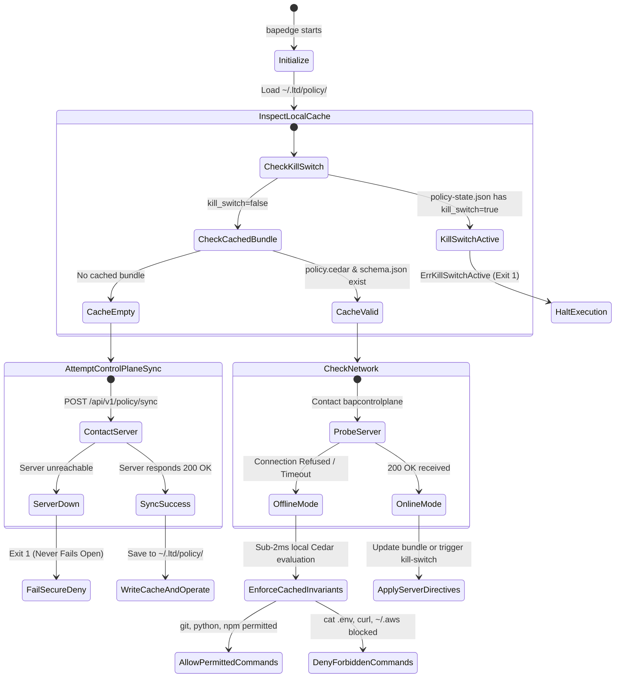

---

## 6. Enterprise Scale & High-Throughput Benchmarks

- **Edge Evaluation Latency:** $<1.5\text{ms}$ per decision via in-process Cedar engine.
- **Gateway PEP Ext-Authz Latency:** $<2.5\text{ms}$ for cryptographic verification and synchronous atomic grant burning.
- **Central Control Plane Ingestion Throughput:** **35,620 events / second** benchmarked over 50,000 events (`tests/perf_test_50k.py`).
- **Concurrent Scale:** Verified up to **3,000 concurrent stateful agent connections** with SQLite WAL and memory profiles.
- **Audit Hash Verification Time:** 50,000 sequential events verified in **32.6 ms**.

---

## 7. Operations & Governance Extension Architecture (BAP-450–BAP-459)

The Operations & Governance Extension provides formal operational controls, administrative governance, separation of duties, and state reconciliation on top of the core Dual-PEP architecture.

### 7.1. Extended Causal Governance Chain & Four Frozen Rules

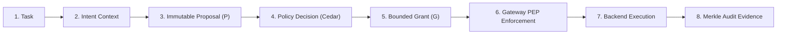

Four foundational architecture rules govern all operational interventions:

> **R1 — Proposals are immutable.**  
> An Action Proposal cannot be mutated once submitted. Any operational correction generates a child proposal (`parent_proposal_id`) establishing auditable lineage.

> **R2 — Humans remediate inputs, never override decisions.**  
> An operator cannot click a button to manually force a `DENY` into an `ALLOW`. Remediated input must pass through the full policy evaluation pipeline.

> **R3 — Authorization does not prove execution.**  
> Gateway PEP authorization and downstream API completion are evidenced separately. If a network disruption occurs between PEP check and execution, the action is marked `UNKNOWN` and reconciled; authorization is never assumed to be execution.

> **R4 — Operating the governance system is itself governed.**  
> Administrators are subject to the same bounded authority principles. BAP administrative APIs require strong authentication, scoped RBAC, and immutable audit logging. **BAP governs BAP.**

---

### 7.2. Immutable Action Proposals & Remediation Lineage (BAP-450, BAP-451)

Every consequential operation is encapsulated in a cryptographically identified, immutable proposal before policy evaluation:

```json
{
  "proposal_id": "prop-8f92a1b4-7c3d",
  "parent_proposal_id": "prop-7a81b2c3-6d2e",
  "trace_id": "trace-991283",
  "agent_id": "claude-worker-7",
  "session_id": "sess-42",
  "task_id": "task-customer-address-fix",
  "human_id": "alice@company.com",
  "intent": "BUG_FIX",
  "action": "customer.address.update",
  "resource": "customer/123",
  "parameters": {"street": "456 Market St"},
  "timestamp": "2026-10-04T12:00:00Z"
}
```

```text
Proposal P100 (customer=124)
           ↓
     DENIED by Policy
           ↓
Operator Corrects Input (customer=123)
           ↓
Proposal P101 (customer=123, parent=P100)
           ↓
Full Cedar Policy Evaluation
           ↓
    ALLOWED → Grant Issued
```

---

### 7.3. Administrative Governance & RBAC: "BAP Governs BAP" (BAP-452, BAP-453)

Administrative actions (policy edits, session revocations, emergency freeze, agent termination) cannot bypass governance:

1. **Governed Operations:** Policy changes, grant revocations, agent terminations, session kills, approvals, configuration updates, and identity changes.
2. **Separation of Duties Matrix:**
   | Role | View Trace | Investigate | Remediate Proposal | Approve High-Risk | Change Policy |
   |---|:---:|:---:|:---:|:---:|:---:|
   | **Observer** | ✓ | ✓ | — | — | — |
   | **Operator** | ✓ | ✓ | ✓ | — | — |
   | **Approver** | ✓ | ✓ | — | ✓ | — |
   | **Policy Admin** | ✓ | ✓ | — | — | ✓ |
3. **Anti-Self-Approval:** The operator who submitted or remediated a proposal cannot be the approver for that same action.

---

### 7.4. Out-of-Band Management UI (BAP-454)

The BAP Operations UI sits strictly outside the execution path. An outage or restart of the dashboard cannot degrade runtime agent operations:

```text
Operations Cockpit UI
         X (DOWN / CRASHED / MAINTENANCE)

Control Plane Core
        │
Runtime ──► Bounded Grant ──► Gateway PEP ──► Business API
                                  ▲
                             STILL 100% OPERATIONAL
```

---

### 7.5. Governed Action Lifecycle State Machine (BAP-455)

Every proposal transitions through a deterministic, strictly validated lifecycle:

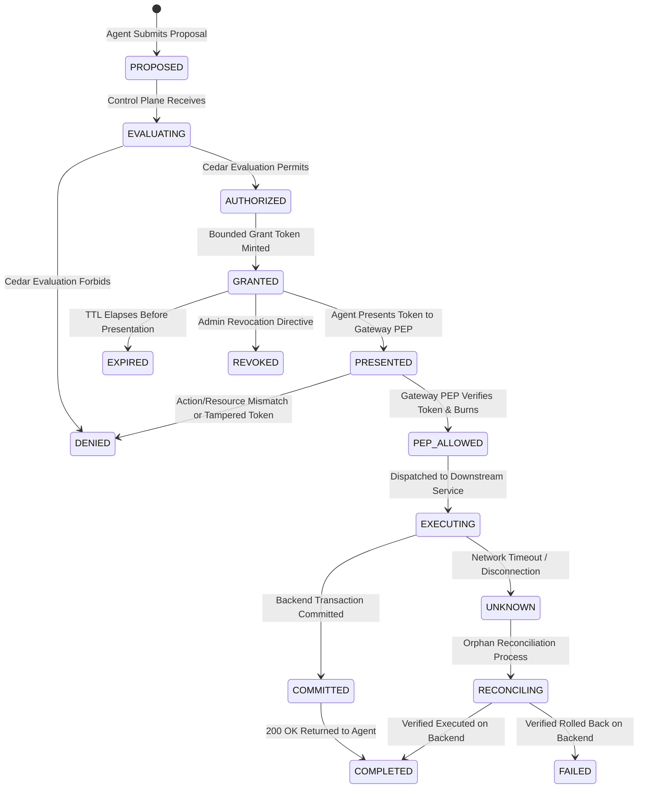

---

### 7.6. Execution Reconciliation & Orphan Detection (BAP-456)

In distributed architectures, authorization does not guarantee execution. If a network partition occurs after the Gateway PEP admits a request, BAP marks the state `UNKNOWN` rather than guessing success or failure:

* **Orphan Detection Scenarios:**
  1. *Unpresented Grants:* State remains `GRANTED` until TTL expiry, then transitions to `EXPIRED`.
  2. *Unconfirmed Executions:* State is `PEP_ALLOWED` but lacks backend receipt. Flagged for background reconciliation.
* **Non-Idempotent Safety:** The reconciliation engine **never automatically re-executes** consequential operations (e.g. transfers, payments, drops, cancellations). It queries the downstream service's idempotency log or raises an incident for human investigation.

---

### 7.7. Governance Simulation & Investigation Timeline (BAP-457, BAP-458, BAP-459)

1. **Policy Simulation & Dry-Run Engine:**
   Security engineers run regression suites of historical proposals against draft Cedar bundles ($V_{N} \rightarrow V_{N+1}$) before deployment to preview behavioral diffs without touching production systems.
2. **Investigation Timeline:**
   The operations cockpit reconstructs both serial workflows and concurrent parallel tool invocations using explicit correlation IDs (`trace_id`, `proposal_id`, `task_id`), accurately displaying multi-agent branching.

---

## 8. Layered Endpoint Enforcement & Workstation Hardening (Epic 23 & Epic 30)

### 8.1. Unified Defense-in-Depth: The 5-Layer Architecture

To eliminate reliance on user-space agent cooperativeness, BAP models workstation defense across five decoupled layers:

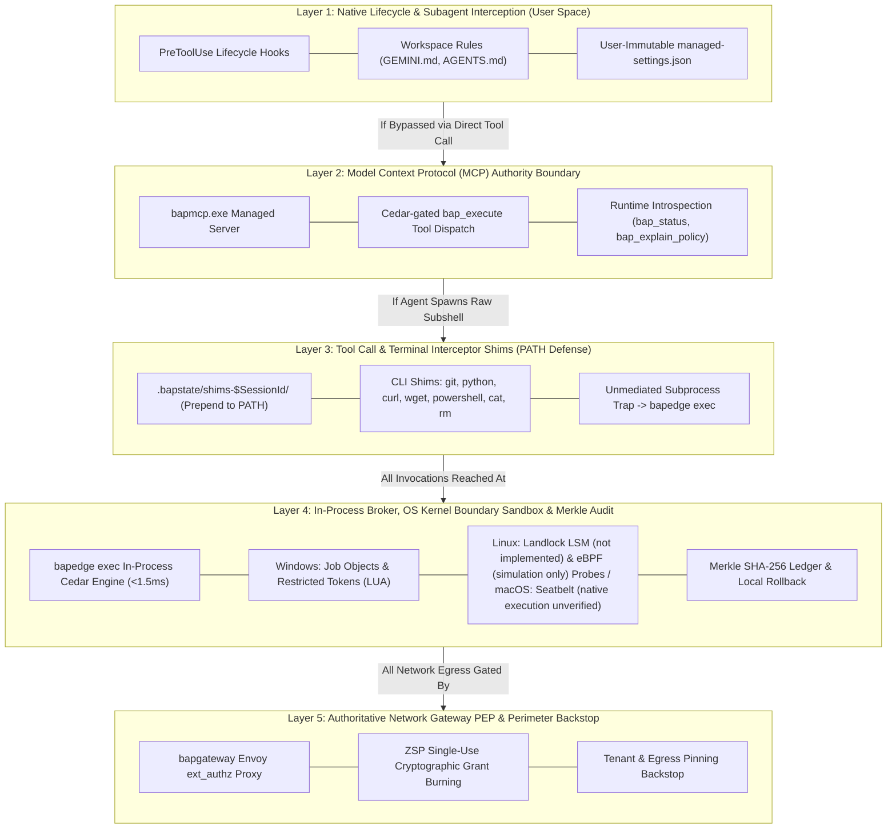

* **Layer 1 (Process & Lifecycle Hooks):** Fast user-space interception for optimal developer experience (<1ms evaluation). Enforces `dangerouslySkipPermissions: false`, prompt classification, and workspace invariants.
* **Layer 2 (MCP Authority Boundary):** Governed tool exposure via `bapmcp.exe`, requiring Cedar policy authorization on all structured tool calls before dispatch.
* **Layer 3 (Terminal Interceptor Shims):** Dynamic per-session PATH interception trapping unmediated subshell commands (`git`, `python`, `curl`, `powershell`) and re-routing to `bapedge exec`.
* **Layer 4 (OS Kernel Boundary Sandbox & Local Broker):** Hard OS containment denying unauthorized process spawns, hidden subshells (`npm` lifecycle scripts), access to standing secrets (`.env`, `id_rsa`), backed by Windows Job Objects / Restricted Tokens, Landlock (not implemented), and Seatbelt (native execution unverified).
* **Layer 5 (Authoritative Network Gateway PEP & Perimeter Backstop):** Centralized perimeter enforcement through `bapgateway` (Envoy `ext_authz`), requiring single-use cryptographic Zero-Trust Session Protocol (ZSP) grant burning and tenant egress pinning before any packet leaves the perimeter.

### Defense layers: what each one does and does not guarantee

The five layers are defense in depth **against an AI agent that is mistaken, manipulated by prompt injection, or over-eager**. They are not a defense against a malicious local administrator or malware that never goes through the agent's tools. Read the layers with that threat model:

| Layer | What it really is | Holds when | Does not hold when |
|---|---|---|---|
| 1. Native hooks | The agent client calls a hook before each tool call (`interceptor`, plugin adapter). | The client honors hooks and the hook binaries are current. | A client without hooks, a disabled hook, or a stale hook binary. |
| 2. BAP MCP | Governed tools served by `bapmcp`. | The agent uses those tools. | The agent uses its own built-in tools instead (Layer 1 covers that). |
| 3. Terminal shims | Per-session `PATH` shims that route `git`, `python`, `curl`… to `bapedge exec`. | The command is resolved through `PATH`. | An absolute path, a different shell, or a process that ignores `PATH`. |
| 4. Broker and OS sandbox | `bapedge exec` evaluates policy; on Windows it runs children under a restricted token and Job Object. | Windows, for commands that go through the broker. | Landlock (not implemented), eBPF (simulation only) and Seatbelt (native execution unverified) are not enforcement today. |
| 5. Gateway PEP | `bapgateway` authorizes calls to protected resources and burns single-use grants. | Traffic is actually routed through the gateway. | Traffic that never reaches the gateway; network egress control on the endpoint is not implemented. |

What changed in how the layers are reported and operated:

- **Status is observed, not assumed.** `bapedge status` prints `NOT_OBSERVED` for a layer until real events from it have been seen, and says outright that Layer 4 is "available" but OS-wide enforcement is not attested. An all-green "COMPLIANT" screen would have claimed more than the code can prove.
- **Layers are separate binaries and can disagree.** A user-level hook, a project-level hook and the plugin adapter all run on every tool call, and the most restrictive answer wins. A stale copy of one of them once denied what the current build allowed. Keep their hashes aligned after every rebuild (see [CLI_REFERENCE.md](docs/CLI_REFERENCE.md#build-and-package)).
- **A cross-cutting spine, not a sixth layer.** What each layer enforces comes from one signed, per-machine policy owned by the control plane (section 17). Layers differ in where they intercept; they share one source of rules.

---

### 8.2. Platform Primitive Matrix

| Control Point | macOS (Sequoia / Sonoma) | Linux (Ubuntu 22.04+ / RHEL 9+) | Windows 11 Enterprise |
| :--- | :--- | :--- | :--- |
| **Execution & Filesystem** | Endpoint Security (not implemented) (`AUTH_EXEC`, `AUTH_OPEN`) + Seatbelt (native execution unverified) | Landlock LSM (not implemented) + eBPF (simulation only) (`sys_enter_execve`, `bprm_check_security`) | Restricted Tokens (LUA) + Windows Job Objects (Kill-on-Close) |
| **Network Egress** | NetworkExtension (not implemented) Content Filter | eBPF (simulation only) cgroup socket filter | Windows Filtering Platform (WFP) (not implemented) |
| **Agent Sandbox** | Seatbelt (native execution unverified) sandbox profile | Bubblewrap + seccomp-bpf | AppContainer Isolation |
| **MDM Packaging** | Jamf Pro / Kandji (`.mobileconfig`) | Ansible / Puppet / Intune Linux | Microsoft Intune (OMA-URI / Custom CSP) |

---

### 8.3. Enterprise MDM Deployment Profiles

BAP automatically generates ready-to-deploy configuration profiles:
* **Microsoft Intune (Windows):** Enforces `C:\ProgramData\Claude\managed-settings.json` with `dangerouslySkipPermissions: false`, activates Restricted Token launch wrappers, and configures WFP (not implemented) redirection.
* **Jamf Pro (macOS):** Deploys `/Library/Application Support/Claude/managed-settings.json` and pre-approves system extension and Full Disk Access permissions with zero developer popups.

---

### 8.4. Interactive Biometric Step-Up Approvals (BAP-462)

High-risk operations (e.g. database schema migrations, production secrets access, large financial transactions) do not force blanket denials or rely on ambient agent authority:
1. The Control Plane mints a cryptographically nonced **Step-Up Challenge** (`/api/v1/endpoint/stepup/challenge`).
2. The workstation prompts the human engineer for biometric authentication (`WINDOWS_HELLO`, `TOUCH_ID`, or `FIDO2_HARDWARE_KEY`).
3. Upon physical confirmation, BAP verifies the attestation signature (`/api/v1/endpoint/stepup/verify`) and mints an ephemeral, single-use, HMAC-signed `StepUpToken` (5-minute TTL).
4. The token is burned synchronously upon execution, preventing capture and replay attacks.

---

### 8.5. Scoped Offline Degradation (BAP-463)

To ensure zero-trust controls do not cause developer lockouts on flights or during network outages:
* **Tier 1 (Safe Local Development):** Compiling source code, running unit tests (`cargo test`, `pytest`, `go test`), code formatting, and git status evaluate locally against the cached Cedar policy bundle indefinitely offline.
* **Tier 2 (Protected Enterprise Egress):** Operations targeting corporate microservices, remote databases, or cloud APIs require online signed grants and fail closed when the 15-minute grant TTL expires.

---

### 8.6. The 5-Layer Defense-in-Depth Architecture (BAP-540)

BAP enforces a comprehensive, runtime-level **5-Layer Defense-in-Depth Mechanism** that governs tool discovery, invocation, local execution, and network egress across all AI developer agents before any action affects the host operating system or corporate infrastructure:

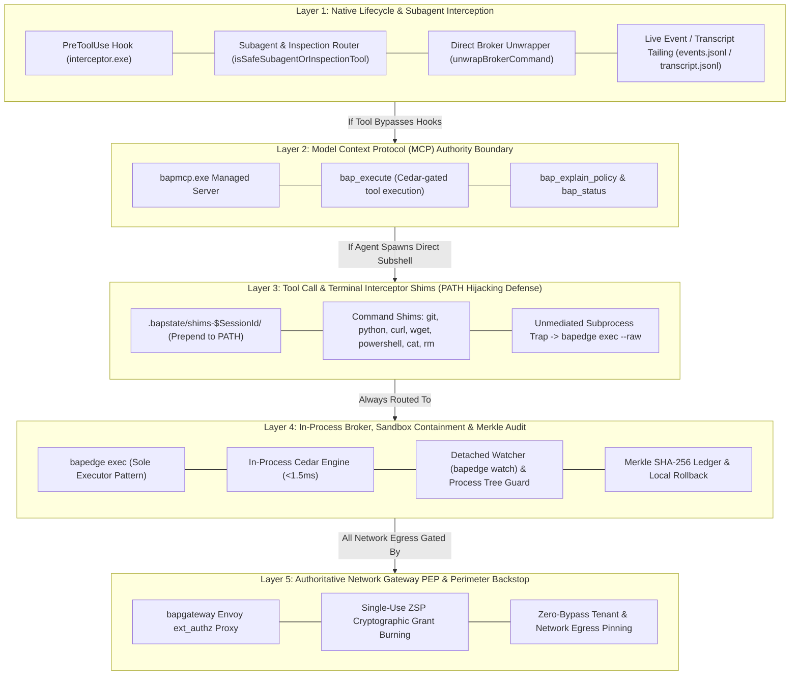

#### Detailed Layer Breakdown:

1. **Layer 1: Native Lifecycle & Subagent Interception:**
   - Intercepts agent tool requests at the prompt and pre-execution phase.
   - Claude Code routes through `cchook/interceptor.exe` on `SessionStart`, `UserPromptSubmit`, and `PreToolUse`.
   - Dedicated inspection router `isSafeSubagentOrInspectionTool` identifies non-shell tools (`search_code_subagent`, `Glob`, `Grep`, `Agent`, `Task`, `LS`, `bap_*`) that lack shell commands, allowing legitimate codebase inspection while maintaining directory traversal and `.env` protections.
   - `unwrapBrokerCommand` unwraps nested `bapedge.exe exec "<cmd>"` calls emitted by agents following workspace rules (`AGENTS.md`, `GEMINI.md`) without recursion, preserving multi-agent source attribution.
   - Live event tailers stream mission prompts and agent responses to the central Control Plane in real time.

2. **Layer 2: Model Context Protocol (MCP) Authority Boundary:**
   - Exposes `bapmcp.exe` as a managed MCP server configured in the agent's MCP catalog (`.claude/settings.json`, `.copilot/mcp-config.json`, `.antigravity/mcp_config.json`).
   - Forces structured tool execution through `bap_execute`, evaluating tool arguments against Cedar policies prior to dispatch.
   - Provides runtime introspection tools: `bap_explain_policy` and `bap_status`.

3. **Layer 3: Tool Call & Terminal Interceptor Shims (`PATH` Hijacking Defense):**
   - Intercepts raw terminal commands or unmediated child subshells that attempt to bypass Layer 1 and Layer 2.
   - The launcher engine (`Initialize-BapShims`) generates per-session command shims in `.bapstate/shims-$SessionId/` for critical CLI executables (`git`, `python`, `curl`, `wget`, `powershell`, `cat`, `rm`) and prepends this directory to `$env:PATH`.
   - Any raw invocation of `git` or `curl` by an agent subshell executes the `.cmd` shim, which immediately forwards execution through `bapedge.exe exec --raw` under the active session and Cedar rules. Re-entrant execution inside the broker is un-shimmed via `BAP_IN_BROKER=1`.

4. **Layer 4: In-Process Broker, Sandbox Containment & Merkle Audit:**
   - The final host-level execution authority: `bapedge exec` with an in-process AWS Cedar engine evaluates operations in $<1.5\text{ms}$.
   - Enforces execution environment variables (`BAP_MODE=enforce`, `BAP_AGENT_SANDBOX=1`).
   - Spawns a detached background watchdog (`bapedge watch`) pulsing liveness heartbeats to `/api/v1/sessions/heartbeat` and enforcing real-time administrative revocations and emergency freezes.
   - Seals every execution result and token accounting record (`accountingSnapshot`) into the tamper-evident SHA-256 Merkle chain at `/api/v1/audit/ingest`.

5. **Layer 5: Authoritative Network Gateway PEP & Perimeter Backstop:**
   - Centralized, authoritative perimeter enforcement via `bapgateway` (Envoy `ext_authz`).
   - Validates that every network call matches a pre-authorized, un-expired Zero-Trust Session Protocol (ZSP) grant.
   - Burns single-use grants upon execution to prevent replay attacks and verifies cryptographic tenant isolation before traffic reaches corporate backends or cloud egress.

---

### 8.7. Multi-Agent Defense Matrix: Implementation Across All Tools

| Agent Toolchain | Layer 1 (Hooks / Invariants) | Layer 2 (MCP Integration) | Layer 3 (Terminal Shims) | Layer 4 (Broker & Sandbox) | Layer 5 (Gateway PEP Egress) | Test Verification |
| :--- | :--- | :--- | :--- | :--- | :--- | :--- |
| **Claude Code CLI** | `cchook/interceptor.exe` (`SessionStart`, `UserPromptSubmit`, `PreToolUse`) | `bapmcp.exe` mounted in `.claude/settings.json` | Active in `.bapstate/shims-$SessionId` | `bapedge exec` + watchdog + refcounted custody | Envoy `ext_authz` + ZSP grant burning | `tests/test_multi_layer_defense.py` |
| **Google Antigravity (IDE)** | `GEMINI.md` zero-trust rules + 120ms `transcript.jsonl` tailer | `bapmcp.exe` mounted in `.antigravity/mcp_config.json` | Active in `.bapstate/shims-$SessionId` | Electron GUI lifecycle guard + `bapedge exec` | Envoy `ext_authz` + ZSP grant burning | `tests/test_multi_layer_defense.py` |
| **Google Antigravity (CLI)** | `GEMINI.md` rules + direct console capture | `bapmcp.exe` mounted in `.antigravity/mcp_config.json` | Active in `.bapstate/shims-$SessionId` | `agy.exe` supervised by `bapedge exec` | Envoy `ext_authz` + ZSP grant burning | Automated launcher suite |
| **GitHub Copilot CLI** | `AGENTS.md` rules + live `events.jsonl` streamer | `bapmcp.exe` mounted in `.copilot/mcp-config.json` | Active in `.bapstate/shims-$SessionId` | Standalone `copilot.exe` + `accountingSnapshot` capture | Envoy `ext_authz` + ZSP grant burning | Automated launcher suite |
| **Autonomous Python SDK** | `bap_sdk.BAPSession` native mission wrapper | MCP tool wrappers & programmatic decorators | Subprocesses routed through `bap.exec()` | Real-time 3s daemon heartbeat + Cedar broker | Envoy `ext_authz` + ZSP grant burning | `tests/test_bounded_authority_matrix.py` |

---

### 8.8. Universal Extension Guide: How to Onboard a New AI Tool

To onboard any new AI tool (e.g. Cursor, Windsurf, Devin, OpenAI Operator, or internal CLI) into BAP's 5-layer defense system, follow this 5-step integration recipe:

#### Step 1: Layer 1 — Hook Configuration or Workspace Rule Injection
1. If the tool supports native lifecycle hooks (JSON on stdin/stdout), register `dist/windows-amd64/interceptor.exe` (or `cchook/interceptor.exe`) in the tool's settings.
2. If the tool is prompt- or rule-driven, inject an authoritative workspace invariant file (e.g. `.cursorrules`, `SYSTEM_PROMPT.md`, `INVARIANTS.md`) directing the agent:
   - All shell executions MUST use `bapedge.exe exec "<cmd>"`.
   - Never execute raw shell commands directly.
3. In [`cchook/interceptor.go`](file:///c:/Users/User/pyprj/bapltd/cchook/interceptor.go), register the tool's source identifier in `unwrapBrokerCommand` (e.g., `source = "newtool"`).

#### Step 2: Layer 2 — MCP Server Catalog Registration
1. Generate the tool's native MCP configuration file (e.g. `.newtool/mcp.json` or `~/.config/newtool/mcp.json`).
2. Mount `bapmcp.exe` as the `bap-zero-trust` MCP server:
   ```json
   {
     "mcpServers": {
       "bap-zero-trust": {
         "command": "C:\\path\\to\\bapltd\\bapmcp.exe",
         "args": []
       }
     }
   }
   ```

#### Step 3: Layer 3 — Terminal Shims Activation
1. When launching the tool, invoke `Initialize-BapShims` from [`scripts/bap_launcher_engine.ps1`](file:///c:/Users/User/pyprj/bapltd/scripts/bap_launcher_engine.ps1).
2. This generates `.cmd` shims for `git`, `python`, `curl`, `wget`, `powershell`, `cat`, `rm` in `.bapstate/shims-$SessionId/`.
3. Prepend the shim directory to `$env:PATH`:
   ```powershell
   $ShimDir = Initialize-BapShims -Workspace $Workspace -BapEdgeBin $BapEdgeBin -AgentId $AgentId -SessionId $SessionId
   $env:PATH = "$ShimDir;$env:PATH"
   ```
4. If the new tool uses custom CLI binaries, append them to the `$toolsToShim` array.

#### Step 4: Layer 4 — Launcher Engine Profile & Lifecycle Supervision
1. Create `run_<newtool>_bap.bat` and `run_<newtool>_bap.ps1`.
2. Invoke `Invoke-BapGovernedSession` with:
   - `AgentId`: e.g. `'newtool'`
   - `AgentMode`: `'cli'` for terminal CLIs, or `'ide'` for GUI/Electron apps (activates active process tree monitoring so the session doesn't prematurely terminate).
   - `CandidateExecutables`: Discovery paths for the tool executable.
   - `ConfigureFiles`: Callback scriptblock injecting the workspace rule file and MCP configuration file.
3. If the tool emits background session logs (e.g. JSON lines of prompts or tokens), attach a lightweight background tailer job (similar to Antigravity's `transcript.jsonl` or Copilot's `events.jsonl`) to stream prompts to `/api/v1/sessions/prompt` and tokens to `/api/v1/audit/ingest`.

#### Step 5: Layer 5 — Gateway PEP Route Registration & Egress Pinning
1. Register backend service endpoints in `bapgateway` Envoy configuration.
2. Require Zero-Trust Session Protocol (ZSP) grant headers on outgoing requests:
   - `X-BAP-Grant-ID`: Single-use capability token minted by BAP Control Plane.
   - `X-BAP-Signature`: Ed25519 cryptographic authorization signature.
3. Ensure unauthenticated direct egress from the host to production backends is blocked at the firewall, forcing all enterprise traffic through `bapgateway`.

---

## 9. Operational Resilience, Crash Sweeps & Developer Tooling Architecture (Epic 24)

### 9.1. Clean Sweep & Crash Recovery Reconciler (BAP-470)

In enterprise deployments, developer laptops abruptly sleep, battery dies, processes are force-killed, or terminals close without executing graceful shutdown hooks. BAP solves state desynchronization via automatic and manual clean sweep routines:

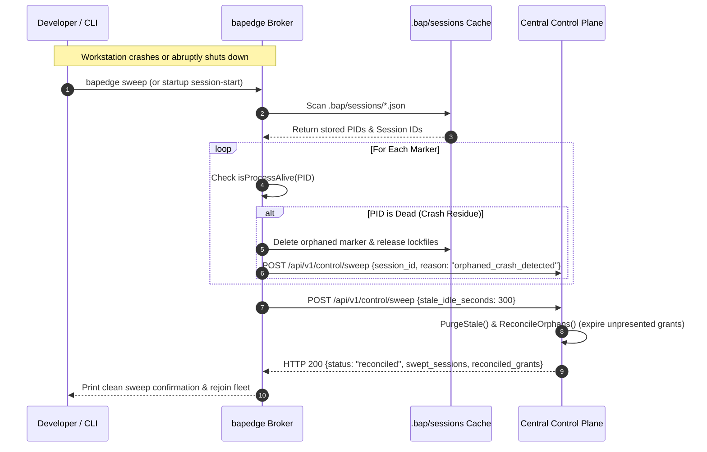

### 9.2. Developer CLI Tooling Architecture (BAP-471, BAP-472)

To minimize friction and prevent developers from bypassing controls, BAP embeds native operational commands into `bapedge`:

1. **`bapedge setup --app=claude-code` (BAP-471):**
   - Idempotently writes `.claude/managed-settings.json`.
   - Strictly enforces `"dangerouslySkipPermissions": false`.
   - Registers `"pre_tool_use": "bapedge exec"`.
   - Configures central control plane connectivity in `.bap/config.json`.
2. **`bapedge status` (BAP-472):**
   - Real-time terminal inspection of active vs stale sessions.
   - Cedar policy bundle version, rules SHA-256 digest, and kill-switch state.
   - 5-Layer Defense-in-Depth Compliance (Layer 1: Hooks, Layer 2: MCP, Layer 3: Terminal Shims, Layer 4: Kernel Sandbox, Layer 5: Gateway PEP).
   - Offline spool backlog count.
3. **`bapedge why "<command>"` (BAP-472):**
   - In-terminal Cedar policy evaluation with zero browser round-trips.
   - Explains decisions (`ALLOWED` vs `DENIED`).
   - Identifies specific Cedar rule IDs and context attributes (executable, workspace escape status).

### 9.3. Offline Audit Store & Reconnection Flush (BAP-473)

Execution events generated while offline are preserved in `ltd-audit.jsonl` maintaining SHA-256 Merkle chain integrity. Upon network reconnection:
1. `bapedge watch` heartbeat pulse detects active control plane connectivity.
2. Background routine calls `audit.FlushOfflineAudit(serverURL, logPath)`.
3. Control Plane ingests batch (`/api/v1/audit/ingest`) and returns a cryptographic `HandshakeAck` (`chain_valid: true`, `receipt_hash: ...`).
4. `bapedge` safely removes transmitted entries locally, relieving edge disk burden while guaranteeing end-to-end auditability.

---

## 10. Enterprise Identity Provider Federation (Okta / Entra / OIDC Device Flow)

Enterprise organizations require autonomous agent execution to be attributable to verified corporate identities with Multi-Factor Authentication (MFA), rather than relying on unauthenticated developer tokens. BAP integrates directly with Microsoft Entra ID, Okta Workforce Identity Cloud, and standard OpenID Connect providers via the **RFC 8628 OAuth 2.0 Device Authorization Flow**.

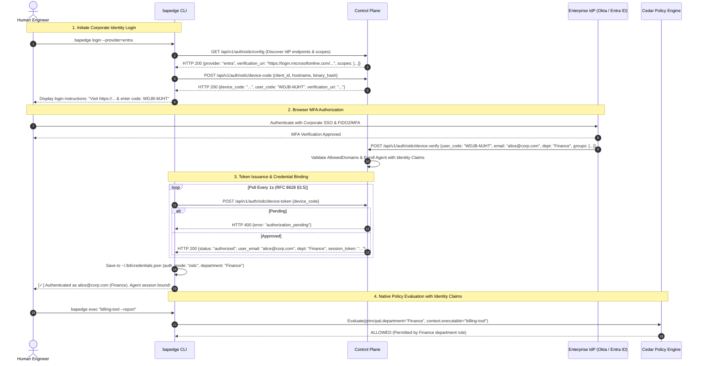

### 10.1. Dual-Mode Environment Security Model (Dev vs Prod)

To prevent security misconfigurations while maintaining fast local development velocity, BAP enforces an explicit environment security boundary:

| Feature / Behavior | Development Mode (`mode: dev`) | Production Mode (`mode: prod`) |
|---|---|---|
| **Self-Service OTC Token API (`/dev-request`)** | **Enabled:** Any local developer can request an instant OTC code without credentials. | **Disabled (`403 Forbidden`):** Unauthenticated OTC requests are rejected. |
| **One-Time Code (OTC) Generation** | Instant self-service via `POST /api/v1/auth/otc/dev-request` or `bapedge register --dev`. | Strictly an **offline / out-of-band administrative process** (`POST /api/v1/agents/pre-register` with `X-BAP-Admin-Token`). |
| **Interactive Developer Authentication** | Optional OIDC login or local OTC code. | **Mandatory OIDC Device Flow (`bapedge login`):** Engineers must authenticate through corporate MFA (Okta / Entra). |
| **Headless CI/CD / Build Pipeline Enrollment** | Supported via OTC codes (`bapedge register --code <OTC>`). | Supported via pre-provisioned offline admin OTC codes. |
| **Security Rationale** | Zero friction for onboarding & rapid prototyping. | Hardened zero-trust: no unauthenticated caller can create valid execution credentials. |

### 10.2. Configurable Enterprise IdP Parameters

All OIDC parameters are fully configurable across configuration files, environment variables, and CLI arguments:

```json
{
  "controlplane_url": "https://bap.corp.internal:8080",
  "gateway_url": "https://gateway.corp.internal:9090",
  "environment": "production",
  "oidc": {
    "enabled": true,
    "provider": "entra",
    "issuer_url": "https://login.microsoftonline.com/72f988bf-86f1-41af-91ab-2d7cd011db47/v2.0",
    "client_id": "bap-edge-agent-client-id",
    "verification_uri": "https://login.microsoftonline.com/common/oauth2/deviceauth",
    "scopes": ["openid", "profile", "email", "groups"],
    "tenant_id": "72f988bf-86f1-41af-91ab-2d7cd011db47",
    "allowed_domains": ["corp.internal", "enterprise.com"],
    "claim_department": "department",
    "claim_groups": "groups",
    "claim_email": "email"
  }
}
```

- **Environment Overrides:** `BAP_OIDC_PROVIDER`, `BAP_OIDC_CLIENT_ID`, `BAP_OIDC_ISSUER_URL`, `BAP_OIDC_TENANT_ID`, `BAP_OIDC_ALLOWED_DOMAINS`.
- **Public Discovery:** Edge clients automatically query `GET /api/v1/auth/oidc/config` to resolve provider verification endpoints dynamically without hardcoding URLs.
- **Client Secret Safety:** Secrets are never sent to edge clients or exposed over discovery APIs.

### 10.3. Native Cedar Policy Claims Propagation

When evaluating local or centralized Cedar policies, `bapedge` and `bapcontrolplane` inject authenticated corporate identity attributes onto the Cedar `Principal` entity and `Context` record:

```cedar
// 1. Role-Based Access: Only Finance team members can invoke financial CLI tools
permit (
    principal == Agent::"Local",
    action == Action::"Execute",
    resource == Command::"CLI"
) when {
    principal.department == "Finance" &&
    ["billing-tool", "invoice-sync", "git"].contains(context.executable)
};

// 2. Strict Boundary: Block production deployment tools unless member of prod-deployers group
forbid (
    principal == Agent::"Local",
    action == Action::"Execute",
    resource == Command::"CLI"
) when {
    !principal.groups.contains("prod-deployers") &&
    context.full_command like "*deploy-prod*"
};
```

### 10.4. Coexistence of OTC & OIDC on Edge Workstations

To ensure headless servers and automated CI/CD runners can operate without interactive browser sessions:
- `bapedge register --code <OTC>` remains fully functional for headless server provisioning and automated integration test pipelines.
- `bapedge login` provides seamless, interactive SSO/MFA authentication for software developers using Claude Code, GitHub Copilot, and Cursor.
- `bapedge status` displays the active enrollment method, corporate identity, department, and group memberships.

---

## 11. Cross-Platform Packaging & CI/CD Release Pipeline Architecture (Epic 26)

### 11.1. Release Pipeline Flow & GitHub Actions Matrix

BAP uses an automated GitHub Actions release matrix (`.github/workflows/release.yml`) and testing matrix (`.github/workflows/ci.yml`) to compile, sign, package, and publish release artifacts across all major operating systems and chip architectures:

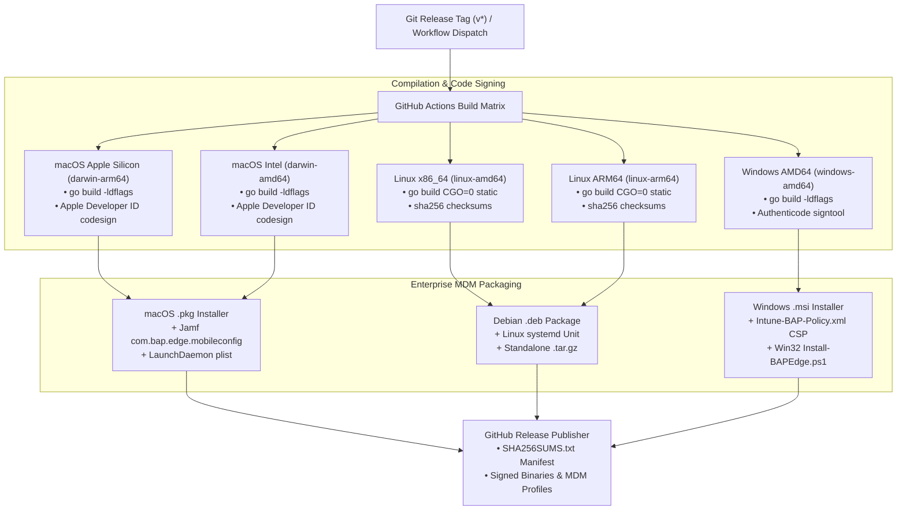

### 11.2. Enterprise MDM Distribution Artifacts

| Platform / MDM Target | Primary Installer | Configuration / Policy Payload | Daemon Supervision | Permissions / TCC |
| :--- | :--- | :--- | :--- | :--- |
| **macOS (Jamf Pro / Kandji)** | `bapedge-darwin-arm64.pkg` | `com.bap.edge.mobileconfig` | LaunchDaemon (`/Library/LaunchDaemons/com.bap.edge.plist`) | Apple TCC Full Disk Access profile for `/usr/local/bin/bapedge` |
| **Windows (Microsoft Intune)** | `bapedge-windows-amd64.msi` | `Intune-BAP-Policy.xml` (OMA-URI CSP) | Windows Service / Scheduled Task (`BAPEdgeDaemon`) | System-level execution & PATH registration in `C:\Program Files\BAP\` |
| **Linux (Ansible / Chef)** | `bapedge-linux-amd64.deb` | `/etc/bap/bap-config.json` | systemd unit (`bapedge.service`) | POSIX root execution with Landlock LSM (not implemented) / eBPF (simulation only) |

### 11.3. Cryptographic Code Signing & Supply Chain Integrity

1. **macOS Gatekeeper & Notarization:**
   - Apple Developer ID certificates sign binaries with the hardened runtime (`--options runtime`).
   - Binaries pass macOS Gatekeeper with zero warning prompts during Jamf enterprise deployment.
2. **Windows SmartScreen & Authenticode:**
   - Signed via Microsoft Authenticode `signtool.exe` with RFC 3161 Digicert timestamping (`/tr http://timestamp.digicert.com`).
   - Prevents Microsoft Defender SmartScreen untrusted binary warnings.
3. **Cryptographic Checksum Ledger:**
   - The release job calculates SHA-256 digests across all compiled packages and produces `SHA256SUMS.txt`.
   - Security teams can independently verify binary digests against the signed manifest before pushing to workstation fleets.

---

## 12. Agent Watch Persona Architecture & Canonical Activity Engine (Epic 28)

### 12.1. Canonical Agent Activity Event Normalization
To prevent disparate data schemas across executive, security, and operational dashboards, BAP enforces a single normalized event structure:
```text
AgentActivityEvent:
  - Identity & Runtime: timestamp (RFC 3339 UTC), session_id, agent_id, agent_type, runtime_id, user_id (redacted), business_unit, application
  - Prompt & Mission: prompt_id, prompt_summary (privacy-safe), intent, intent_category
  - Action & Resource: action, tool, target_resource, data_classification
  - Zero-Trust Policy: policy_decision, risk_score, grant_id, grant_scope, grant_ttl
  - Execution Status: action_status (working/waiting/completed/denied/failed), outcome_category, trace_id, deviation_level
```

### 12.2. Intent to Action Contract & Invariant Deviation Engine
Every agent operation is evaluated against the 8-stage lifecycle contract:
$$\text{Intent} \longrightarrow \text{Interpretation} \longrightarrow \text{Plan} \longrightarrow \text{Capability} \longrightarrow \text{Policy Gate} \longrightarrow \text{ZSP Grant} \longrightarrow \text{Observed Action} \longrightarrow \text{Outcome}$$

When an agent requests capabilities or executes tools conflicting with declared intent (e.g., executing arbitrary database writes during a read-only production latency diagnosis), the engine flags a **CRITICAL DEVIATION**, assigns a high risk score ($0.95$), and denies execution with a human-readable audit explanation.

### 12.3. Enterprise Activity Topology Mapping
Dynamic clustering algorithm groups sessions into a multi-tiered hierarchy:
$$\text{Enterprise Root} \longrightarrow \text{Divisions} \longrightarrow \text{Teams / Applications} \longrightarrow \text{Agent Platforms}$$
Nodes scale proportionally to active session count, while color encodes security posture (`healthy`, `warning`, `critical`).

### 12.4. Production Live Mode vs Demo Simulation
Control Plane natively supports dual operating modes:
- **Pure Live Mode (Default)**: Dynamically aggregates live connected agents, sessions, and activity events. Shows an unsimulated zero-state when the fleet is idle.
- **Demo Mode (`-demo-mode` flag or `?demo=true` param)**: Renders the 1,284-agent enterprise prototype dataset across 31 business units for presentations.

---

## 13. Multi-Layer AIR Defense, MicroVM Sandboxing & Human Step-Up Escalation (Epic 29)

### 13.1. Tiered Sandboxing Architecture vs MicroVMs
While MicroVMs (Firecracker, Cloud-Hypervisor, QEMU/KVM) provide hypervisor-grade isolation, enforcing them exclusively on local developer workstations introduces severe tradeoffs:
1. **Execution Latency**: MicroVM cold boot (150ms–3000ms) and virtio-fs dispatch introduce latency unacceptable for interactive coding assistants requiring sub-10ms CLI responsiveness.
2. **Cross-OS Fragmentation**: Linux relies natively on KVM (Firecracker); Windows requires Hyper-V/WSL2 nested virtualization; macOS relies on Apple Virtualization.framework. A single cross-OS binary cannot run microVMs identically on developer laptops without root/administrator privileges.
3. **Enterprise MDM Conflicts**: BIOS hardware virtualization (VT-x/AMD-V) is frequently locked down by corporate MDM or conflicts with developer Docker Desktop and emulator environments.
4. **Filesystem I/O Tax**: Sharing multi-gigabyte developer repositories (`node_modules`, `.venv`, `.git`) via 9P or virtio-fs incurs a 5x–20x I/O penalty.

**The BAP Hybrid Sandboxing Architecture**:
- **Tier 1 (Host-Native Zero-Dependency Sandbox - Default for CLI/IDE Work)**:
  - Windows: Windows Job Objects (kill-on-close, memory limits) + Restricted Security Tokens (dropping administrative SIDs and `SE_DEBUG_NAME`).
  - Linux: Landlock LSM (not implemented) + unprivileged user/mount namespaces + seccomp-bpf.
  - macOS: `sandbox-exec` Seatbelt (native execution unverified) confinement.
  - Provides sub-millisecond execution, zero hypervisor requirements, and 100% cross-OS mobility.
- **Tier 2 (On-Demand Ephemeral MicroVM Cloud Runner)**:
  - High-risk, unvetted binaries, unapproved container builds, or untrusted network downloads are routed via BAP Gateway PEP to remote ephemeral Firecracker/E2B microVM workers.

### 13.2. Human-in-the-Loop (HITL) Step-Up Escalation
When an agent encounters a policy boundary (e.g. mutating sibling projects, unapproved installers, or unvetted scripts):
1. **Interactive Step-Up TTY Prompt**:
   - `[A] Approve Once`: Permits single command execution; logs cryptographic receipt `ALLOWED_STEPUP` and audit decision `stepup_allow`.
   - `[S] Trust for Session`: Records persistent session trust in `.bap/approvals_<session_id>.json`; subsequent commands within that session execute seamlessly without prompting.
   - `[D] Deny (Default)`: Strictly blocks execution and logs policy violation.
2. **Headless / CI Mode**: Defaults to fail-closed (`step_up_decision: "denied"`) unless authorized via `BAP_STEPUP_DECISION=approve` or pre-authorized BAP Gateway Grants.
3. **Anti-Tampering Invariant**: BAP protected assets (`policy.cedar`, `bapedge.exe`, lifecycle hooks) are strictly non-escalatable and can never be bypassed via Step-Up.

### 13.3. Software Supply-Chain Corporate Mirror Injection
Prevents dependency confusion and public registry exfiltration by automatically injecting enterprise repository manager configurations (Nexus, Artifactory, CodeArtifact):
- **Maven**: Injects `$env:MAVEN_ARGS = "-s .bapstate/mirrors/settings.xml"` configuring `<mirror>` to route all artifact downloads through corporate Nexus (`nexus.corp.internal`).
- **npm / yarn**: Injects `$env:NPM_CONFIG_USERCONFIG = ".bapstate/mirrors/.npmrc"` enforcing corporate registry with `strict-ssl=true`.
- **pip**: Injects `$env:PIP_CONFIG_FILE = ".bapstate/mirrors/pip.ini"` and `$env:PIP_INDEX_URL`.
- **Policy 6 Enforcement**: Cedar invariants strictly block direct public repository bypass flags (`--index-url http://pypi.org`, `--registry registry.npmjs.org`, `-DremoteRepositories=http://repo.maven.apache.org`).
- **Policy 7 Tripwire**: Immediate alert and termination if an agent probes canary honeytokens (`CORP_CANARY_TOKEN`).

### 13.4. Enterprise Multi-Scope Cross-Folder Governance (`BAP-546`)
Enterprise codebases frequently require cross-repository builds, mono-repo traversals, and shared library modifications:
1. **Separation of Read-Only Traversal vs Mutating Escalation**:
   - Reading sibling repositories (`cat ../sibling/README.md`, `git -C ../dep status`) is natively permitted by Cedar Rule 2.
   - Mutating commands (`write`, `delete`, `tamper`, output redirection `>`) escaping workspace root trigger Human-in-the-Loop (HITL) step-up.
2. **Multi-Scope Persistence Architecture**:
   - `Once`: Single execution grant yielding `ALLOWED_STEPUP` cryptographic receipt.
   - `Session`: Stored in `.bap/approvals_<session_id>.json`.
   - `Project`: Stored in `<workspace>/.bap/project_permissions.json`.
   - `Global`: Stored in `~/.bap/global_permissions.json`.
3. **Canonical Prefix Resolution**:
   - Normalized paths handle symlinks, directory boundaries (`C:\app\sub` vs `C:\app\sub-other`), and case-insensitive Windows filesystem semantics.

---

## 14. Unified CLI Architecture & Binary Lifecycle Parity (Epic 30 — `BAP-547`)

### 14.1. Universal CLI Design & Zero-Surprise Invariant
All four BAP binaries (`bapedge`, `bapcontrolplane`, `bapgateway`, `bapmcp`) adhere to a uniform lifecycle contract:

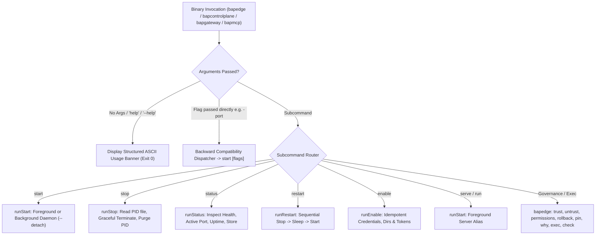

### 14.2. Binary Command Matrix & Parity

| Subcommand | `bapedge` | `bapcontrolplane` | `bapgateway` | `bapmcp` | Description |
|---|:---:|:---:|:---:|:---:|---|
| `start` | ✅ | ✅ | ✅ | — | Start component server / supervisor (supports `--detach` / `-d`, `--port`) |
| `stop` | ✅ | ✅ | ✅ | — | Gracefully terminate running instance via tracked PID |
| `status` | ✅ | ✅ | ✅ | ✅ | Query health, active port, uptime, and database persistence |
| `restart` | ✅ | ✅ | ✅ | — | Atomic restart (`stop` $\to$ wait $\to$ `start`) |
| `enable` | ✅ | ✅ | ✅ | — | Idempotent workstation/service initialization (setup tokens & state) |
| `serve` | ✅ | ✅ | ✅ | ✅ | Explicit foreground server execution alias |
| `trust` | ✅ | — | — | — | Authorize cross-folder mutations (`--session`, `--project`, `--global`) |
| `untrust` | ✅ | — | — | — | Revoke cross-folder mutation authorization |
| `permissions` | ✅ | — | — | — | List all active authorizations across all scopes |
| `rollback` | ✅ | — | — | — | Forensically revert file mutations to pre-execution checkpoints |
| `pin` | ✅ | — | — | — | Cryptographically pin, verify, and re-attest skills, prompts & tools |
| `why` | ✅ | — | — | — | Instant terminal explanation of Cedar policy decisions |
| `exec` / `check` | ✅ | — | — | — | Governed execution / dry-run evaluation under kernel isolation |
| `mcp` | ✅ | — | — | ✅ | Model Context Protocol JSON-RPC stdio server |

### 14.3. Cross-Platform Process Supervision Architecture
Process lifecycle management avoids external shell dependencies and platform-specific lockups:
- **Windows (`proc_windows.go`)**:
  - `isProcessAlive(pid)`: Uses Win32 `OpenProcess` with `PROCESS_QUERY_LIMITED_INFORMATION` and `GetExitCodeProcess`.
  - Background Detachment: Spawns processes with `CREATE_NO_WINDOW (0x08000000)` and `CREATE_NEW_PROCESS_GROUP (0x00000200)`, disconnecting standard I/O handles.
  - Termination: `os.FindProcess(pid).Kill()` followed by `taskkill /F /PID <pid>` for complete child process-tree eradication.
- **POSIX (`proc_unix.go`)**:
  - `isProcessAlive(pid)`: `syscall.Kill(pid, 0)`.
  - Background Detachment: Sets `SysProcAttr.Setpgid = true`.
  - Termination: `syscall.Kill(pid, syscall.SIGTERM)` with fallback to `SIGKILL`.

### 14.4. Interactive Terminal Guard on BAP MCP
Running `bapmcp` or `bapedge mcp` in an interactive console without stdin redirection detects terminal mode via `isTerminal(os.Stdin)` and outputs an onboarding guide with instructions for Claude Code (`~/.claude/settings.json`), Google Antigravity (`~/.gemini/antigravity/mcp/bap-zero-trust/`), and Cursor IDE (`~/.cursor/mcp.json`). When spawned by an agent host with piped stdio or passed `--stdio`, it immediately engages the JSON-RPC 2.0 message loop.

---

## 15. Unified Workstation Registration, Child Session SVIDs & Subagent Architecture (Epic 43 — `BAP-800`)

### 15.1. The Workstation Anchor vs Child Session SVID Model
Enterprise fleet governance requires physical host accountability. Rather than permitting each ephemeral AI process to register an independent agent identity (which causes fleet sprawl and breaks device-level attestation), BAP implements a **Workstation Authority Anchor**:
- **Physical Workstation (Master Anchor)**: A single developer laptop, desktop, or CI build runner enrolls via `bap login`, minting a persistent machine credential anchored in `~/.bapstate/credentials.json`.
- **Workstation SPIFFE ID**: `spiffe://<trust_domain>/workstation/<instance_id>` (or `spiffe://<trust_domain>/app/<app_id>/instance/<instance_id>`).
- **Child Workload Session SVID**: Every tool running on the workstation (Claude Code CLI, Claude IDE, Antigravity, GitHub Copilot, custom Python SDK agents) executes as an ephemeral child session bound to a hierarchical Session SVID:
  $$\text{Session SVID} = \text{spiffe://} + \text{TrustDomain} + \text{/workstation/} + \text{InstanceID} + \text{/session/} + \text{SessionID}$$

### 15.2. Hierarchical Identity Topology

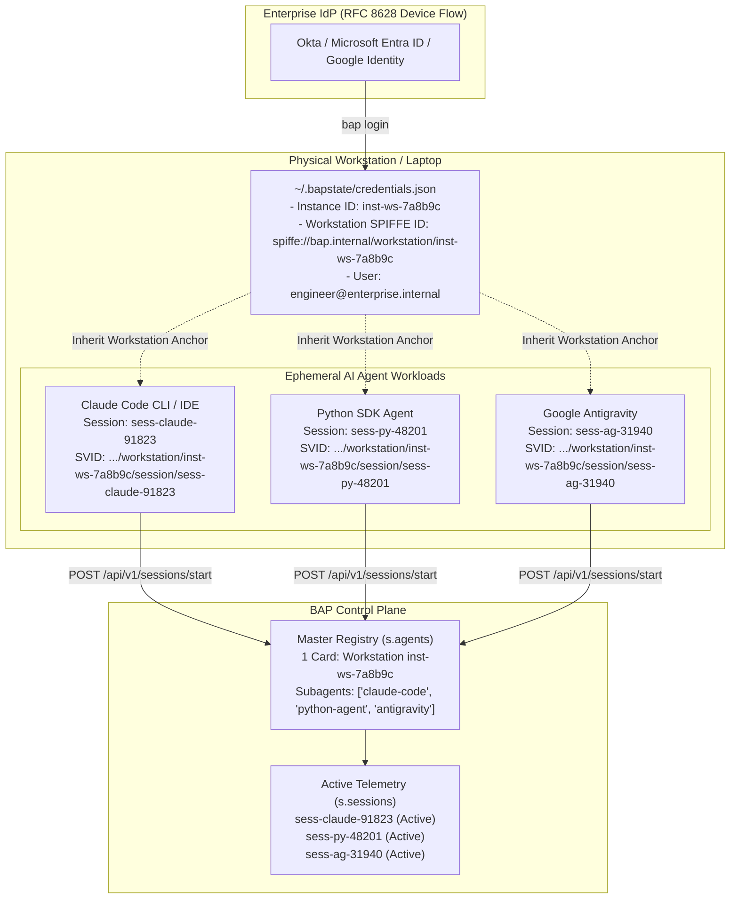

### 15.3. Control Plane Registry Deduplication (`EnsureSessionAgent`)
To prevent agent sprawl, `EnsureSessionAgent` matches incoming sessions against existing records in `s.agents`:
1. **Instance & Agent Matching**: Checks if `a.InstanceID == instanceID || a.AgentID == instanceID`.
2. **Host & User Matching**: Checks if `a.Hostname == hostname && a.UserEmail == email`.
3. **Subagent Dynamic Append**: When a match is found, appends the tool name (`app_id`) to `master.Subagents` (preventing duplicates), updates `a.LastHeartbeatAt`, and returns the master card without minting a new agent entry in `s.agents`.
4. **Session Isolation**: Ephemeral tool activity is recorded in `s.sessions`, ensuring granular start, prompt, execution receipts, and termination tracking without polluting the master agent inventory.

### 15.4. Unified Workstation Credentials Distribution
All client runtimes resolve the workstation authority anchor via standard path discovery:
- **`bap-edge watch`**: Reads `~/.bapstate/credentials.json`, extracts `user_email` and `spiffe_id`, sets `resource_id`, `workstation_spiffe_id`, and `session_svid` in `startPayload`.
- **`bap-edge identity`**: Prioritizes `credentials.json` in Stage 2 of `resolveLocalIdentity()`, eliminating `"NA"` identity degradations.
- **`python-agent/bap_sdk`**: Automatically loads `credentials.json`, deriving `self.instance_id`, `self.workstation_spiffe_id`, and `self.session_svid` directly on session instantiation.
- **Daemon Route Isolation**: `bapedge exec` validates `serverMatches` before delegating audit telemetry to local daemons, ensuring events are never routed to dead or mismatched test/production endpoints.

### 15.5. Tool-Agnostic Decision Normalization
Developer tooling utilizes divergent JSON output schemas:
- **Anthropic Claude Code**: Strict legacy schema requiring top-level `decision: "approve" | "block"`.
- **Generic CLI & IDE Agents**: Standard schema expecting `decision: "allow" | "deny"`.
- **Interceptors (`interceptor.exe`, `cchook-interceptor.exe`)**: Automatically detect caller binary variants (`claude`, `claude-code`, `claudecode`, wrapper batch files) and synthesize exact matching response schemas, preventing `Hook JSON output validation failed` errors while preserving invariant Cedar policy enforcement.

---

## 16. Capability-Based Policy Evolution, Governed MCP Tools & Kernel Filesystem Boundary (Epic 44 — `BAP-817`–`BAP-822`)

### 16.1. Capability-Based Policy Evolution & Semantic Execution Classes (BAP-817)
To resolve the brittle token-allowlist "cat-and-mouse" combinatorial game against generative coding models:
- **Cedar Deny-Overrides Alignment**: BAP preserves declarative `forbid` rules (Policies 2–7) as inviolable security invariants (workspace escaping writes, credential stores, raw sockets, curl exfiltration, untrusted package mirrors, canary honeytokens).
- **Execution Class Permitting**: Policy 1 evolves from an enumerated token array to semantic execution classes:
  $$\text{context.executable\_class} \in \{\text{"toolchain"}, \text{"shell\_builtin"}, \text{"script\_runtime"}, \text{"expression"}, \text{"filesystem"}, \text{"system\_utility"}\}$$
- **PowerShell & POSIX AST Classification**: `ClassifyCommand` in `bap-edge/internal/authz/classifier.go` resolves cmdlet aliases, pipelines (`Out-Null`, `Tee-Object`, `Select-Object`), and in-memory variable expressions into their canonical execution classes, eliminating false-positive token rejections during multi-step migration deployments.

### 16.2. Native Governed Model Context Protocol (MCP) File Operations (BAP-820)
To eliminate 90% of fragile raw shell generation and command-line quoting permutations:
- **Governed File Tools**: `bapmcp` exposes structured JSON-RPC tools (`bap_write_file`, `bap_read_file`, `bap_edit_file`, `bap_list_dir`).
- **Structured Boundary Evaluation**: Every file operation processes typed parameters (`path`, `content`), canonicalizes paths relative to the active workspace, inspects credential stores (`.env`, `.ssh`, `.aws`), and checks `IsTargetAuthorized` across Session, Project, and Global stores before invoking OS I/O.
- **Instant Audit Telemetry**: Operations emit structured audit entries directly to the local ledger and Control Plane with zero shell parsing overhead.

### 16.3. AWS Dogwood Temporal Multi-Turn Governance (BAP-818)
To govern multi-turn agent workflows and temporal delegation lifetimes:
- **Metric First-Order Temporal Logic (MFOTL)**: Central Control Plane defines declarative temporal rules over session event sequences:
  - Cumulative denial budgets: $\square (\text{denial\_count} \le 3)$
  - Time-bounded step-up delegation: $\text{action} \to \lozenge_{[-15m, 0]} \text{HITL\_Approve}$
  - Tool-chaining constraints: $\text{Migrate} \to \lozenge_{[-5m, 0]} \text{Inspect}$
- **Runtime Lowering**: The Control Plane lowers temporal policies into stateful Cedar evaluation context slots (`context.session_denial_count`, `context.grant_age_seconds`), retaining sub-2ms edge evaluation.

### 16.4. Kernel-Level Filesystem Virtualization & Restricted Tokens (BAP-819)
- **Windows Write-Restricted SIDs**: `CreateRestrictedToken` applies `DISABLE_MAX_PRIVILEGE` and restricts write access strictly to `$WORKSPACE_ROOT` and `%TEMP%\bap_*`, returning native NT kernel `ACCESS_DENIED` on escaping file writes.
- **Linux Landlock LSM (not implemented)**: Establishes Landlock (not implemented) rulesets restricting `LANDLOCK (not implemented)_ACCESS_FS_WRITE` to the approved workspace prior to process execution.

### 16.5. JWS Policy Streaming & In-Memory Hot-Reload (BAP-821)
- **RFC 7515 JWS Policy Bundles**: Authoritative policy bundles (`policy.cedar`, `schema.json`) are signed with the Control Plane enterprise key.
- **Live SSE Streaming**: Edge daemons subscribe to `/api/v1/control/policy-stream` and hot-reload verified policies in-memory within 500ms without disk hash mismatch locks.

### 16.6. Interactive Policy Studio & Explainer Engine (BAP-822)
- **V3 Cockpit Policy Studio**: Interactive visual simulator for testing agent commands against live policies with full AST breakdown.
- **"Why Was It Blocked?" Modal**: 1-click verdict explanation in the Activity feed mapping blocked operations to Cedar rule IDs, evaluated invariants, and suggested remediation (`bapedge trust <path> --project`).

---

## 17. Universal Self-Healing Runtime Auto-Remediation & Compile-Time Dev-Override Segregation (Epic 45 — `BAP-823`–`BAP-824`)

### 17.1. Universal Self-Healing Auto-Remediation & `--fix` Parameter (BAP-823)
To eliminate manual developer intervention when recovering from ungraceful crashes, dead session mutexes, or orphaned configuration backups:
1. **Out-of-the-Box Non-Interactive Healing**:
   - Every BAP entry point (`bap claude`, `bap codex`, `bap review`, `bap doctor`, `bap status`) inspects runtime state upon startup.
   - If an ungracefully terminated session leaves behind recovery manifests (`bap-recovery-*.json`) whose parent and child processes are dead, the launcher verifies whether the original configuration (`settings.json`) is intact. If the configuration cannot be cleanly matched or if the recovery manifest is corrupted, the dead manifest is safely expunged.
   - Any orphaned backup files (`.claude/settings.json.bap-backup-*`) found without an active surviving session are automatically moved into a dedicated quarantine archive directory:
     $$\text{Quarantine Directory: } \texttt{.claude/.bap-recovery-archive/}$$
   - The launcher prints diagnostic guidance, logs the remediation event to the local audit ledger, and proceeds to start the agent session seamlessly. Developers never need to manually delete BAP internal files.
2. **Forced `--fix` Parameter**:
   - All BAP CLI commands accept an optional `--fix` flag (e.g. `bap claude --fix`, `bap status --fix`, `bap doctor --fix`).
   - When specified, `--fix` triggers aggressive reconciliation:
     - Dead process cleanup: Force-reconciles stale registry markers and clears dangling PID tracking records.
     - Settings restoration: Validates JSON syntax of agent configuration files and restores last-known good backups if corruption is detected.
     - Hook synchronization: Verifies that interceptor binary paths in agent hook manifests point to active, valid binaries, updating absolute path references if the workspace directory was moved.

### 17.2. Compile-Time Build-Type Hard-Gating & Dev-Override Segregation (BAP-824)
To ensure internal developer agility while guaranteeing zero escape hatches in enterprise environments:
1. **Physical Segregation via Go `-ldflags`**:
   - The variable `AllowDevOverrides` is embedded at compile time:
     ```go
     // In bap-edge/pkg/version/version.go and cchook/interceptor.go
     var AllowDevOverrides = "true" // Defaults to "true" in internal developer builds
     ```
   - Enterprise Production releases and CI deployment pipelines compile all binaries with overrides physically disabled:
     ```powershell
     go build -ldflags "-X 'bap-edge/pkg/version.AllowDevOverrides=false' -X 'main.AllowDevOverrides=false'" -o bapedge.exe .
     ```
2. **Enterprise Production Invariant Enforcement**:
   - In production builds (`DevOverridesAllowed() == false`), any attempt to bypass or suppress BAP governance via environment variables (`BAP_HOOKS=false`, `BAP_DISABLE_HOOKS=1`, `BAP_MODE=disabled`) or CLI flags (`--hooks-disabled`, `bapedge dev-override on`) results in an immediate fatal rejection:
     ```
     [-] [BAP ZERO-TRUST SECURITY VIOLATION] Dev-overrides are permanently disabled in Enterprise Production builds.
     [*] Refusing to launch ungoverned session.
     ```
   - The event is logged as an invariant security violation to the local audit ledger and reported to the Control Plane.
3. **Internal BAP Development Agility**:
   - When developing and testing BAP itself, internal engineering builds (`AllowDevOverrides == "true"`) honor `BAP_HOOKS=false` and `--hooks-disabled`.
   - In unmonitored development mode, `bap status` transparently renders:
     ```
     • [ACTIVE (UNMONITORED)] Session: sess-claude-... App: claude-code PID: 1234 Uptime: 10s Plugin: Hooks Disabled (Unmonitored)
     ```
   - This clear visual distinction guarantees that unmonitored sessions cannot be mistaken for compliant enterprise-governed sessions.

### 17.3. OTC Workstation Parity & Persistent Enrollment Invariant (BAP-825)
To ensure identical workstation identity invariants regardless of whether an edge workstation enrolls via enterprise OIDC (`bap login`) or headless One-Time Code (`bap register <CODE>`):
1. **Workstation Master vs Ephemeral Session Decoupling**:
   - The edge workstation master enrollment (`credentials.json`) represents the physical host developer machine (`DeviceType: "workstation"`, `AuthMode: "otc"|"oidc"`), remaining active across sessions until an explicit `bap logout` / `bap deregister`.
   - AI agent tools (`claude-code`, `copilot`, `antigravity`, `codex`) start transient sub-sessions (`sess-claude-...`) governed by the workstation.
   - Central Control Plane termination handlers (`handleSessionEnd`, `EndSessionAgent`) and idle purgers (`PurgeStale`) evaluate `isWorkstationAgent`:
     ```go
     func isWorkstationAgent(a *types.RegisteredAgent) bool {
         return strings.Contains(strings.ToLower(a.AppID), "workstation") ||
             strings.EqualFold(a.AppID, "bapedge") ||
             strings.EqualFold(a.AppID, "bap") ||
             a.DeviceType != "" ||
             a.AuthMode == "oidc" ||
             a.AuthMode == "otc" ||
             a.EnrolledAt != nil
     }
     ```
   - Ephemeral session exit terminates only the tool session, permanently preventing master workstation deregistration.
2. **Workstation Re-Enrollment & Prior Logout Clearing**:
   - `handleRegisterEdge` automatically clears previous logout records (`sessionStore.ClearWorkstationLogout` and `RestoreTarget`), allowing seamless re-enrollment and issuing 1-year persistent workstation tokens (`MintWorkstationSession`).
3. **Strictly Non-Destructive Compliance Inspection (`bap status`)**:
   - Inspection commands are strictly read-only and never wipe local credentials.
   - Displays unified identity attributes: `One-Time Code (OTC)` vs `OIDC Federated (...)`, user email, and host properties.
4. **CLI Parity & Deregistration Symmetry**:
   - `bap deregister` is a direct alias for `bap logout`, ensuring semantic symmetry: `bap register <CODE>` enrolls, `bap deregister` deregisters.

---

## 18. Two-Tier Enterprise Governance Architecture (Epic 46 — `BAP-829`)

### 18.1. Architectural Philosophy: Prompt Observability & Boundary Defense vs AST Parsing Fragility
As autonomous AI developer agents (Claude Code, Antigravity IDE, GitHub Copilot CLI, OpenAI Codex) evolve, they feature sophisticated native confirmation dialogs, asking the developer directly before running shell scripts or executing mutating actions.

In enterprise software engineering, attempting to exhaustively pre-parse, tokenize, and broker every permutation of thousands of host shell commands (PowerShell cmdlets, subshells, aliases, pipes, flags) via synchronous hooks introduces severe engineering fragility, false-positive blocks, and subshell performance latency. More critically, developers are already the ultimate human-in-the-loop for typical coding tasks (compiling binaries, running unit tests, git branch operations, package installations).

However, **enterprise crown jewels and security boundaries are non-negotiable invariants** that must never be exposed or tampered with by any autonomous agent. To deliver zero-trust security without crippling developer productivity, BAP establishes the **Two-Tier Enterprise Governance Architecture**:

```mermaid
flowchart TD
    subgraph CP ["Central Control Plane (bapcontrolplane)"]
        TierConfig["Central Tier State<br/>(Default: tier_1_standard)"]
        TierAPI["/api/v1/control/tier<br/>/api/v1/policy/tier"]
        PolicyDist["Signed Policy Bundle<br/>(StrictToolEnforcement: false)"]
        Cockpit["Cockpit Dashboard<br/>[Live (Standard Tier 1)]"]
        TierConfig --> TierAPI
        TierConfig --> PolicyDist
        TierConfig --> Cockpit
    end

    subgraph Edge ["Developer Workstation (bapedge & cchook)"]
        CachedPolicy["policy-state.json<br/>(Local Non-Blocking Cache)"]
        UserPrompt["User Prompt<br/>(UserPromptSubmit Hook)"]
        ToolUse["Tool Execution<br/>(PreToolUse Hook)"]

        subgraph Invariants ["Inviolable Credential Hard Gate"]
            SecretCheck{Target Resource<br/>Protected?}
            HardDeny["HARD DENY<br/>(403 Invariant Violation)"]
        end

        subgraph TierRouter ["Governance Tier Router"]
            IsStrict{Control Plane<br/>Mandates Tier 2?}
            Tier1Path["Tier 1: Native Tool Execution<br/>(Developer Human-in-the-Loop)"]
            Tier2Path["Tier 2: Cedar AST Whitelist<br/>+ bapedge exec Broker"]
        end

        PolicyDist -.->|Background Sync| CachedPolicy
        CachedPolicy --> IsStrict

        UserPrompt -->|100% Ingestion| CP
        ToolUse --> SecretCheck

        SecretCheck -->|.env, ~/.aws, ~/.ssh, keys, BAP tamper| HardDeny
        SecretCheck -->|Safe Resource| IsStrict

        IsStrict -->|No (Default: Tier 1)| Tier1Path
        IsStrict -->|Yes (Mandated)| Tier2Path
    end
```

### 18.2. Tier 1 — Standard Enterprise Governance (Default: Enabled Everywhere)
**Tier 1 is the default operational mode for all BAP deployments.** It provides immediate enterprise compliance and risk containment with zero developer friction:

1. **100% User Prompt Observability**:
   - Interceptors (`cchook`, plugin hooks, CLI shims) capture every raw prompt submitted to the agent (`UserPromptSubmit`).
   - Prompts are ingested synchronously and streamed to the Central Control Plane, creating an immutable audit trail of developer intent, project context, and compliance activity.
   - Enables enterprise Shadow AI detection, prompt injection monitoring, and activity analytics across all workstations.
2. **Inviolable Credential & System Boundary Hard Gates**:
   - Evaluated on every `PreToolUse` invocation for all tool types (`Bash`, `Read`, `Write`, `Edit`, `View`).
   - Any attempt to access, read, write, or exfiltrate protected credentials is unconditionally and synchronously **DENIED**:
     - Environment secrets: `.env`, `.env.*`
     - Cloud credentials: `~/.aws/*`, `~/.azure/*`, `~/.gcp/*`, `credentials.json`
     - Private keys & certificates: `~/.ssh/*`, `*.pem`, `*.key`, `id_rsa`, `id_ed25519`
     - BAP anti-tamper targets: `bapedge.exe`, `policy-state.json`, `credentials.json`, `.claude/settings.json.bap-backup-*`
   - Hard denial emits an immediate Cedar invariant violation receipt to the Control Plane audit ledger.
3. **Frictionless Native Tool Execution**:
   - For all standard developer tasks (running compilers, formatters, tests, git commands, npm/cargo/pip builds), tools execute natively in the developer workspace.
   - Completely eliminates subshell latency, quote-stripping issues, and the endless combinatorial explosion of PowerShell/Bash cmdlet parsing.
   - Operational approval remains natively with the developer inside the coding agent's native confirmation dialogs.
4. **Cockpit UI & Status Visualization**:
   - Real-time radar cockpit badges sessions as: `Live (Standard Tier 1)` or `Prompts & Boundaries (Tier 1)`.
   - `bap status` reports:
     ```
     Governance Tier: TIER 1 (STANDARD) - Prompt-First & Boundary Governance [Default]
     ```

### 18.3. Tier 2 — Strict Tool Enforcement (Central Control Plane Commanded Only)
**Tier 2 is strictly OFF by default.** It is reserved for high-risk, regulated, or air-gapped environments where every individual shell cmdlet must be parsed and executed through the BAP Edge broker:

1. **Control Plane Exclusive Authority**:
   - Edge clients cannot arbitrarily elevate themselves to Tier 2 without Control Plane authorization.
   - Tier 2 is triggered only when the Central Control Plane sets `StrictToolEnforcement = true` (`EnforcementTier = "tier_2_strict"`) in the signed policy bundle, or via administrative API command.
2. **Mandatory Cedar AST Whitelisting & Brokered Execution**:
   - When commanded by the Control Plane, edge interceptors switch dynamically to full Cedar AST inspection.
   - Commands are tokenized, evaluated against binary allowlists, and rewritten to pass through `bapedge.exe exec "<command>"` under Windows restricted tokens or Linux namespaces.
   - Any unapproved binary or syntax construct triggers step-up authentication or denial.
3. **Cockpit UI & Status Visualization**:
   - Sessions are badged in real-time on the cockpit as: `Live (Strict Tier 2)`.
   - `bap status` reports:
     ```
     Governance Tier: TIER 2 (STRICT) - Central Control Plane Mandated Tool Brokerage
     ```

### 18.4. Control Plane Tier Synchronization API Contract
The Central Control Plane exposes dedicated management endpoints for inspecting and toggling governance tiers:

| Endpoint | Method | Auth | Description |
|---|---|---|---|
| `/api/v1/control/tier` | `GET` | Bearer / Public | Returns active tier (`tier_1_standard` or `tier_2_strict`), `strict_tool_enforcement` bool, and architectural description. |
| `/api/v1/control/tier` | `POST` | Bearer Admin | Dynamically toggles enforcement tier across the enterprise fleet. Updates signed policy bundles. |
| `/api/v1/policy/tier` | `GET` / `POST` | Bearer Admin | Policy store alias for tier inspection and updates. |
| `/api/v1/sessions/start` | `POST` | Workstation Token | Session registration payload includes `enforcement_tier` and `strict_tool_enforcement` metadata. |

### 18.5. Edge Resilience & Non-Blocking Policy Cache
To guarantee that edge developers never experience IDE freezes or tool latency when offline or disconnected from the Control Plane:
1. **Local Non-Blocking Evaluation**:
   - `cchook` reads `StrictToolEnforcement` directly from the cached `policy-state.json` written by `bapedge`.
   - Read latency is $< 1\text{ ms}$ with zero synchronous network round-trips.
2. **Safe Fallback Invariant**:
   - If `policy-state.json` is missing, unreadable, or corrupted, the interceptor safely defaults to **Tier 1 (Standard)**.
   - Hard boundary checks (`.env`, `~/.aws`, `~/.ssh`, BAP anti-tamper) are compiled directly into the interceptor binary and execute deterministically regardless of policy bundle availability.

---

## 19. Pure Zero-Trust AI Agent Architecture: Cryptographic Identity, Zero Standing Privileges & JIT Task Governance (BAP-900 Series: BAP-900–BAP-918)

### 19.1. Architectural Philosophy: Why Ambient Privileges Fail
Enterprise security cannot treat AI agents as human developers or static services. Autonomous coding agents are probabilistic, non-deterministic execution engines. When granted ambient standing privileges or allowed to execute unbrokered shell tools, any prompt injection, malicious dependency, or model hallucination can compromise the entire infrastructure.

BAP grounds agent governance on three core truths:
1. **Identity tells *who you are*.** The agent principal must be distinct from both its human owner and its hosting runtime, backed by an ephemeral in-memory Ed25519 keypair and signed `CryptographicAgentSVID`.
2. **Authorization determines *what you are eligible to do*.** In Zero-Trust, starting permissions are strictly ZERO ($\emptyset$). The agent possesses no ambient privileges.
3. **Execution requires an explicit task contract.** To execute any operation, the agent must submit an atomic **4-Tuple Task Authorization Envelope**:
   $$E = \Big(\text{Who}, \text{AuthorizedBy}, \text{Intent}, \text{PermissionAsk}\Big)$$
   Deterministic Cedar policy validates developer eligibility, attenuates over-broad requests, issues an ephemeral, single-use `TaskGrant`, executes the task within the broker, burns the grant atomically, and generates an unforgeable cryptographic **Audit Lineage Proof**.

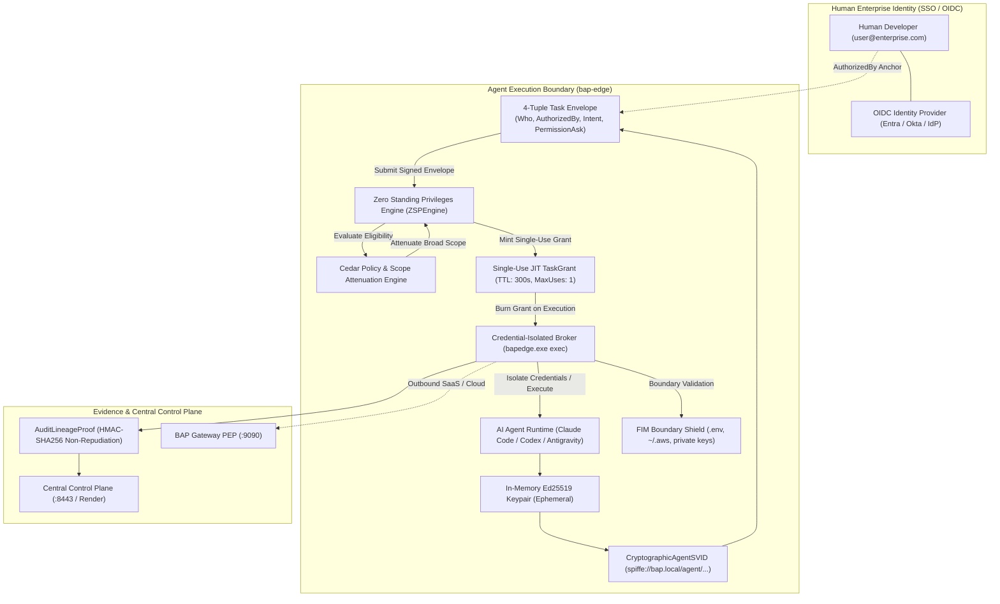

### 19.2. Explicit Cryptographic Agent Principal & SVID Binding (BAP-911, BAP-915)
Every registered agent has an identifiable principal distinct from its human owner and hosting runtime:
- **Ephemeral Keypair**: On agent session startup, `GenerateAgentKeypair()` generates an in-memory Ed25519 public/private keypair. Private keys are never persisted to disk or transmitted over the network.
- **CryptographicAgentSVID**: `MintAgentSVID()` produces a signed SVID binding:
  - `AgentKeyID`: Unique public key fingerprint (e.g. `key-ed25519-915a`).
  - `SPIFFE_ID`: `spiffe://bap.local/agent/<runtime-family>/<key-id>`.
  - `HumanOwnerID`: Corporate email of the developer (`user@enterprise.com`).
  - `OIDCSub`: Enterprise OIDC Subject identifier (`sub-azure-99128`).
  - `WorkstationID`: Machine fingerprint (`wkstn-84192b0e-User`).
  - `RuntimeFamily`: Hosting runtime (`claude-code`, `codex`, `antigravity`, `copilot`).
- **Cryptographic Verification**: `VerifyAgentSVID()` validates the signature and ensures the agent SVID has not expired (default TTL 8 hours).

### 19.3. Complete Network & Control Channel Architecture (BAP-912)
Communication paths across BAP components are formally specified in machine-readable inventory `docs/control_channels.json`:
- **CH-01**: HookWatch / Native Hooks $\rightarrow$ Agent Runtime (`bapedge.exe`). IPC named pipe/stdio, JSON-RPC, fail-closed on timeout.
- **CH-02**: Agent Runtime $\rightarrow$ Control Plane (`bapcontrolplane`). mTLS 1.3, authenticated via Workstation SVID, async bounded spooling.
- **CH-03**: Workstation $\rightarrow$ SPIFFE / STS Infrastructure. mTLS 1.3, RFC 8693 token exchange.
- **CH-04**: Edge Broker $\rightarrow$ Target System (Direct Brokered Execution). Local process containment, Windows Restricted Token / Linux cgroups.
- **CH-05**: Agent Runtime $\rightarrow$ BAP Gateway PEP (`:9090`). HTTP proxy with grant verification.
- **CH-06**: Gateway PEP $\rightarrow$ Target Cloud / SaaS APIs. Outbound egress with isolated target credentials.
- **CH-07**: Control Plane $\rightarrow$ Enterprise IdP (Entra / Okta). OIDC Device Authorization & PKCE.
- **CH-08**: Administrative Interface $\rightarrow$ Control Plane. HTTPS, Bearer Admin Token with scoped RBAC.

### 19.4. Customer-Network Credential & Enforcement Boundary (BAP-913)
Strict trust boundaries separate the central decision plane, local execution infrastructure, and credential broker:
1. **Decision Plane Isolation**: The centralized policy service (`bapcontrolplane`) evaluates policy and distributes signed bundles; it **cannot** directly execute local actions on workstations or retrieve target secrets.
2. **Local Execution Isolation**: Workstations execute approved commands under Windows Restricted Tokens (`bapedge/internal/authz/boundary.go`).
3. **Target Credential Isolation**: Credentials for external SaaS and databases are stored in dedicated credential managers and injected exclusively at the Gateway PEP or trusted broker. AI agents never receive raw credentials in tool arguments, outputs, or logs.

### 19.5. LLM Call Inventory & Security Non-Reliance Governance (BAP-914)
All model calls performed by agents or BAP governance components are inventoried in `docs/llm_call_inventory.json`:
- **Intent Evaluation (`LLM-01`)**: Purpose: classifying user prompts into 10 canonical CIO categories. Trust Boundary: Edge Interceptor. Policy: Evaluated for telemetry only (Invariant 1).
- **Permission Planning (`LLM-02`)**: Purpose: synthesizing least-privilege proposals from agent prompts. Trust Boundary: Edge ZSP Engine. Policy: AI output is strictly non-binding advisory.
- **Content Sanitization / DLP (`LLM-03`)**: Purpose: masking PII, credentials, and tokens in prompt streams.
- **Invariant Enforcement**: Under `ValidateNonReliance()`, security-critical decisions **never rely solely on untrusted LLM outputs**. Cedar policy invariants deterministically supersede any AI-generated permission plan.

### 19.6. Intent Planning, Policy Narrowing & Monotonic Scope Attenuation (BAP-901, BAP-902, BAP-906)
- **BAP-901 (Intent-to-Permission Planning)**: Captures declared intent and translates it into a least-privilege proposal.
- **BAP-902 (Policy Narrowing & Conditional Authorization)**: Enforces four decision outcomes: `ALLOW`, `DENY`, `NARROW`, and `REQUIRE_APPROVAL`. Monotonic scope attenuation strips excessive wildcards (`repo:*` $\rightarrow$ `repo:read`, `repo:push`).
- **BAP-906 (Data Sensitivity-Aware Authorization)**: Restricts access to sensitive data classifications (e.g. `RESTRICTED_CUSTOMER_DATA`) without explicit human approval.

### 19.7. Atomic 4-Tuple Task Authorization Envelope (BAP-916)
Work execution requires an immutable `TaskAuthorizationEnvelope`:
```go
type TaskAuthorizationEnvelope struct {
    EnvelopeID     string                 // Unique envelope ID
    Who            CryptographicAgentSVID // Ephemeral Agent Identity
    AuthorizedBy   HumanPrincipalBinding  // Human Enterprise IdP Identity
    Intent         DeclaredTaskIntent     // Canonical CIO Category & Statement
    PermissionAsk  RequestedPermissions   // Resources, Actions, TargetAudience
    Timestamp      time.Time              // UTC Creation timestamp
    AgentSignature string                 // Ed25519 signature by Agent private key
}
```
The envelope digest is computed over canonical representations of all four fields. The agent signs this digest using its private Ed25519 key, providing non-repudiation that the specific agent workload requested the exact task.

### 19.8. Zero Standing Privileges (ZSP) Engine & Single-Use JIT Grants (BAP-917)
The BAP `ZSPEngine` governs task lifecycle:
1. **Zero Standing Privileges Baseline**: Default permissions for any registered agent are strictly empty ($\emptyset$). Unsolicited tool calls fail closed immediately.
2. **Envelope Evaluation (`AuthorizeTaskEnvelope`)**: Validates the agent signature, verifies the human IdP binding, applies Cedar policy, and attenuates permissions.
3. **Single-Use JIT Grant Issuance**: Mints a `TaskGrant` with:
   - `GrantID`: Cryptographic identifier (e.g. `grant-task-84912d09`).
   - `MaxUses`: Exactly 1 (`Single-Use`).
   - `TTL`: 300 seconds (5 minutes).
4. **Atomic Grant Burning (`ConsumeTaskGrant`)**: At execution time, the broker verifies the grant and immediately sets `Consumed = true`. Any attempt to replay, double-spend, or re-execute with the same grant fails with `GrantAlreadyConsumed`.

### 19.9. Cryptographic Non-Repudiation Audit Lineage Proofs (BAP-918)
Every executed action generates an unforgeable `AuditLineageProof`:
- **HMAC-SHA256 Signature**: Computed using the BAP workstation secret key across:
  $$\text{HMAC}\Big(K, \text{HumanOwner} \,\|\, \text{AgentSVID} \,\|\, \text{EnvelopeDigest} \,\|\, \text{GrantID} \,\|\, \text{Command} \,\|\, \text{CommandHash} \,\|\, \text{BinaryHash} \,\|\, \text{ProcessTree} \,\|\, \text{ExitCode}\Big)$$
- **Forensic Guarantee**: Enables complete, independent reconstruction of any action: who authorized it, which agent ran it, what policy evaluated it, what exact binary executed, and proof that the grant was burned.

### 19.10. Canonical Semantic Action Classification & AST Decomposition Pipeline (BAP-919, BAP-920)
Autonomous coding agents interact with developer environments by invoking hundreds of command-line tools (`git`, `npm`, `pytest`, `cargo`, `docker`, `aws`, `go`, etc.). Writing an AST parser for 5,000 distinct CLI binaries is fragile, unmaintainable, and an architectural anti-pattern.

BAP solves this through **Semantic Action Decomposition** using the **Airport Security / Real-World Impact Mental Model**:
Rather than inspecting binary syntax, BAP classifies commands based on their real-world impact across five canonical security archetypes:

| Canonical Archetype | Example Commands | Security Impact & Default Baseline | Cedar Target Mapping |
|:---|:---|:---|:---|
| **`inspect:read`** | `git status`, `git diff`, `cat`, `ls`, `grep`, `pwd`, `Get-ChildItem` | Non-mutating read inspection of workspace files and metadata. Permitted by default under active task envelope. | `action: inspect:read`, `resource: repo:local` / `workspace://current` |
| **`workspace:mutate`** | `git commit`, `npm test`, `go build`, `pytest`, `cargo check`, `New-Item` | Project-scoped modifications, compilation, and testing. Permitted within workspace boundaries; cross-folder writes trigger HITL step-up. | `action: workspace:mutate`, `resource: workspace://current` |
| **`credential:access`** | `cat .env`, `type ~/.aws/credentials`, `Get-Content ~/.ssh/id_rsa` | Secret exfiltration and credential reading. **Inviolably BLOCKED** across all policy layers without exception. | `action: credential:access`, `resource: system://secret` |
| **`network:egress`** | `curl https://...`, `wget`, `nc -zv`, raw socket creation | Raw, unmediated network exfiltration. **BLOCKED**; outbound network access must route through the BAP Gateway PEP. | `action: network:egress`, `resource: network://external` |
| **`system:recon`** | `whoami`, `id`, `netstat`, `ipconfig`, `ps`, `tasklist` | Host environment and privilege reconnaissance. Denied ambient execution; gated behind explicit task envelope or step-up. | `action: system:recon`, `resource: system://local` |

#### How the Decomposition Pipeline Works:
1. **Deconstruction & Normalization (`bap-edge/internal/authz/decomposer.go`)**:
   - Parses multi-command pipelines (`|`, `&&`, `||`, `;`), subshells, and flags.
   - Normalizes command aliases (`g` $\rightarrow$ `git`, `dir` $\rightarrow$ `Get-ChildItem`, `gc` $\rightarrow$ `git commit`).
   - Resolves target paths relative to the active workspace jail.
2. **Deterministic Intent Classifier (`bap-edge/internal/classifier/classifier.go`)**:
   - Matches commands against the 5 canonical action archetypes and extracts concrete target resources.
   - Produces a normalized 4-tuple: `(Principal, Action, Resource, Context)`.
3. **Cedar Policy Evaluation (`policy.cedar`)**:
   - The normalized tuple is evaluated against compiled AWS Cedar policies in **$<1.5\text{ms}$**, completely eliminating syntax parsing complexity at the policy tier.

### 19.11. First-Class Monotonic Scope Attenuation: ALLOWED-LIMITED State & Visual Governance (BAP-921)
In traditional security systems, permission decisions are binary: `ALLOW` or `DENY`. When an agent requests broad wildcard privileges (e.g. `repo:*`), a binary decision either:
- **Denies the request**, terminating the agent's task and inducing unproductive agent retry loops; or
- **Grants the request**, creating massive standing privilege and violating least privilege.

BAP introduces **Monotonic Scope Attenuation** as a first-class operational state:
$$\text{Scope}_{\text{granted}} = \text{Attenuate}(\text{Scope}_{\text{requested}}, \text{CedarPolicy}) \subseteq \text{Scope}_{\text{requested}}$$

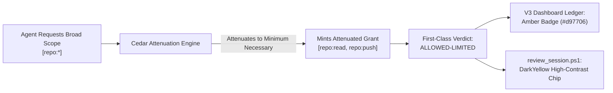

#### First-Class Platform Integration:
1. **ZSP Engine (`bap-edge/cmd/zsp.go`)**:
   - When requested permissions exceed permitted policy bounds but a safe subset exists, the engine mints the grant with the narrowed scope and marks the decision as `ALLOWED-LIMITED`.
   - Logs the precise monotonic attenuation: `[ALLOWED-LIMITED] Requested [repo:*] -> Granted [repo:read,repo:push]`.
2. **Central Control Plane (`bap-controlplane/internal/api/`)**:
   - Serializes `decision: "ALLOWED-LIMITED"` and `scope_attenuated: true` across REST endpoints (`/api/v1/sessions/events`, `/api/v1/audit/ingest`).
3. **Agent Watch V3 Dashboard (`v3.html` & `index.html`)**:
   - Renders a distinctive burnt-orange / amber chip (`.chip.limited { background: rgba(217, 119, 6, 0.18); color: #d97706; border: 1px solid rgba(217, 119, 6, 0.45); }`).
   - Surfaces attenuated operations in the executive summary banner: `Scope Attenuated (Limited): N`.
4. **Session Performance & Governance CLI (`review_session.ps1`)**:
   - Color-codes `ALLOWED-LIMITED` in bold amber/DarkYellow in the chronological action ledger and session summary.

### 19.12. Cryptographic Policy Bundle Signing & Tamper Verification (BAP-922)
To satisfy SOC 2 Type II, FedRAMP, and ISO 27001 compliance standards, developers and rogue processes on governed workstations must be cryptographically prevented from altering local policy files (`policy.cedar`, `schema.json`).

```mermaid
sequenceDiagram
    autonumber
    actor Admin as Enterprise Security Admin
    participant Studio as Cedar Policy Studio (Control Plane UI)
    participant CPStore as Central Policy Store (store.go)
    participant EdgeStore as Edge Policy Store (bap-edge)
    participant Rogue as Rogue Agent / Process

    Admin->>Studio: Update Cedar Policy (e.g. restrict credential:access)
    Studio->>CPStore: Save & Publish Bundle
    Note over CPStore: Computes SHA-256 Digest of policies & schema<br/>Signs with Enterprise Secret Key via HMAC-SHA256 / Ed25519
    CPStore->>EdgeStore: Distribute Signed Bundle {BundleID, Policies, Schema, Signature}
    EdgeStore->>EdgeStore: VerifyBundleSignature(secretKey)
    alt Valid Signature
        EdgeStore->>EdgeStore: Atomically write ~/.ltd/policy/ with signature
        EdgeStore-->>Admin: Bundle Accepted & Active (<2ms)
    else Signature Invalid / Corrupted
        EdgeStore->>EdgeStore: Reject & Fail-Closed (retain existing bundle)
    end

    Note over Rogue: Rogue agent attempts to modify ~/.ltd/policy/policy.cedar
    Rogue->>EdgeStore: Injects "permit(principal, action, resource);"
    EdgeStore->>EdgeStore: VerifyBundleSignature on load / exec
    Note over EdgeStore: Cryptographic Hash Mismatch Detected!
    EdgeStore-->>Rogue: Hard Fail-Closed: PolicyTamperDetectedException
```

#### Tamper-Proofing Mechanics:
- **Control Plane Signing (`bap-controlplane/internal/policy/store.go`)**:
  - `SignBundle()` generates an HMAC-SHA256 signature across the concatenated SHA-256 digest of `policy.cedar` and `schema.json`.
  - Policies receive immutable version IDs (e.g. `bundle-sha256:f0b64f...`).
- **Edge Attestation & Verification (`bap-edge/internal/policystore/store.go`)**:
  - `VerifyBundleSignature()` verifies the digital signature before accepting or loading any policy bundle.
  - If a developer or malware modifies the on-disk `.cedar` file, the edge engine detects the mismatch and immediately fails closed (`ErrInvalidSignature`), refusing to execute unbrokered commands.
- **Cedar Policy Studio (`/#policies`)**:
  - Embedded directly in the Control Plane dashboard (`v3.html`). Provides administrative syntax editing, "What-If" sandbox dry-run simulation, and instantaneous zero-downtime signed bundle distribution.

### 19.13. Token Overhead & Runtime Performance Analysis
A foundational requirement for enterprise AI adoption is that governance must not degrade developer flow or inflate AI inference costs.

```text
┌─────────────────────────────────────────────────────────────────────────────┐
│                      BAP RUNTIME OVERHEAD PERFORMANCE                       │
├─────────────────────────────────────────────────────────────────────────────┤
│ 1. Decision Latency:                                                        │
│    • In-Process Cedar Evaluation: <1.5 ms                                   │
│    • AST Decomposition & Classification: <0.2 ms                            │
│    • Total Execution Broker Overhead: <2.0 ms                               │
│    • Human Perceptible Delay: 0.0% (imperceptible)                          │
│                                                                             │
│ 2. Token Consumption & AI Inference Impact:                                 │
│    • LLM Tokens Consumed for Authorization: 0 tokens (pure Go/Rust code)    │
│    • 4-Tuple Task Envelope Overhead: <1% total turn token budget            │
│    • Prompt Ingestion & Streaming: Asynchronous background spooling         │
│                                                                             │
│ 3. Throughput & Scalability:                                                │
│    • Control Plane Ingestion: 35,620 events / second                        │
│    • Merkle Hash Verification: 50,000 sequential events in 32.6 ms          │
│    • Fleet Kill-Switch Propagation: <100 ms global propagation              │
└─────────────────────────────────────────────────────────────────────────────┘
```

1. **Zero LLM Token Overhead**:
   - Authorization decisions are evaluated deterministically in compiled Go code against Cedar invariants.
   - BAP never calls external LLM APIs to approve or deny commands. Zero additional LLM tokens are billed for security evaluation.
2. **Sub-2ms Execution Broker Latency**:
   - `bapedge exec` evaluates cached, cryptographically signed policy bundles in-process. Local file operations (`git`, `npm`, `pytest`) run at near-native speed.
3. **Asynchronous Telemetry Spooling**:
   - Audit event notarization and Merkle hash chaining are decoupled from execution via persistent local ring buffers (`ltd-audit.jsonl`), ensuring network latency to the Control Plane never blocks local developer commands.


---

## 17. Control-Plane-Owned Signed Policy, Per-Machine Settings and Recommendations

This section records the architecture changes that sit under every layer in section 8.

### 17.1. One signed policy per machine

The control plane owns enforcement settings. Each **machine** (a hardware-derived asset id, not a registered client, so re-registering does not shed anything) receives its own bundle:

- **Signed with Ed25519.** The signature covers the asset id, version, rules digest, kill switch, strictness, tier, `zsp_read_exempt`, the update time and, when present, the machine's approved effects. A bundle cannot be edited locally or replayed to another machine.
- **Key pinned at enrollment.** OTC and OIDC enrollment return the control plane's public key and the machine's asset id over the authenticated channel; the edge pins both. Users never handle keys. Key rotation is a chain of links, each signed by the previous key, that enrolled machines follow automatically.
- **Seconds, not minutes.** Short-lived commands (hooks, `bapedge check`) refresh a stale cache themselves, and the watcher syncs on an interval, so an administrator change reaches a machine within seconds.
- **Offline behavior.** If the control plane is unreachable, the last verified signed rules stay in force. If the cached rules fail verification (edited, deleted, wrong machine) **and** the control plane is unreachable, `bapedge` refuses to start and waits to reconnect and be re-issued signed rules. The one exception is the developer override (17.4).
- **Version rules.** A client rejects any bundle older than the one it holds. A control plane on an ephemeral disk seeds its version counter from the clock so a redeploy cannot strand the fleet.

### 17.2. Settings an administrator controls

| Setting | Scope | Effect |
|---|---|---|
| `zsp_read_exempt` | fleet default, per machine | Plain reads inside the workspace (Read, Glob, Grep, `git status`, `dir`…) need no task grant. Credentials and anything outside the workspace never qualify. |
| Approved effects | per machine | Specific local-development effects (for example `dev:go:test`) run without a task grant. |
| Kill switch, tier, strictness | fleet | As before. |

Overrides and approvals can only target a machine the control plane has enrolled, and every change is audited.

### 17.3. Recommendation and approval loop

A registered machine can report a blocked call it believes is benign (`bap recommend`, details in [docs/POLICY_RECOMMENDATIONS.md](docs/POLICY_RECOMMENDATIONS.md)). It is not an open API: the submit route requires a valid enrolled-workstation credential. An administrator reviews the queue on the control plane; approving adds the effect to that machine's signed bundle and advances the version, and the machine picks it up on its next sync.

Approvals are deliberately narrow:

- They relax **only the task-grant requirement**. Cedar invariants (credentials, exfiltration, tamper protection) are evaluated separately and are never relaxed.
- Only the local development loop is approvable. Network, deletion, publishing, package installs, databases, arbitrary interpreters and credentials never are. The control plane refuses them, and the edge ignores them even if a list contained them.
- They cover work **inside the workspace** only, on that machine only, and a command that mixes an approved effect with an unapproved one still needs a grant.

### 17.4. Developer override

The override exists so BAP can be repaired under BAP. It is a human-activated, time-boxed window that exists only in builds compiled with `AllowDevOverrides=true` and only in a development environment. While it is active an integrity failure no longer locks the developer out: the edge runs on the unverified local policy, labelled `DEV OVERRIDE` and degraded, and never accepts or caches it. Credentials, revocation and Cedar rules still apply. Release builds compile the override out.

### 17.5. Process lifecycle

`bapedge watch` is one process per session, guarded by a lock. It exits when the session ends, when the watched process exits, or when the control plane closes or revokes the session; a duplicate exits immediately. An end-to-end test starts real watchers and fails if any process is left running (`tests/test_bapedge_process_lifecycle.py`).

### 17.6. Known limits

- A control plane on an ephemeral disk (Render, containers) loses its enrolled-machine registry, settings, recommendations and approvals on redeploy unless it uses persistent storage (BAP-1070). Set `BAP_POLICY_SIGNING_SEED` so the signing key survives redeploys, and `BAP_POLICY_SYNC_REQUIRE_AUTH=1` so policy is only served to enrolled machines. Machines re-bind on their next authenticated sync, but approvals are lost.
- Per-machine approvals only. Fleet-wide approvals and a company policy matrix (BAP-1067) are not built; they need a client-version gate because older clients cannot verify a payload with approvals.
