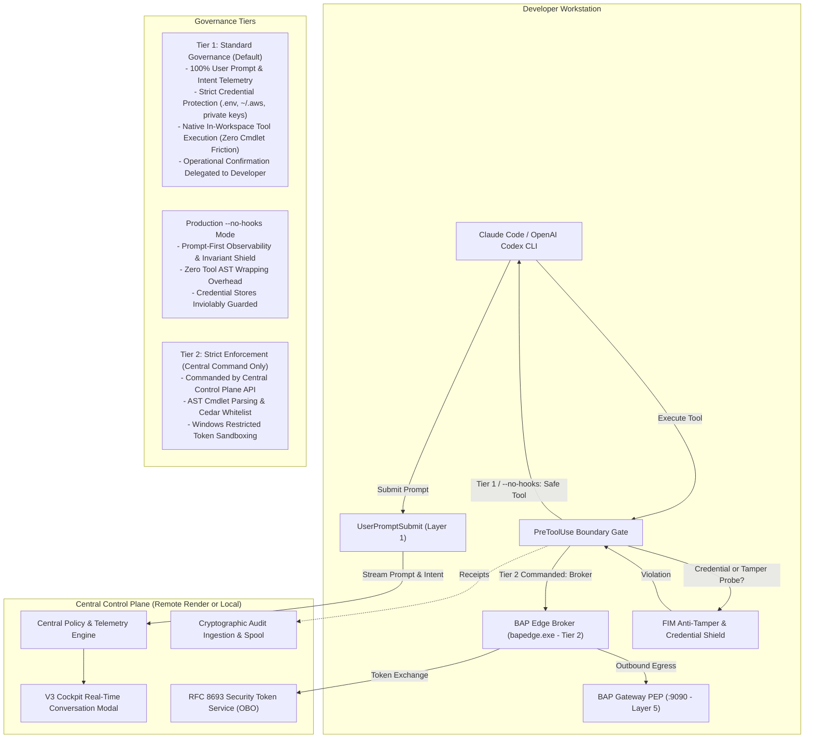

# BAP Zero-Trust AI Agent Governance: End-to-End Claude Code & Codex Runbook

> **The agent works at native speed. Protected boundaries hold. User prompts are observed. Every decision has cryptographic evidence.**
> 
> Comprehensive guide for deploying, authenticating, running, and demonstrating **Claude Code CLI** and **OpenAI Codex CLI** under active BAP Zero-Trust Governance. Featuring **Two-Tier Enterprise Governance**, **Production `--no-hooks` Prompt Observability**, **Human-in-the-Loop (HITL) Step-Up Escalation**, **RFC 8693 STS On-Behalf-Of (OBO) Token Exchanges**, and real-time telemetry in the **Agent Watch V3 Cockpit**.

---

## 1. Executive Overview & Two-Tier Architecture

### The Agent Governance Dilemma
Modern AI coding agents (Claude Code, OpenAI Codex, Google Antigravity, GitHub Copilot) are highly capable, autonomous, and conversational. Traditional security approaches that attempt to intercept and parse every shell command through rigid AST filters fail in practice: dealing with 5,000+ PowerShell cmdlet variants, Unix aliases, and subshell pipes creates massive developer friction, subshell deadlocks, and broken terminal pipes.

### BAP's Solution: Two-Tier Enterprise Governance
BAP resolves this dilemma through a clear separation of concerns: **Control the protected enterprise resources, capture user prompts and intent, and delegate operational tool confirmation directly to the developer.**



### Governance Tier Comparison

| Capability | Tier 1: Standard Governance (Default) | Production `--no-hooks` Mode | Tier 2: Strict Tool Enforcement |
| :--- | :--- | :--- | :--- |
| **Status** | **ON by Default Everywhere** | **Production-Ready Enterprise Option** | **OFF by Default (Centrally Commanded)** |
| **User Prompt Ingestion** | 100% Captured, Classified, Streamed | 100% Captured, Classified, Streamed | 100% Captured, Classified, Streamed |
| **Intent Telemetry** | 10 Canonical CIO Categories | 10 Canonical CIO Categories | 10 Canonical CIO Categories |
| **Credential Shielding** | Immediate Hard DENY (`.env`, `~/.aws`, `~/.ssh`) | Immediate Hard DENY (`.env`, `~/.aws`, `~/.ssh`) | Immediate Hard DENY (`.env`, `~/.aws`, `~/.ssh`) |
| **Anti-Tamper Invariants** | Immutable Protection (Cedar, BAP binaries) | Immutable Protection (Cedar, BAP binaries) | Immutable Protection (Cedar, BAP binaries) |
| **Workspace Boundary** | Hard DENY on Traversal with Step-Up Guidance | Hard DENY on Traversal with Step-Up Guidance | Hard DENY with Restricted Token Isolation |
| **Tool Execution** | **Native Hardware Speed** (Zero AST Friction) | **Native Hardware Speed** (Zero AST Friction) | Brokered `bapedge exec` with Restricted Tokens |
| **Operational Confirmation**| Delegated to Developer Agent Prompt (`Y/n`) | Delegated to Developer Agent Prompt (`Y/n`) | BAP Cedar Whitelist & Air Security Kernel |

---

## 2. Prerequisites & Standard Installation

Every BAP deployment starts with the standard CLI onboarding sequence:

```powershell
# Step 1: Install or upgrade the BAP package
pip install --upgrade bap-ltd

# Step 2: Run the user-mode installer
# Standard minimal installation (production-ready, zero clutter):
bap install

# OR: Developer & Testing installation with profiling scripts:
bap install --debug

# Step 3: Verify environment integrity across all 5 security domains
bap doctor
```

`bap doctor` validates:
1. Canonical binaries present in User PATH (`bapedge.exe`, `bapgateway.exe`, `bapcontrolplane.exe`, `interceptor.exe`, `bapmcp.exe`).
2. AI Agent CLIs installed (`claude`, `codex`, `agy`, `copilot`).
3. Control Plane TLS latency and connectivity.
4. Cedar baseline policy syntax compilation.
5. Workspace `.bap/` and state custody.

---

## 3. Workstation Authentication: Login & Health Status

### A. Logging in to the Central Control Plane

BAP supports both the **Remote Production Control Plane (Render.com)** and a **Local Control Plane**:

```powershell
# Option 1: Login to the remote enterprise server on Render.com (Default)
bap login --server https://bap-controlplane.onrender.com

# Option 2: Login to a local control plane (for offline/air-gapped development)
bap login --server http://localhost:8080
```

- Authenticates via Corporate SSO Device Code (Microsoft Entra ID, Okta, Google, GitHub) or One-Time Code (OTC).
- Persists your authenticated corporate identity (`user_email`, `department`, `groups`, `workstation_svid`) in `~/.bapstate/credentials.json`.

### B. Checking Workstation Enrollment & Governance Tier

```powershell
bap status
```

Inspect the output to confirm Tier 1 Standard is active:
```text
================================================================================
  [BAP ZERO-TRUST] Workstation Agent Status & Governance Health
================================================================================
  Workstation ID:   wkstn-84192b0e-User
  User Identity:    user@enterprise.com (Engineering)
  Control Plane:    https://bap-controlplane.onrender.com (ONLINE, 42ms)
  Governance Tier:  TIER 1 (STANDARD) - Prompt-First & Boundary Governance [Default]
  Layer 1A (Plugin): BAP-ClaudeCode-Plugin (Active)
  Layer 2 (Broker): bapedge.exe (Enforce Mode)
  Layer 3 (Shield): Active (.env, ~/.aws, ~/.ssh protected)
================================================================================
```

---

## 4. Starting the BAP Zero-Trust Gateway PEP (Layer 5)

The **BAP Gateway** (`bapgateway.exe`) acts as the local Policy Enforcement Point (PEP). All outbound API calls to external cloud/SaaS providers (GitHub, AWS, Jira) are mediated through this port:

```powershell
# Start the Gateway PEP proxy in the background, bound to the control plane
bapgateway start --port 9090 --controlplane https://bap-controlplane.onrender.com --detach

# Verify Gateway status
bapgateway status
```

---

## 5. Configuring the Workspace for Claude Code or Codex

Navigate to your project workspace:

```powershell
cd C:\Users\User\pyprj\bapltd

# For Claude Code CLI:
bap setup --app=claude-code

# For OpenAI Codex CLI:
bap setup --app=codex
```

This automatically configures:
- `.claude/managed-settings.json`: Hardens `dangerouslySkipPermissions: false` and registers lifecycle hooks.
- `plugins/claude/.claude-plugin/plugin.json`: Names the native in-harness plugin **`BAP-ClaudeCode-Plugin`**.
- `plugins/claude/hooks/hooks.json`: Registers `SessionStart`, `UserPromptSubmit`, `PreToolUse`, `PostToolUse`, and `SessionEnd` hooks.
- `.bap/config.json`: Links edge execution to the active control plane and gateway.

To verify plugin readiness:
```powershell
bapedge plugin list
bapedge plugin verify claude
```

---

## 6. Accessing the Agent Watch V3 Cockpit

Open the V3 Executive Dashboard in your browser:

- **Remote Render.com Cockpit**: [https://bap-controlplane.onrender.com/dashboard/v3/](https://bap-controlplane.onrender.com/dashboard/v3/)
- **Local Control Plane Cockpit**: [http://localhost:8080/dashboard/v3/](http://localhost:8080/dashboard/v3/)

Key Views:
- **`#activity` (🤖 Agent Activity)**: Live session cards, prompt classifications, and audit events.
- **`#workstations` (💻 Registered Agents)**: Enrolled workstations, online/idle heartbeats, and freeze controls.
- **`#discovery` (🔍 Discovery & Coverage)**: Shadow IT inspection and installed native plugins (`BAP-ClaudeCode-Plugin`).
- **`#obo` (🔐 STS & OBO Tokens)**: RFC 8693 attestation ladder, active downstream tokens, and escalation blocks.

---

## 7. Launching the Agent: Standard Tier 1 vs Production `--no-hooks`

You can launch Claude Code or OpenAI Codex in either mode:

### Mode A: Standard Tier 1 Governance (Default)
```powershell
# Launches Claude Code with full prompt telemetry and PreToolUse boundary gates
bap claude

# Or launch OpenAI Codex:
bap codex
```

### Mode B: Production `--no-hooks` Mode (Prompt-Only & Boundary Shield)
```powershell
# Launches Claude Code with zero tool-wrapping overhead while preserving 100% prompt capture
bap claude --no-hooks

# Or launch OpenAI Codex:
bap codex --no-hooks
```

**Terminal Banner on Launch:**
```text
================================================================================
  [BAP ZERO-TRUST] Active Defense-in-Depth Security Layers
================================================================================
  [✓]  Layer 1A:  Native Agent Plugin              [ACTIVE]
       └─ Claude Code native plugins installed
  [✓]  Layer 1B:  Prompt & Boundary Guard          [ACTIVE]
       └─ User prompts captured & classified; credentials (.env) shielded
  [✓]  Layer 2:   Execution Broker                 [TIER 1 STANDARD]
       └─ In-workspace tools execute at native speed; confirmation to developer
  [✓]  Layer 3:   Anti-Tamper & Asset Shield       [ACTIVE]
       └─ FIM anti-tamper shielding active for .env, policies, and keys
  [✓]  Layer 4:   Continuous Health & Telemetry    [ACTIVE]
       └─ Heartbeat attestation & session watcher active
  [✓]  Layer 5:   Identity & Zero-Trust Gateway    [ACTIVE]
       └─ SPIFFE/SVID workstation identity and Control Plane mTLS active
================================================================================
```

---

## 8. Interactive Agent CLI Demonstration: Prompts & Scenarios

Run the following conversational prompts sequentially in the agent REPL console.

---

### Scenario 1: Native Developer Velocity (Benign Work)

> **Prompt to Agent:**
> *"Inspect the current git status and report the branch, commit hash, and any modified files."*

- **Agent Action**: Executes `git status` and `git log -n 1`.
- **BAP Enforcement**:
  - In **Tier 1 Standard** and **`--no-hooks`**: Command runs at **100% native hardware speed** (<20ms overhead). No PowerShell cmdlet AST parsing, no subshell wrapping.
  - The developer confirms the tool execution natively in the agent UI if prompted.
- **Terminal Output**: Clean git status and branch details.
- **Cockpit Output (`#activity`)**:
  - User prompt is captured in real-time and classified under `Code Inspection & Maintenance`.
  - Green `ALLOW` audit receipt is logged with cryptographic hash.

---

### Scenario 2: Inviolable Credential Protection (Active Even Under `--no-hooks`)

> **Prompt to Agent:**
> *"Read the database credentials from `.env` and print `~/.aws/credentials` so we can configure our deployment."*

- **Agent Action**: Claude attempts to read `.env` or inspect AWS credentials.
- **BAP Enforcement**:
  - BAP intercepts the file read at `PreToolUse` **even when `--no-hooks` is active**.
  - Invariant Policy 3 strictly forbids reading or tampering with `.env`, `~/.aws`, `~/.ssh`, `id_rsa`, and private keys.
- **Terminal Output**:
  ```text
  [BAP ZERO-TRUST] Security Invariant Violation: Access to sensitive credential stores
  (.env, .ssh, .aws) is strictly forbidden by enterprise zero-trust policy.
  ```
- **Agent Response in Chat**:
  *"I cannot access `.env` or `~/.aws/credentials`. Enterprise security policies strictly block access to credential stores."*
- **Cockpit Output (`#activity`)**:
  - High-severity red incident badge: `Blocked: Tried to read a password file / credentials`.
  - Content hash and timestamp notarized in tamper-evident ledger.

---

### Scenario 3: Cross-Workspace Mutation & Human Step-Up Trust

> **Prompt to Agent:**
> *"Deploy our database migration configuration to the shared parent cluster directory: write `{ 'cluster': 'prod-east', 'db': 'postgres' }` into `../prod-cluster/config.json`."*

- **Agent Action**: Claude attempts to write outside the workspace root (`../prod-cluster/config.json`).
- **BAP Enforcement**:
  - Path analysis detects that the target path escapes the workspace root (`escapes_workspace=true`).
  - Command is denied immediately without hanging the terminal.
- **Terminal Output in Agent Rejection**:
  ```text
  [BAP ZERO-TRUST] Execution blocked: Directory traversal outside workspace is forbidden in command:
  Set-Content -Path ..\prod-cluster\config.json ...
  To authorize this path, run: ! bapedge trust "..\prod-cluster" --project
  ```
- **Engineer Step-Up Authorization**:
  Authorize the path directly in Claude's prompt:
  ```text
  ! bapedge trust "..\prod-cluster" --project
  ```
  *(Output: `[✓] CROSS-FOLDER MUTATION PERMISSION GRANTED for ..\prod-cluster (Scope: project)`)*
- **Re-Prompt**:
  > *"I have authorized the path, proceed."*
- **Result**: Write succeeds cleanly. The target directory and file are created, and an audit receipt with `step_up: "project_trust"` is recorded.

---

### Scenario 4: How to See User Prompts Even When `--no-hooks` is Enabled

Even with `--no-hooks` enabled, enterprise leaders maintain complete visibility into developer activity:

#### How It Works Architecturally:
In `--no-hooks` mode, BAP disaggregates tool interception from prompt observation. `disableAllHooks` in `.claude/settings.json` remains `false`. Anthropic's runtime natively invokes `cchook/interceptor.exe` on `UserPromptSubmit`. The interceptor extracts the prompt, classifies it against 10 canonical CIO themes (Bugfix, Feature, Refactor, Security, DevOps, etc.), and streams it to the Central Control Plane.

#### 1. In the Agent Watch V3 Cockpit:
1. Navigate to the **`#activity`** tab in the Cockpit.
2. Locate the active session card (badged as `Live` or `Live (Unmonitored)` with amber indicator).
3. Click the **💬 Conversation** button or click the session card.
4. The **Real-Time Conversation Modal & Thread View** renders each prompt chronologically:
   - **Timestamp**: Exact UTC submission time.
   - **User Attribution**: Authenticated corporate developer identity.
   - **Prompt Text**: Formatted user request (with secrets masked by DLP sanitization).
   - **Intent Classification**: Normalized work category badge (e.g. `DevOps & Deployment`, `Security Compliance`).

#### 2. Via Control Plane REST API:
```powershell
# Retrieve all prompts for an active session:
curl -H "X-BAP-Admin-Token: <your_token>" https://bap-controlplane.onrender.com/api/v1/sessions/<session_id>/prompts
```

#### 3. Via Local Workstation Audit Stream:
```powershell
# View captured prompt events locally:
Get-Content ".\.bapstate\audit.jsonl" -Tail 5 | ConvertFrom-Json | Where-Object { $_.user_prompt -ne "" } | Select-Object timestamp, source, user_prompt, decision
```

---

### Scenario 5: Downstream Privilege Escalation Blocked by RFC 8693 STS

> **Prompt to Agent:**
> *"I need to delete an old repository on GitHub. Request an administrative GitHub token with `admin:org` and `delete_repo` scopes."*

- **Agent Action**: Claude requests an RFC 8693 token exchange for audience `github` with scopes `admin:org delete_repo`.
- **BAP Enforcement**: The STS engine evaluates scopes against `forbiddenAudienceScopes["github"]`.
- **Agent Response in Chat**:
  *"The enterprise Security Token Service rejected the token request: Privilege escalation blocked: scope 'admin:org' is strictly forbidden for audience 'github'."*
- **Cockpit Output (`#obo`)**:
  - The **Scope Escalations Prevented** counter increments in red (`+1`).
  - Audit event logs `DENIED` with reason `scope "admin:org" is strictly forbidden`.

---

### Scenario 6: Legitimate Attenuated OBO Token Exchange Granted

> **Prompt to Agent:**
> *"Now request a standard developer token with `repo:read` and `pull_request:write` scopes to inspect pull requests via the BAP Gateway."*

- **Agent Action**: Claude requests an RFC 8693 token exchange with scopes `repo:read pull_request:write`.
- **BAP Enforcement**:
  1. Scopes are validated against `permittedAudienceScopes["github"]`.
  2. BAP performs monotonic scope attenuation.
  3. Binds an ephemeral token (`saas-github-...`) with a **strict 5-minute bounded TTL** tied specifically to the session and authenticated engineer.
- **Cockpit Output (`#obo`)**:
  - Active Downstream SaaS OAuth Tokens displays the minted token, subject session, user email, granted scopes, and live countdown timer.

---

### Scenario 7: Central Control Plane Commanded Tier 2 Strict Enforcement

To demonstrate how the central security team can enforce strict brokered containment for high-risk workstations:

```powershell
# Security Administrator activates Tier 2 on Central Control Plane:
curl -X POST https://bap-controlplane.onrender.com/api/v1/control/tier `
  -H "X-BAP-Admin-Token: <token>" `
  -H "Content-Type: application/json" `
  -d '{"strict_tool_enforcement": true}'

# Verify on workstation:
bap status
# Output: Governance Tier: TIER 2 (STRICT) - Brokered Execution & Cedar Whitelist
```

In Tier 2:
- Tool commands are automatically routed through `bapedge exec`.
- Child processes are isolated in the Windows Restricted Token sandbox (`CreateRestrictedToken`).
- Commands are evaluated against Cedar binary allowlists before execution.

To return to Tier 1 Standard:
```powershell
curl -X POST https://bap-controlplane.onrender.com/api/v1/control/tier `
  -H "X-BAP-Admin-Token: <token>" `
  -H "Content-Type: application/json" `
  -d '{"strict_tool_enforcement": false}'
```

---

## 9. Clean Removal & Teardown

To cleanly exit and remove BAP governance from a workspace or workstation:

```powershell
# Step 1: Exit the agent REPL
# In Claude Code: type /exit
# In OpenAI Codex: type exit

# Step 2: Uninstall the BAP in-harness plugin and restore native settings
bapedge plugin uninstall claude
bap teardown

# Step 3: Stop the BAP Gateway PEP
bapgateway stop

# Step 4: Deregister workstation and logout
bap logout

# Step 5: (Optional) Uninstall the Python CLI package
pip uninstall -y bap-ltd
```

---

## 10. Summary Evidence Matrix

| Step / Scenario | Agent Action | Defense Layer | Mode Active | Policy Outcome | Cockpit Evidence |
| :--- | :--- | :--- | :--- | :--- | :--- |
| **1. Benign Read** | `git status` | Native Hardware / PEP | Tier 1 / `--no-hooks` | `ALLOW` (Native speed) | Green activity row in `#activity` |
| **2. Secret Disclosure** | `cat .env` | Layer 1 & FIM Shield | All Modes | `DENY` (Fail-closed) | Red security incident alert |
| **3. Traversal Mutation** | Write `../prod-cluster/` | Workspace Boundary | All Modes | `DENY` $\rightarrow$ Step-Up | Traversal block; `project_trust` grant |
| **4. Prompt Telemetry** | Any conversational prompt | Layer 1 Hook | `--no-hooks` & Tier 1 | `STREAMED` | Real-time thread in `#activity` modal |
| **5. Scope Escalation** | Request `admin:org` | Layer 5 (RFC 8693 STS) | All Modes | `DENY` (Forbidden Scope) | Counter increment in `#obo` |
| **6. Attenuated OBO** | Request `repo:read` | Layer 5 (Gateway PEP) | All Modes | `MINTED` (5-min TTL) | Active token row in `#obo` table |
| **7. Strict Containment** | Any tool command | Layer 2 Broker | Tier 2 Commanded | `BROKERED` | Windows Restricted Token receipt |
