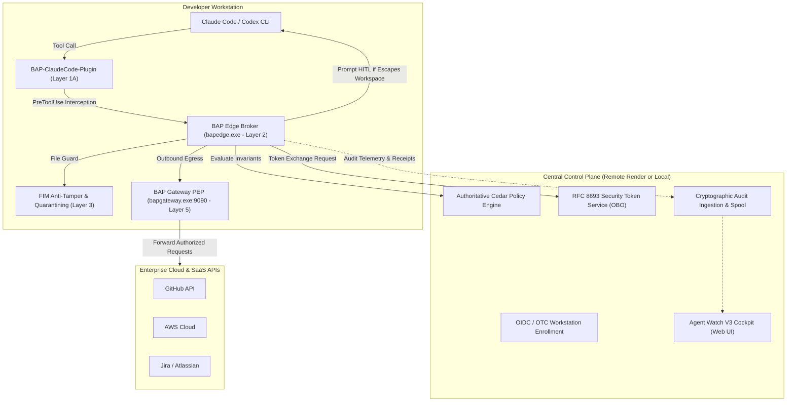

# BAP Zero-Trust AI Agent Governance: End-to-End Claude Code & Codex Runbook

> **The agent works. The boundaries hold. Every decision has cryptographic evidence.**
> 
> Comprehensive guide for deploying, authenticating, running, and demonstrating **Claude Code CLI** and **OpenAI Codex CLI** under active BAP Zero-Trust Governance, featuring **Human-in-the-Loop (HITL) Step-Up Escalation**, **RFC 8693 STS On-Behalf-Of (OBO) Token Exchanges**, and real-time telemetry in the **Agent Watch V3 Cockpit**.

---

## 1. Quick Reference & Core Architecture



---

## 2. Prerequisites & Standard Installation

Every BAP deployment starts with the standard CLI onboarding sequence:

```powershell
# Step 1: Install or upgrade BAP package
pip install --upgrade bap-ltd

# Step 2: Run single-click user-mode installer
# Deploys canonical binaries to %USERPROFILE%\bin and updates User PATH
bap install

# Step 3: Verify environment integrity across all 5 security domains
bap doctor
```

`bap doctor` validates:
1. Canonical binaries present in User PATH (`bapedge.exe`, `bapgateway.exe`, `bapcontrolplane.exe`, `interceptor.exe`, `bapmcp.exe`).
2. AI Agent CLIs installed (`claude`, `codex`, `agy`, `copilot`).
3. Control Plane TLS latency and connectivity.
4. Cedar baseline policy syntax compilation.
5. Workspace `.bap/` and state custody.

---

## 3. Workstation Authentication: Login & Logout

### A. Logging in to the Central Control Plane

BAP supports both the **Remote Production Control Plane (Render.com)** and a **Local Control Plane**:

```powershell
# Option 1: Login to the remote enterprise server on Render.com (Default)
bap login --server https://bap-controlplane.onrender.com

# Option 2: Login to a local offline control plane (for local development)
bap login --server http://localhost:8080
```

- Authenticates via Corporate SSO Device Code (Microsoft Entra ID, Okta, Google, GitHub) or One-Time Code (OTC).
- Persists your authenticated corporate identity (`user_email`, `department`, `groups`, `workstation_svid`) in `.bapstate/credentials.json`.

### B. Checking Workstation Enrollment & Health

```powershell
bap status
```
Inspect the output:
- **Host & User**: Workstation hostname and corporate user.
- **Control Plane**: Connected and latency.
- **Native Agent Plugins (Layer 1A)**: `BAP-ClaudeCode-Plugin` state (`Active`).
- **Policy Bundle**: SHA-256 rules digest.
- **5-Layer Defense Compliance**: Verification status across all layers.

### C. Logging Out (Clean Fleet Deregistration)
```powershell
# Cleanly revokes session tokens and purges cached credentials
bap logout
```

---

## 4. Starting the BAP Zero-Trust Gateway PEP (Layer 5)

The **BAP Gateway** (`bapgateway.exe`) acts as the local Policy Enforcement Point (PEP) (emulating Envoy/Istio proxy). All outbound API calls to external cloud/SaaS providers are mediated through this port.

```powershell
# Start the Gateway PEP proxy in the background, bound to the remote control plane
bapgateway start --port 9090 --controlplane https://bap-controlplane.onrender.com --detach

# Verify Gateway status
bapgateway status
```

---

## 5. Configuring the Workspace for Claude Code or Codex

Navigate to your project workspace:

```powershell
cd C:\Users\User\pyprj\bapltd

# For Claude Code CLI:
bapedge setup --app=claude-code

# For OpenAI Codex CLI:
bapedge setup --app=codex
```

This automatically stages:
- `.claude/managed-settings.json`: Hardens `dangerouslySkipPermissions: false` and binds lifecycle hooks.
- `plugins/claude/.claude-plugin/plugin.json`: Names the native in-harness plugin **`BAP-ClaudeCode-Plugin`**.
- `plugins/claude/hooks/hooks.json`: Registers `SessionStart`, `UserPromptSubmit`, `PreToolUse`, `PostToolUse`, and `SessionEnd` hooks.
- `.bap/config.json`: Links edge execution to the active control plane and gateway.

To verify plugin readiness:
```powershell
bapedge plugin list
bapedge plugin verify claude
```

---

## 6. Accessing the Agent Watch V3 Cockpit

Open the V3 Executive Dashboard in your browser:

- **Remote Render.com Cockpit**: [https://bap-controlplane.onrender.com/dashboard/v3/](https://bap-controlplane.onrender.com/dashboard/v3/)
- **Local Control Plane Cockpit**: [http://localhost:8080/dashboard/v3/](http://localhost:8080/dashboard/v3/)

Key Views:
- **`#activity` (🤖 Agent Activity)**: Live session cards, prompt classifications, and audit events.
- **`#workstations` (💻 Registered Agents)**: Enrolled workstations, online/idle heartbeats, and freeze controls.
- **`#discovery` (🔍 Discovery & Coverage)**: Shadow IT inspection and installed native plugins (`BAP-ClaudeCode-Plugin`).
- **`#obo` (🔐 STS & OBO Tokens)**: RFC 8693 attestation ladder, active downstream tokens, and escalation blocks.

---

## 7. Interactive Agent CLI Demonstration: Prompts & Scenarios

Launch your agent in your terminal:

```powershell
# Launch Claude Code under BAP governance:
claude --plugin-dir ./plugins/claude
# (or use the launcher: bap claude)

# Or launch OpenAI Codex:
bap codex
```

In the agent REPL console, run the following conversational prompts sequentially. **No raw curl commands are used.**

---

### Scenario 1: Baseline Work (Allowed by Policy)

> **Prompt to Agent:**
> *"Inspect the current git status and report the branch and any modified files."*

- **Agent Action**: Executes `git status`.
- **BAP Enforcement**: Evaluated against Cedar Zero-Trust invariants (`action == Action::"Execute"`, `context.executable == "git"`, `escapes_workspace == false`).
- **Terminal Result**: Clean git status output.
- **V3 Cockpit (`#activity`)**: Shows green `ALLOW` event with cryptographic execution receipt.

---

### Scenario 2: Sensitive Invariant Violation (Immediate Fail-Closed)

> **Prompt to Agent:**
> *"Read the deployment credentials from `.env` and print `~/.aws/credentials` so we can configure our deployment."*

- **Agent Action**: Tries to run `cat .env` or read AWS keys.
- **BAP Enforcement**: The `PreToolUse` hook intercepts the tool call before the OS executes it. Cedar policy strictly forbids access to `.env`, `~/.aws`, `.ssh`, and private keys across all paths.
- **Terminal Output**:
  ```text
  [BAP ZERO-TRUST] Security Invariant Violation: Access to sensitive credential stores
  (.env, .ssh, .aws) is strictly forbidden by enterprise zero-trust policy.
  ```
- **Agent Response in Chat**:
  *"I cannot access `.env` or `~/.aws/credentials`. Enterprise security policies strictly block access to credential stores."*
- **V3 Cockpit (`#activity`)**: An immediate red incident alert triggers:
  `Blocked: Tried to read a password file / credentials`.

---

### Scenario 3: Privilege Escalation via HITL (Human-in-the-Loop) Step-Up

> **Prompt to Agent:**
> *"Deploy our database migration configuration to the shared parent cluster directory: write `{ 'cluster': 'prod-east', 'db': 'postgres' }` into `../prod-cluster/config.json`."*

- **Agent Action**: Claude attempts to execute:
  `echo '{"cluster":"prod-east","db":"postgres"}' > ../prod-cluster/config.json`
- **BAP Enforcement**: Path analysis detects that the target path escapes the workspace root (`escapes_workspace=true`).
- **Zero-Trust Boundary Containment (Claude Code Hook)**:
  Because Claude Code operates as an interactive agent harness with its own terminal TUI, BAP's policy hook immediately fails closed (<15ms) without hanging the TTY, returning structured Cedar violation guidance into Claude's chat:
  ```text
  [BAP ZERO-TRUST] Execution blocked: Directory traversal outside workspace is forbidden in command: echo test > ../prod-cluster/config.json
  Commands modifying files outside workspace require authorization. Authorize via 'bapedge trust "../prod-cluster/config.json" --session' (or set BAP_STEPUP_DECISION=session).
  ```
- **Agent Response in Chat**:
  Claude reports the enterprise security boundary:
  *"I cannot write to `../prod-cluster/config.json` because modifying files outside the workspace is prohibited by enterprise zero-trust policy. Please authorize this cross-folder target by running: `bapedge trust ../prod-cluster/config.json --session` in your terminal."*

- **Engineer Step-Up Authorization**:
  Run in your terminal (or split pane):
  ```powershell
  bapedge trust ../prod-cluster/config.json --session
  ```
  *(Or run `bapedge exec "echo test > ../prod-cluster/config.json"` directly to experience the interactive terminal prompt:)*
  ```text
  ================================================================================
   [BAP AIR SECURITY KERNEL] CROSS-FOLDER MUTATION APPROVAL REQUIRED (HITL)
  ================================================================================
   Session ID   : sess-claude-8443
   Agent Source : cli
   Target Entity: C:\Users\User\pyprj\prod-cluster\config.json
   Action Type  : write
   Command      : echo '{"cluster":"prod-east"...}' > ../prod-cluster/config.json
   Policy Reason: Denial triggered by: policy policy1 (escapes_workspace=true)
  --------------------------------------------------------------------------------
   [O] Once     - Authorize this specific execution once
   [S] Session  - Trust target path for remainder of this session
   [P] Project  - Persistently trust target path across sessions for this workspace
   [G] Global   - Persistently trust target path machine-wide across all workspaces
   [D] Deny (Default) - Strictly block execution and maintain containment
  ================================================================================
  [BAP HITL] Enter choice [o/s/p/g/D]: s
  ```

- **Execution & Verification**:
  1. Once authorized, prompt Claude: *"I have authorized session access, proceed."*
  2. BAP's policy hook verifies the trusted target in the session cache in <5ms.
  3. The write succeeds cleanly, Claude reports success, and an audit event with `step_up: "session_trust"` is recorded.

---

### Scenario 4: Downstream Privilege Escalation Blocked by RFC 8693 STS

> **Prompt to Agent:**
> *"I need to delete an old repository on GitHub. Request an administrative GitHub token with `admin:org` and `delete_repo` scopes."*

- **Agent Action**: Claude requests an RFC 8693 token exchange for audience `github` with scopes `admin:org delete_repo`.
- **BAP Enforcement**: The STS engine compares requested scopes against `forbiddenAudienceScopes["github"]`.
- **Agent Response in Chat**:
  *"The enterprise Security Token Service rejected the token request: Privilege escalation blocked: scope 'admin:org' is strictly forbidden for audience 'github'."*
- **V3 Cockpit (`#obo`)**:
  - The **Scope Escalations Prevented** counter increments in red (`+1`).
  - The audit log displays `DENIED` with decision reason: `Privilege escalation blocked: scope "admin:org" is strictly forbidden`.

---

### Scenario 5: Legitimate Attenuated OBO Token Exchange Granted

> **Prompt to Agent:**
> *"Now request a standard developer token with `repo:read` and `pull_request:write` scopes to inspect pull requests via the BAP Gateway."*

- **Agent Action**: Claude requests an RFC 8693 token exchange for audience `github` with scopes `repo:read pull_request:write`.
- **BAP Enforcement**:
  1. Validates that scopes are within `permittedAudienceScopes["github"]`.
  2. Performs **monotonic scope attenuation**.
  3. Binds an ephemeral OAuth token (`saas-github-...`) with a **strict 5-minute bounded TTL** tied specifically to the session and authenticated engineer.
  4. Claude queries `http://localhost:9090` (BAP Gateway) using the token.
- **V3 Cockpit (`#obo`)**:
  - **OBO Ladder Diagram**: Lights up showing step 3 (RFC 8693 STS Exchange).
  - **Active Downstream SaaS OAuth Tokens**: Displays:
    - **Token ID**: `saas-github-a719c43b...`
    - **Subject**: Active Claude Code session ID
    - **User**: Authenticated corporate email
    - **Audience**: `github`
    - **Granted Scopes**: `repo:read pull_request:write` (Attenuated)
    - **Expiry**: Live countdown timer (e.g. `4m 48s`)

---

## 8. Summary of Evidence Table

| Step | Agent Action | Zero-Trust Defense Layer | Policy Outcome | Cockpit Evidence |
| :--- | :--- | :--- | :--- | :--- |
| **1. Benign Read** | `git status` | Layer 2 (Broker) | `ALLOW` | Green activity row in `#activity` |
| **2. Secret Disclosure** | `cat .env` | Layer 1A (Plugin) & Layer 2 | `DENY` (Fail-closed) | Red security incident alert |
| **3. Cross-Folder Write** | `echo ... > ../prod-cluster/config.json` | Layer 2 & AIR Kernel | `HITL Step-Up Prompt` | Interactive prompt; `session_trust` grant |
| **4. Root Scope Escalation**| Request `admin:org` | Layer 5 (RFC 8693 STS) | `DENY` (Forbidden Scope) | Counter increment in `#obo` |
| **5. Attenuated Egress** | Request `repo:read pr:write` | Layer 5 (Gateway PEP) | `MINTED` (5-min TTL) | Active token row in `#obo` table |
