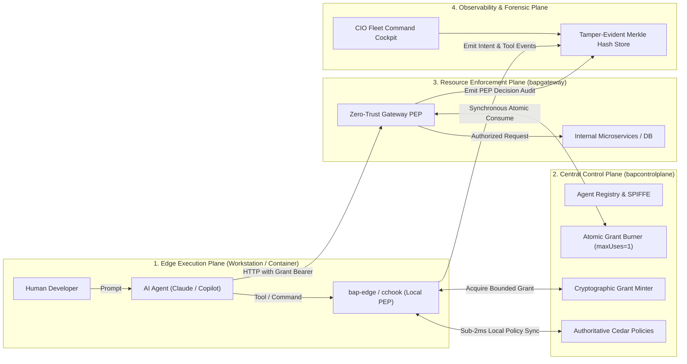

# 🛡️ Bounded Authority Plane (BAP)

### Identity, Zero Standing Privilege, and Runtime Authorization for AI Agents

> **"The human requested the work. The agent performed the action. The enterprise must be able to independently prove both, bound the blast radius to zero, and guarantee that intent is never mistaken for authority."**

BAP is an open reference architecture and implementation for governing AI agents (Claude Code, GitHub Copilot CLI, autonomous worker scripts, and MCP toolchains) that execute commands, touch source files, call APIs, and access enterprise resources.

📖 **Core Documentation Links:**
- [🚀 5-Minute Developer Onboarding Guide (`docs/ONBOARDING.md`)](docs/ONBOARDING.md) — Single-click user-mode setup for Claude Code, Antigravity, Copilot, Cursor & Python.
- [📰 Launch Blog & Announcement (`docs/BLOG_LAUNCH_ANNOUNCEMENT.md`)](docs/BLOG_LAUNCH_ANNOUNCEMENT.md) — Why Autonomous AI Coding Agents Demand a Bounded Authority Plane.
- [📋 Enterprise Pilot Runbook & Evaluation Protocol (`docs/PILOT_RUNBOOK.md`)](docs/PILOT_RUNBOOK.md) — 30-Day implementation guide for CISOs, Platform Engineering & DevLeads.
- [🛡️ Security Assurance & Enterprise FAQ (`docs/FAQ_AND_SECURITY_ASSURANCE.md`)](docs/FAQ_AND_SECURITY_ASSURANCE.md) — Privacy, zero code exfiltration, compliance, and threat mitigation.
- [🏢 Enterprise Fleet Deployment (`docs/ENTERPRISE_DEPLOYMENT.md`)](docs/ENTERPRISE_DEPLOYMENT.md) — IT Admin guide for Intune, Jamf, GPO, and Ansible rollouts.
- [🐍 Python Agent SDK Guide (`docs/PYTHON_SDK_GUIDE.md`)](docs/PYTHON_SDK_GUIDE.md) — Zero-dependency governance client for custom Python autonomous agents.
- [🌟 Strategic Vision Document (`VISION.md`)](VISION.md) — The executive problem statement, the AI agent crisis, and strategic North Star.
- [🏛️ Architecture & Technical Design (`ARCHITECTURE.md`)](ARCHITECTURE.md) — Complete 4-Plane technical architecture, state machines, and threat mitigations.
- [📁 `.bapstate` Architecture & Troubleshooting (`docs/BAPSTATE_AND_TROUBLESHOOTING.md`)](docs/BAPSTATE_AND_TROUBLESHOOTING.md) — Unified state directory, command operations, and troubleshooting playbooks.
- [📋 Jira Backlog & Stories (`JIRA_Stories.md`)](JIRA_Stories.md) — Complete epics, user stories, and delivery boards (BAP-100 through BAP-743).
- [🔒 Security Assurance Program: BAP-700 Series (`docs/adr/ADR-004-IAM-Federation-And-Fallback.md`)](docs/adr/ADR-004-IAM-Federation-And-Fallback.md) — Enterprise Trust, Containment, Evidence, and Risk-Based Acceleration (BAP-701 to BAP-743).
- [🧪 10-Point Adversarial Test Matrix (`tests/test_bounded_authority_matrix.py`)](tests/test_bounded_authority_matrix.py) — 100% automated regression matrix.
- [🎯 Adversarial Red-Team Test Suite (`tests/test_bap714_containment_redteam.py`)](tests/test_bap714_containment_redteam.py) — Automated escape validation across 5 attack vectors.

---

## ⚡ Quickstart (Zero-Privilege User-Mode Install)

Install BAP via pip or directly using pure Python:

```bash
# 1. Install via PyPI
pip install bap-ltd

# 2. Run single-click user-mode installer (No admin / UAC required)
bap install

# 3. Verify workstation health with pre-flight doctor
bap doctor

# 4. Launch developer cockpit & verify governed agents
bap launch
```

Or execute without package installation:
```bash
python scripts/bap_install.py
python scripts/bap_doctor.py
python scripts/bap_launch.py
```

---

## 🏛️ The Five Architectural Invariants (Baseline Core)

These foundational invariants define the non-negotiable security boundaries of BAP:

> **I1 — Intent is context, never authority.**  
> An agent declaring intent to "update customer 123" does not grant executable privilege to write, cancel, or modify resources. Intent provides context for policy evaluation and audit evidence, never executable permission.

> **I2 — `bap-edge` determines what authority an agent may obtain; it is not assumed to execute every resulting operation.**  
> `bap-edge` evaluates local policy and broker requests, but cannot be assumed to observe or execute every downstream HTTP/RPC call. Local intent or policy approval alone is never proof that an actual operation was authorized.

> **I3 — Actual protected operations are independently enforced at a resource-side PEP against bounded authority.**  
> Business APIs and microservices are protected by gateway Policy Enforcement Points (PEP) that derive actual actions from trusted request characteristics (HTTP method, route, parameters), validating bounded cryptographically signed grants.

> **I4 — Control Plane owns master policy, lifecycle, and centralized state; ordinary authorization must not unnecessarily depend on a synchronous Control Plane round-trip.**  
> The Control Plane distributes signed, immutable policy bundles. High-throughput edge decisions evaluate locally cached policies in sub-2ms; only operations requiring mutable state (e.g. single-use atomic consumption) hit central state.

> **I5 — Observability establishes causality and evidence across Runtime → Authority → PEP → Execution, but telemetry itself is never treated as authorization.**  
> The Observability Plane reconstructs the end-to-end timeline for forensic integrity, but telemetry reporting or health signals never substitute for cryptographic authorization tokens.

### 🛡️ Four Architecture Rules (Operations & Governance Baseline)

> **R1 — Proposals are immutable.** Correction creates lineage (`parent_proposal_id`), never mutation of existing proposals.  
> **R2 — Humans remediate inputs, never override decisions.** Changed input goes through full policy governance again. No human operator overrides authorization outcomes directly.  
> **R3 — Authorization does not prove execution.** PEP authorization and actual backend completion are separately evidenced. If network failure occurs post-authorization, state is marked `UNKNOWN` and reconciled; authorization is never assumed to be execution.  
> **R4 — Operating the governance system is itself governed.** Administrative privilege must never become the back door around bounded authority. BAP governs BAP.

**Extended Governance Chain:**
$$\text{Task} \longrightarrow \text{Intent Context} \longrightarrow \text{Action Proposal} \longrightarrow \text{Policy Decision} \longrightarrow \text{Bounded Grant} \longrightarrow \text{Gateway PEP} \longrightarrow \text{Execution} \longrightarrow \text{Evidence}$$

---

## 🧪 The 10-Point Architectural Adversarial Matrix

Every pull request and security enhancement must pass the 10 adversarial scenarios:

```text
Can a compromised or misbehaving agent:
 1. Claim a different intent?                             --> BLOCKED (I1)
 2. Modify its requested authority?                       --> BLOCKED (I3, HMAC Signature)
 3. Use a grant against another resource?                 --> BLOCKED (I3, Path Derivation)
 4. Perform an additional operation (Header Spoofing)?    --> BLOCKED (I3, deriveOperation)
 5. Reuse or over-consume a constrained grant?            --> BLOCKED (I4, Atomic Burn)
 6. Execute operations concurrently to bypass limits?     --> BLOCKED (I4, Mutex Lock)
 7. Bypass bap-edge (Tampering with policies/assets)?     --> BLOCKED (I2, Interceptor Gate)
 8. Bypass Gateway PEP (Direct unauthenticated access)?   --> BLOCKED (I3, 401 Rogue Drop)
 9. Exploit unknown or ambiguous prompts?                 --> BLOCKED (I1, UNKNOWN Safe Fallback)
10. Forge the historical audit trail?                     --> BLOCKED (I5, Merkle Hash Chain)
```

### Run the Full Matrix in 1 Second:
```powershell
python -m unittest tests/test_bounded_authority_matrix.py -v
```

---

## 🚀 System Topology: The Four Operating Planes

BAP decomposes AI agent governance into four decoupled, resilient planes:



1. **Control Plane (`bapcontrolplane`):** Authoritative Cedar policy master, SPIFFE SVID workload identity issuance, ephemeral bounded grant minting, and atomic single-use state burning.
2. **Edge Execution Broker (`bapedge` / `cchook` / `copilot`):** Embeds pure-Go AWS Cedar engine for **sub-2ms local evaluation**, enforces command containment, and deterministically classifies mission intent into 11 CIO categories.
3. **Gateway PEP (`bapgateway`):** Independent zero-trust boundary in front of business APIs. Autonomously derives required operations (`deriveOperation`) from HTTP attributes, rejects spoofed headers, and burns single-use grants.
4. **Observability Plane:** Cryptographically links `Intent -> Authority -> PEP -> Execution` into a SHA-256 Merkle chain and visualizes live fleet health on the CIO Cockpit.

---

## ⚡ Quickstart & Interactive Testing

### 🚀 Governed Agent Launchers (Production 1-Click Runtimes)

BAP provides dedicated zero-trust launchers for all major developer coding assistants, with automatic workspace policy mounting, liveness monitoring, token telemetry, and clean teardown:

| Launcher Script | Agent Runtime | Capabilities & Zero-Trust Governance |
| :--- | :--- | :--- |
| [`run_claude_bap.bat`](file:///c:/Users/User/pyprj/bapltd/run_claude_bap.bat) | **Claude Code CLI** | Multi-instance concurrency, reference-counted custody locks, transactional `settings.json` backup/restore, `cchook/interceptor.exe` hook integration. |
| [`run_antigravity_ide_bap.bat`](file:///c:/Users/User/pyprj/bapltd/run_antigravity_ide_bap.bat) | **Google Antigravity (IDE)** | Electron GUI process supervision (prevents premature exit), holds session active in Control Plane, live high-speed `transcript.jsonl` streaming, `GEMINI.md` policy and MCP injection. |
| [`run_antigravity_cli_bap.bat`](file:///c:/Users/User/pyprj/bapltd/run_antigravity_cli_bap.bat) | **Google Antigravity (CLI)** | Transactional CLI execution (`agy.exe`) under full BAP workspace and command containment. |
| [`run_copilot_cli_bap.bat`](file:///c:/Users/User/pyprj/bapltd/run_copilot_cli_bap.bat) | **GitHub Copilot CLI** | Prioritizes standalone `copilot.exe` (v1.0.97+) with `gh copilot` fallback, live `events.jsonl` telemetry tailing, `AGENTS.md` and MCP server injection, exit token & credit accounting snapshot. |
| [`run_agent_demo.bat`](file:///c:/Users/User/pyprj/bapltd/run_agent_demo.bat) | **Multi-Agent Fleet Demo** | Interactive squad demo (Python SDK + Claude Code) with dynamic scaling and live Cockpit radar validation. |

---

### Option 1: Automated Regression & End-to-End Suites
```powershell
# Run complete test discovery across all 79 unit, integration & E2E tests
python -m unittest discover tests

# Run 10-stage End-to-End (E2E) Full Mission Lifecycle Suite
python -m unittest tests/test_e2e_full_lifecycle.py -v

# Run End-to-End (E2E) Adversarial & Negative Security Hardening Suite
python -m unittest tests/test_e2e_adversarial_hardening.py -v

# Run 10-point architectural adversarial test matrix
python -m unittest tests/test_bounded_authority_matrix.py -v

# Run Cedar Policy Studio & "What-If" historical replay suite
python -m unittest tests/test_cedar_policy_studio.py -v

# Run full sole-executor & process containment suite
python -m unittest tests/test_bap200_sole_executor.py -v
```

### Option 2: Live Gateway PEP & Atomic Single-Use Testing

**1. Start Control Plane & Gateway PEP:**
```powershell
# Terminal 1: Control Plane
.\dist\windows-amd64\bapcontrolplane.exe -port 8080 -secret "matrix-test-signing-key-32-chars-long-ok!" -admin-token "test-admin-secret-12345" -db memory

# Terminal 2: Gateway PEP
.\dist\windows-amd64\bapgateway.exe -port 8090 -controlplane http://127.0.0.1:8080 -secret "matrix-test-signing-key-32-chars-long-ok!" -consume=true
```

**2. Test Rogue Agent Rejection (Direct Bypass Attempt):**
```powershell
curl.exe -i http://127.0.0.1:8090/api/v1/financial-records
# Output: HTTP 401 Unauthorized (AccessDenied: Rogue agent lacking BAP Bearer Grant)
```

**3. Test Header Spoofing Rejection:**
```powershell
curl.exe -i -X POST http://127.0.0.1:8090/api/v1/financial-records -H "X-Agent-Action: financial.records.read"
# Output: HTTP 401 Unauthorized (Gateway derives 'financial.records.write' and ignores header)
```

**4. Test Anti-Tampering of Policy Assets:**
```powershell
echo '{"hook_event_name":"PreToolUse","tool_name":"Write","tool_input":{"file_path":"policy.cedar"}}' | .\dist\windows-amd64\interceptor.exe
# Output: permissionDecision: "deny" (Security Invariant Violation: Direct modification of BAP protected asset forbidden)
```

---

## 🛡️ Epic 23: Layered Endpoint Enforcement & Workstation Hardening

BAP enforces defense-in-depth across developer workstations using an authoritative 5-layer security model:

```
┌────────────────────────────────────────────────────────────────────────┐
│  LAYER 1: Cooperative Agent Hooks & Rules (User Space)                 │
│  - Claude Code PreToolUse hooks, Antigravity/Copilot workspace rules   │
│  - MDM locks: managed-settings.json (dangerouslySkipPermissions: false)│
│  - UX benefit: Sub-millisecond evaluation (<1ms), native in-CLI hints  │
└──────────────────────────────────┬─────────────────────────────────────┘
                                   │ (Structured Tool Call Boundary)
                                   ▼
┌────────────────────────────────────────────────────────────────────────┐
│  LAYER 2: Model Context Protocol (MCP) Authority Boundary              │
│  - Managed bapmcp.exe server with Cedar policy evaluation              │
│  - Governed bap_execute, bap_status, bap_explain_policy tools          │
└──────────────────────────────────┬─────────────────────────────────────┘
                                   │ (Unmediated Terminal & Tool Call Trap)
                                   ▼
┌────────────────────────────────────────────────────────────────────────┐
│  LAYER 3: Tool Call & Terminal Interceptor Shims (PATH Defense)        │
│  - Dynamic per-session shims (.bapstate/shims-$SessionId/)             │
│  - Traps raw CLI calls (git, python, curl) and routes to bapedge exec  │
└──────────────────────────────────┬─────────────────────────────────────┘
                                   │ (Host Process & Sandbox Containment)
                                   ▼
┌────────────────────────────────────────────────────────────────────────┐
│  LAYER 4: OS Execution & Boundary Control (Kernel / Hypervisor)        │
│  - Windows Restricted Tokens (LUA) + Job Objects (Kill-on-Close)       │
│  - Linux Landlock LSM (Filesystem Jail) + eBPF sys_enter_execve probe  │
│  - macOS Endpoint Security (AUTH_EXEC, AUTH_OPEN) + Seatbelt profiles  │
│  - Blocks hidden child subshells and theft of .env / id_rsa secrets    │
└──────────────────────────────────┬─────────────────────────────────────┘
                                   │ (Perimeter Egress Pinning & ZSP Grant)
                                   ▼
┌────────────────────────────────────────────────────────────────────────┐
│  LAYER 5: Authoritative Network Gateway PEP (Perimeter Backstop)       │
│  - bapgateway Envoy ext_authz proxy with authoritative derivation      │
│  - Single-use Zero-Trust Session Protocol (ZSP) grant burning          │
│  - Direct egress dropped; all enterprise API traffic pinned to PEP     │
└────────────────────────────────────────────────────────────────────────┘
```

### 📋 Step-by-Step Endpoint Testing Guide

You can test and verify all Layered Endpoint Hardening features step by step using any of the three methods below:

#### Option 1: Automated Integration Test Suite (Fastest)
Run the dedicated Epic 23 test suite to validate all 7 verification gates:
```powershell
python -m unittest tests/test_endpoint_layered_enforcement.py
```
**Verification Evidence:**
- `test_01_endpoint_layers_reference`: Verifies the 5-layer defense primitive mappings across Windows, macOS, and Linux.
- `test_02_endpoint_compliance_managed_clean`: Verifies managed laptop with active defense layers achieves `COMPLIANT` status.
- `test_03_endpoint_compliance_managed_quarantine`: Verifies missing Layer 4 (Kernel Control) or Layer 5 (Gateway PEP) immediately triggers `QUARANTINED`.
- `test_04_endpoint_compliance_byod_cooperative`: Verifies unmanaged BYOD operates in `COOPERATIVE_BYOD` with Gateway PEP backstop.
- `test_05_mdm_profile_generation_intune_and_jamf`: Validates Intune CSP and Jamf mobileconfig payloads.
- `test_06_biometric_step_up_challenge_and_verification`: Initiates challenge, verifies biometric attestation, mints signed `StepUpToken`, and verifies replay rejection.
- `test_07_offline_capability_classification`: Verifies Tier 1 (Safe Local Dev) is permitted offline while Tier 2 (Cloud Egress) fails closed.

---

#### Option 2: Step-by-Step Verification via REST API (`curl.exe`)

Start the Control Plane in Terminal 1:
```powershell
.\dist\windows-amd64\bapcontrolplane.exe -port 8080 -admin-token "test-admin-token-12345" -allow-remote-admin
```

In Terminal 2, run each step-by-step verification:

**Step 2.1: Inspect 5-Layer Mappings per OS:**
```powershell
curl.exe -s http://127.0.0.1:8080/api/v1/endpoint/layers?os=windows | ConvertFrom-Json
curl.exe -s http://127.0.0.1:8080/api/v1/endpoint/layers?os=darwin | ConvertFrom-Json
curl.exe -s http://127.0.0.1:8080/api/v1/endpoint/layers?os=linux | ConvertFrom-Json
```

**Step 2.2: Evaluate Managed Device Compliance & Quarantine:**
```powershell
# Non-compliant device (Missing Layer B Kernel Control):
curl.exe -s -X POST http://127.0.0.1:8080/api/v1/endpoint/compliance `
  -H "Content-Type: application/json" `
  -d '{"hostname":"rogue-laptop","agent_id":"agent-1","is_managed_fleet":true,"layers":[{"layer_id":"LAYER_A_COOPERATIVE_HOOKS","active":true,"enforcing":true},{"layer_id":"LAYER_B_KERNEL_EXECUTION_CONTROL","active":false,"enforcing":false},{"layer_id":"LAYER_C_NETWORK_EGRESS_PINNING","active":true,"enforcing":true}]}'
# Result: "compliance_state": "QUARANTINED"
```

**Step 2.3: Generate Enterprise MDM Profiles (Intune & Jamf):**
```powershell
# Microsoft Intune (Windows CSP / JSON payload):
curl.exe -s http://127.0.0.1:8080/api/v1/endpoint/mdm/profile?platform=windows | ConvertFrom-Json

# Jamf Pro (macOS configuration profile):
curl.exe -s http://127.0.0.1:8080/api/v1/endpoint/mdm/profile?platform=macos | ConvertFrom-Json
```

**Step 2.4: Test Interactive Biometric Step-Up Elevation:**
```powershell
# 1. Request Step-Up challenge for high-risk action:
$chal = curl.exe -s -X POST http://127.0.0.1:8080/api/v1/endpoint/stepup/challenge `
  -H "Content-Type: application/json" `
  -d '{"agent_id":"agent-007","operation":"database.schema_migration","risk_score":0.85}' | ConvertFrom-Json

# 2. Verify biometric signature and mint StepUpToken:
curl.exe -s -X POST http://127.0.0.1:8080/api/v1/endpoint/stepup/verify `
  -H "Content-Type: application/json" `
  -d "{`"challenge_id`":`"$($chal.challenge_id)`",`"method`":`"WINDOWS_HELLO`",`"biometric_signature`":`"valid-fingerprint-sig`"}"
```

**Step 2.5: Test Scoped Offline Capability Classification:**
```powershell
# Safe local command -> Tier 1 (Allowed offline):
curl.exe -s -X POST http://127.0.0.1:8080/api/v1/endpoint/offline/classify `
  -H "Content-Type: application/json" `
  -d '{"operation":"pytest tests/unit"}'

# Enterprise microservice egress -> Tier 2 (Fails closed offline):
curl.exe -s -X POST http://127.0.0.1:8080/api/v1/endpoint/offline/classify `
  -H "Content-Type: application/json" `
  -d '{"operation":"POST /api/v1/core-banking/transfer"}'
```

---

#### Option 3: Visual Verification in Web Dashboard Cockpit
1. Launch the interactive cockpit:
   ```powershell
   .\run_vision_demo.bat --interactive
   ```
2. Navigate to **`http://127.0.0.1:8080/dashboard`** in your browser.
3. Click the **"Endpoint Hardening"** tab:
   - **5-Layer Architecture**: Switch OS between Windows, macOS, and Linux to see active primitives.
   - **MDM Configuration Packaging**: Toggle between Microsoft Intune and Jamf Pro to inspect deployment payloads.
   - **Biometric Step-Up Sandbox**: Click **"Initiate Biometric Challenge"** and then **"Touch Biometric Authenticator"** to observe live HMAC token minting and replay rejection.
   - **Scoped Offline Degradation**: Enter any command (`cargo test`, `pytest`, `POST /api/v1/transfer`) to view the instant Tier 1 vs Tier 2 policy verdict.

---

### 9. Operational Resilience, Crash Sweeps & Developer CLI Tooling (Epic 24)

Epic 24 introduces four practical operational capabilities for developer workstations and fleet recovery:

#### 1. 1-Click Developer Setup (`bapedge setup`)
Idempotently configures local agent settings, sets `dangerouslySkipPermissions: false`, and wires the `PreToolUse` hook directly to `bapedge exec`:
```powershell
.\dist\windows-amd64\bapedge.exe setup --app claude-code
```
**Output:**
```text
  [✓] Configured .claude\managed-settings.json
      - dangerouslySkipPermissions: FALSE (Hardened by BAP)
      - pre_tool_use hook:          bapedge exec
  [✓] Configured .bap\config.json
  ✅ Workstation setup complete! Agent execution is bound to Zero-Trust Policy.
```

#### 2. In-Terminal Workstation Inspection (`bapedge status`)
Inspects active local sessions, cached Cedar policy version, 5-layer defense compliance, operating mode, and offline audit spool backlog (with automatic sweep & flush on pending messages):
```powershell
.\dist\windows-amd64\bapedge.exe status
```
**Output:**
```text
  Host:             DESKTOP (windows/amd64)
  Control Plane:    http://localhost:8080 [CONNECTED / ONLINE (1ms)]
  Operating Mode:   STANDALONE USER-SPACE (Degraded: zero admin rights required)
  POLICY BUNDLE & ZERO-TRUST CACHE:
    • Version:        v1
    • Rules Digest:   d70701d094...
    • Kill Switch:    false
  5-LAYER DEFENSE-IN-DEPTH COMPLIANCE STATUS:
    • Layer 1 (Process Interception Hooks):       COMPLIANT (bapedge exec PreToolUse hook wired)
    • Layer 2 (Model Context Protocol MCP):       COMPLIANT (bapmcp server mounted with Cedar policy gate)
    • Layer 3 (Terminal Interceptor Shims):       COMPLIANT (PATH shims active for unmediated subshells)
    • Layer 4 (OS Kernel Boundary Sandbox):       COMPLIANT (Windows Job Objects & Restricted Tokens + Gateway PEP perimeter backstop active)
    • Layer 5 (Network Perimeter Gateway PEP):    COMPLIANT (Authoritative Gateway PEP perimeter backstop active)
  TELEMETRY & OFFLINE RESILIENCE:
    • Auto-Sync:      ⚡ Auto-triggered sweep: 0 pending audit record(s) synced to Control Plane
    • Spool Backlog:  0 pending entries (All audit logs ingested by Control Plane)
```

#### 3. In-Terminal Policy Decision Debugging (`bapedge why`)
Directly explains why any command is allowed or denied under local Cedar policy:
```powershell
# Safe developer action:
.\dist\windows-amd64\bapedge.exe why "git status"
# -> ✅ ALLOWED (Permitted within local workspace development boundaries)

# Dangerous action:
.\dist\windows-amd64\bapedge.exe why "rm -rf /"
# -> ⛔ DENIED (Blocked by Cedar Policy: Default deny invariant)
```

#### 4. Clean Sweep & Crash Recovery Reconciler (`bapedge sweep`)
Recovers from sudden laptop shutoffs, terminal force-kills, or power loss by purging orphaned process markers, releasing stale locks, flushing un-ingested offline audit batches, and synchronizing with the control plane (`/api/v1/control/sweep`):
```powershell
.\dist\windows-amd64\bapedge.exe sweep
```
**Output:**
```text
  [✓] Swept 2 orphaned/crashed local session markers
  [✓] Flushed 0 offline audit records to central tamper-evident ledger
  [✓] Central Control Plane reconciled: 2 idle sessions closed, 1 stale grant expired
  [✓] Workstation successfully rejoined fleet with clean state.
```

#### 5. Bootstrap Discovery Cascade, Fail-Closed Guarantee & Caller Lineage Attestation
- **First-Time Discovery Cascade**: When `bapedge` boots on a new machine without configuration, it cascades through:
  1. `https://bap-controlplane.onrender.com` (with a 30s budget: attempt 1 -> 15s cold-start sleep -> attempt 2).
  2. Local HTTPS `https://localhost:8443` and `https://127.0.0.1:8443`.
  3. Local HTTP `http://localhost:8080` and `http://127.0.0.1:8080`.
- **Fail-Closed Policy Enforcement**: If all control planes fail after the 30s cascade budget AND no `policy.cedar` exists locally, `bapedge` **FAILS CLOSED** with error `ErrNoPolicyAvailable` (`policy.cedar not available`) and refuses to start.
- **Degraded Mode**: If all control planes fail but a local `policy.cedar` exists on disk, `bapedge` enters Degraded Mode (strictly enforcing Cedar policy locally and spooling audit records to `.bapstate/audit.jsonl`).
- **Caller Process Lineage Attestation**: `bapedge` is stateless. The calling agent (`a.exe`, `claude.exe`, `antigravity.exe`, `copilot.exe`) originates state. Interceptors inspect parent PID via kernel APIs (`QueryFullProcessImageNameW`), calculate SHA-256 hashes of the executable binary, derive the `AppID`, and seal this lineage directly into the cryptographic `ExecutionReceipt`.
```

---

### 10. Agent Watch Persona Control Plane & Canonical Activity Engine (Epic 28)

Epic 28 transforms the administrative console into a persona-driven governance experience supporting four enterprise lenses over a unified zero-trust data model:

```text
             HookWatch (Interceptors)
                       │
             Agent Runtime (bapedge)
                       │
                       ▼
             AgentActivityEvent
                       │
             ┌─────────┼─────────┐
             │         │         │
           Intent    Policy     ZSP
             │         │         │
             └─────────┼─────────┘
                       ▼
             Activity / Evidence API
                       │
          ┌────────────┼────────────┐
          │            │            │
         CIO          CISO       ProdOps
          │                         │
          └─────── IT Enablement ───┘
```

#### 1. Persona Control Plane Switching (`?persona=cio|ciso|ops|it`)
- **CIO / Business**: AI Workforce Pulse, work category distributions, business-unit adoption, and governance efficiency.
- **CISO / Security**: Invariant violations, quarantine controls, blast-radius mitigation, and intent deviation detection.
- **Prod Ops / SRE**: Fleet telemetry, interceptor health, local evaluation latencies, and grant issuance rates.
- **IT Enablement**: Managed catalog deployment, endpoint compliance (Layers 1–5), and MDM packaging.

#### 2. CIO AI Workforce Pulse & Live Activity Stream
- High-level executive pulse: Communicates active governed scale without fabricated ROI claims.
- **Live Work Stream**: Real-time SSE streaming (`/api/activity/stream`) of sanitized activity records.
- **Intent Mix & Sub-Intent Drill-Down**: Categorizes work across `Build / Change`, `Investigate / Diagnose`, `Search / Explain`, `Automate Workflow`, and `Business Analysis`.
- **Pure Live vs Demo Simulation**: Production defaults to pure live unsimulated telemetry (zero-state when no agents connected); demo prototype dataset (1,284 agents) is activated via `-demo-mode` or `?demo=true`.

#### 3. Enterprise Activity Topology Map
- Hierarchical organizational tree (`/api/activity/topology`) mapping Divisions, Teams/Workloads, and Agent Platforms (Claude Code, Copilot, Codex, Internal CLI).
- Interactive node filtering updates live session streams in real time.

#### 4. Intent $\rightarrow$ Action Lifecycle Contract
- Cryptographically tracks the 8-stage execution chain:
  $$\text{Human Intent} \to \text{Interpretation} \to \text{Plan} \to \text{Capability} \to \text{Policy Gate} \to \text{ZSP Grant} \to \text{Observed Action} \to \text{Outcome}$$
- Automated **Critical Intent Deviation Detection**: Blocks side-effects when an agent performs actions inconsistent with declared human purpose (e.g. `PRODUCTION_DIAGNOSIS` attempting customer database modifications).

---

### 11. Beyond-Hook Enforcement, Daemon Supervision & Content Pinning (Epic 29)

Epic 29 elevates BAP beyond cooperative hooks and MCP wrappers into operating-system-level zero-trust enforcement, addressing multi-tenant prompt injection, hidden child processes, and dynamic skill drift:

#### 1. Background Supervisor & Two-Tier Execution (`bapedge daemon`)
Manages `bap-daemon`, a local background supervisor with dynamic loopback HTTP IPC (`127.0.0.1:<port>`), sub-2ms telemetry ingestion, automatic background spool flushing, and attached agent session tracking:
- **Degraded Mode (Standard Non-Elevated User)**: Automatically detects when running without administrator / root rights (`TokenElevation` on Windows, `UID != 0` on Unix). Disarms kernel eBPF probes and driver packet filtering while maintaining robust user-mode containment (Windows Job Objects / Landlock, IPC hub, and background spooling). **Zero admin rights required.**
- **Optimal Mode (Elevated Administrator / Root)**: Activates full OS-level telemetry and kernel probes.

```powershell
# Start daemon in background (detached process)
.\bapedge.exe daemon start

# Start in foreground for interactive log monitoring
.\bapedge.exe daemon start -foreground

# Query capability matrix, connected control plane, and IPC message throughput
.\bapedge.exe daemon status

# Output status in machine-readable JSON
.\bapedge.exe daemon status -json

# Stop daemon cleanly
.\bapedge.exe daemon stop
```

#### 2. Content Pinning & Dynamic Tool Attestation (`bapedge pin` — AIR Model)
Implements the AI Incident Response (AIR Model - BAP-531) core insight: an agent approved under an initial skill definition or prompt must never execute if the underlying file (`SKILL.md`), prompt template (`CLAUDE.md`), or MCP schema changes on disk without explicit re-attestation:
- **Fail-Closed on Drift**: If an attacker or dynamic prompt injection modifies a skill's `SKILL.md` or an MCP tool schema, `bapedge exec` and `bapedge mcp` immediately fail closed with `HashMismatchError`, revoking active grants and blocking execution.
- **Tamper-Evident Receipts**: The validated `ContentHash` is recorded directly inside `AuditEntry` and chained into BAP's sequential SHA-256 cryptographic ledger.

```powershell
# Auto-discover and pin workspace skills, prompt templates, and manifests
.\bapedge.exe pin scan

# List pinned assets with SHA-256 digests and attestation metadata
.\bapedge.exe pin list

# Re-verify all pinned assets against disk state (alerts on drift)
.\bapedge.exe pin verify

# Pin an individual custom skill, prompt, or script
.\bapedge.exe pin add .claude/skills/deploy/SKILL.md --id skill:deploy

# Re-attest and update hash after human approval of intentional modifications
.\bapedge.exe pin update skill:deploy

# Re-attest all pinned assets across the workspace
.\bapedge.exe pin update --all
```

#### 3. Intelligent Auto-Sweep & Concurrency Guard
- `bapedge status` automatically detects pending offline audit entries in `.bapstate/audit.jsonl` and triggers an immediate sweep & flush to the control plane.
- **Concurrency Guard**: If `bap-daemon` or another `bap-edge` executor is actively running and responsive, `bapedge status` defers the sync so as not to contend with active spooling—unless that instance is dead or unresponsive, in which case it performs crash recovery.

#### 4. Robust AST Command Parsing & Canonical Symlink Resolution (BAP-533)
Standard string-splitting and regex decomposers are notoriously susceptible to command obfuscation, subshell embedding, directory traversal, and symlink evasion. `bap-edge` incorporates a pure Go shell grammar AST tokenizer and canonical path resolver:
- **Compound Pipeline Decomposition**: Parses operators (`&&`, `||`, `;`, `&`, `|`) into distinct atomic execution nodes.
- **Recursive Subshell Parsing**: Automatically extracts and evaluates embedded command substitutions (`$(curl ...)` and `` `...` ``) before any command runs.
- **Canonical Symlink Resolution**: Resolves all path arguments and I/O redirection targets (`>`, `>>`, `<`) via `filepath.Clean` and `filepath.EvalSymlinks` to their real filesystem destinations. Accessing sensitive files (`.env`, `~/.ssh`, `~/.aws`, `/etc/shadow`) through symlinks or relative traversal (`/app/subdir/../.env`) is evaluated against the target path and blocked.
- **Fail-Closed Pipeline Gating**: In compound pipelines (e.g. `git status && curl untrusted.site`), each node is evaluated independently against Cedar policy. If **any** sub-command, subshell, or redirected path violates security policy, the entire pipeline is denied immediately—preventing execution of any part of the command.

#### 5. Process-Level Supervision & Child Ancestry Tracking (BAP-534)
Subprocesses spawned by permitted parent commands (e.g., `npm`, `make`, `python`) are cryptographically and structurally governed:
- **Cryptographic Ancestry**: Every tool execution records complete process ancestry (`parent:<pid>`, `broker:<pid>`, `child:<pid>`) inside `ExecutionReceipt` and audit log entries.
- **Windows Job Object Containment**: Child processes are assigned to a Windows Job Object with `JOB_OBJECT_LIMIT_KILL_ON_JOB_CLOSE`, ensuring any unapproved child processes cannot outlive or escape the broker's process boundary.

#### 6. Ambient Credential Shielding & Secret Redaction (BAP-535)
Protects standing developer secrets from ambient exposure and exfiltration:
- **Ambient Secret Stripping**: All child processes executed under `bapedge exec` or launcher sessions have standing credentials scrubbed from the environment (`AWS_*`, `GITHUB_*`, `OPENAI_*`, `ANTHROPIC_*`, `SLACK_*`, `AZURE_*`, and sensitive suffixes `*_TOKEN`, `*_KEY`, `*_SECRET`, `*_PASSWORD`).
- **Output Stream Redaction**: Detects and redacts private keys (`BEGIN ... PRIVATE KEY`), AWS access keys (`AKIA...`), GitHub tokens (`ghp_...`), OpenAI keys (`sk-...`), and Bearer JWT tokens in stdout/stderr with `[BAP_REDACTED_*]` tags.

#### 7. Incident Forensics & Automated Snapshot Rollback (BAP-538)
Provides point-in-time recovery for files modified during agent execution:
- **Pre-Execution Checkpointing**: Files targeted by mutating commands or file redirection (`>`, `>>`) are automatically captured into `.bapstate/snapshots/<sessionID>/<ckptID>/` with SHA-256 hashes before execution occurs.
- **1-Click Rollback CLI**:
  ```powershell
  # List checkpoints for a session
  .\bapedge.exe rollback --session-id <session_id> --list --json

  # Rollback a specific file or the entire session to safe baseline
  .\bapedge.exe rollback --session-id <session_id> --file <target_file> --json
  ```

---

### 12. Unified CLI UX, Binary Consistency & Service Lifecycle (Epic 30 — `BAP-547`)

BAP provides an identical, cohesive command-line interface across all four production binaries (`bapedge`, `bapcontrolplane`, `bapgateway`, `bapmcp`):

#### 1. Universal Command Matrix

| Subcommand | `bapedge` | `bapcontrolplane` | `bapgateway` | `bapmcp` | Description |
|---|:---:|:---:|:---:|:---:|---|
| `start` | ✅ | ✅ | ✅ | — | Start component server / supervisor (supports `--detach` / `-d`, `--port`) |
| `stop` | ✅ | ✅ | ✅ | — | Gracefully terminate running instance and cleanup PID files |
| `status` | ✅ | ✅ | ✅ | ✅ | Query health, active port, uptime, and database persistence |
| `restart` | ✅ | ✅ | ✅ | — | Atomic restart (`stop` $\to$ wait $\to$ `start`) |
| `enable` | ✅ | ✅ | ✅ | — | Idempotent workstation/service initialization (setup tokens & state) |
| `serve` | ✅ | ✅ | ✅ | ✅ | Explicit foreground server execution alias |
| `trust` | ✅ | — | — | — | Authorize cross-folder mutations (`--session`, `--project`, `--global`) |
| `untrust` | ✅ | — | — | — | Revoke cross-folder mutation authorization |
| `permissions` | ✅ | — | — | — | List all active authorizations across all scopes |
| `rollback` | ✅ | — | — | — | Forensically revert file mutations to pre-execution checkpoints |
| `pin` | ✅ | — | — | — | Cryptographically pin, verify, and re-attest skills, prompts & tools |
| `why` | ✅ | — | — | — | Instant terminal explanation of Cedar policy decisions |
| `dev-override` | ✅ | — | — | — | Time-boxed developer override for BAP self-development (developers-only) |
| `exec` / `check` | ✅ | — | — | — | Governed execution / dry-run evaluation under kernel isolation |
| `mcp` | ✅ | — | — | ✅ | Model Context Protocol JSON-RPC stdio server |

#### 2. Building All BAP Binaries
Compile zero-dependency static binaries and deploy across the workspace:
```powershell
# 1. Build Central Control Plane
cd bap-controlplane; go build -o bapcontrolplane.exe ./cmd/server; cd ..

# 2. Build Zero-Trust Gateway PEP
cd bap-gateway; go build -o bapgateway.exe .; cd ..

# 3. Build Edge Local Trusted Daemon (LTD) & MCP Broker
cd bap-edge; go build -o bapedge.exe .; cd ..

# 4. Deploy binaries to workspace root and dist/
powershell -ExecutionPolicy Bypass -File update_binaries.ps1
```

#### 3. Command Line Parameters Reference

##### A. `bapcontrolplane` (Central Policy Authority)
```powershell
# Display help and usage banner (default when no parameters provided)
.\bapcontrolplane.exe

# Start server in foreground
.\bapcontrolplane.exe start --port 8080 --mode dev --db bap-controlplane.db

# Start server as detached background daemon
.\bapcontrolplane.exe start --detach --port 8080

# Query running control plane status, port, uptime, and state stores
.\bapcontrolplane.exe status

# Gracefully terminate running control plane
.\bapcontrolplane.exe stop

# Restart running control plane
.\bapcontrolplane.exe restart --port 8080

# Initialize admin tokens (.bap-admin-token) and state directories
.\bapcontrolplane.exe enable
```

**Common Flags:**
- `--port <p>`: Port for HTTP server (default: `8080` or `$PORT`, `$BAP_PORT`)
- `--detach`, `-d`: Spawn as background process
- `--mode <dev|prod>`: Environment mode (`dev` for open OTC, `prod` for enterprise OIDC)
- `--db <path>`: SQLite database file (default: `bap-controlplane.db`, or `:memory:`)
- `--secret <key>`: HMAC signing secret for JWT grants (or `$BAP_SECRET_KEY`)
- `--admin-token <token>`: Administrative bearer token (persisted in `.bap-admin-token`)
- `--tls`, `--https`: Enable HTTPS with auto-generated dev certificates
- `--policy <path>`: Path to authoritative Cedar policy file

##### B. `bapgateway` (Zero-Trust Policy Enforcement Point - PEP)
```powershell
# Display usage banner
.\bapgateway.exe

# Start Gateway PEP in foreground
.\bapgateway.exe start --port 9090 --controlplane http://localhost:8080

# Start Gateway PEP in background
.\bapgateway.exe start --detach --port 9090

# Query live status and upstream control plane connectivity
.\bapgateway.exe status

# Stop Gateway PEP
.\bapgateway.exe stop

# Restart Gateway PEP
.\bapgateway.exe restart

# Validate upstream connectivity and credentials
.\bapgateway.exe enable
```

**Common Flags:**
- `--port <p>`: Port for Gateway HTTP server (default: `9090` or `$BAP_GATEWAY_PORT`)
- `--detach`, `-d`: Spawn as background process
- `--controlplane <url>`: Central BAP Control Plane base URL (default: `http://localhost:8080`)
- `--secret <key>`: HMAC secret key for offline JWT verification
- `--consume`: Atomically consume single-use grants via control plane (default: `true`)

##### C. `bapedge` (Edge Local Trusted Daemon & Execution Broker)
```powershell
# Service Lifecycle
.\bapedge.exe start [--foreground]   # Start supervisor daemon
.\bapedge.exe stop                   # Stop supervisor daemon
.\bapedge.exe restart                # Restart supervisor daemon
.\bapedge.exe status                 # Inspect active sessions, policy cache, spool
.\bapedge.exe enable                 # 1-click developer setup

# Zero-Trust Governance & HITL Authorization
.\bapedge.exe trust --path <dir> [--scope session|project|global] [--ops write,delete]
.\bapedge.exe untrust --path <dir>
.\bapedge.exe permissions            # List active cross-folder authorizations
.\bapedge.exe why "<command>"        # Explain Cedar policy decision
.\bapedge.exe rollback --checkpoint-id <id> # Forensically restore mutated files

# Cryptographic Content Pinning (AIR Attestation & Agent Scoping)
.\bapedge.exe pin list                      # List pinned assets with AgentScope
.\bapedge.exe pin verify [--scope <agent>]  # Verify skills/prompts for specific agent
.\bapedge.exe pin add <path> [--scope <ag>] # Pin asset with explicit agent scope
.\bapedge.exe pin update <id> [--all]       # Re-attest approved modification
.\bapedge.exe pin unpin <id> [--all]        # Unpin specific asset or all assets
.\bapedge.exe pin clear                     # Clear manifest to start fresh
.\bapedge.exe pin reset                     # Reset & auto-discover workspace assets

# Fleet Resilience, Sweep & Disconnected Sync
.\bapedge.exe sweep [--force]        # Clean dead sessions, purge dead PIDs & shims
.\bapedge.exe sync [--server <url>]  # Sync policy cache & flush offline audit spool

# Governed Execution
.\bapedge.exe exec "<command>"       # Execute under kernel isolation
.\bapedge.exe check "<command>"      # Policy evaluation only (zero side-effects)

# Developer Self-Development Override (Developers-Only Feature)
.\bapedge.exe dev-override status             # Inspect dev-override status & environment gating
.\bapedge.exe dev-override on [--duration 4h] # Suspend BAP asset anti-tampering (max 12h)
.\bapedge.exe dev-override off                # Immediately restore full anti-tampering
```

##### D. `bapmcp` (Model Context Protocol Server)
```powershell
# Interactive mode in terminal: displays MCP onboarding and configuration guide
.\bapmcp.exe

# Start JSON-RPC 2.0 stdio transport (default when spawned by Claude Code / Cursor)
.\bapmcp.exe --stdio

# Query MCP tool configuration and policy status
.\bapmcp.exe status
```

**Exposed MCP Tools:**
- `bap_execute`: Governed shell execution within sandboxed kernel isolation.
- `bap_explain_policy`: Zero-trust Cedar decision query and explanation.
- `bap_status`: Real-time inspection of local sessions, daemon health, and policy cache.

---

### 13. Developer Workflows, Override Modes & Local Configuration

When developing, testing, or compiling BAP itself, developers frequently modify protected assets (e.g. recompiling `interceptor.exe`, `bapedge.exe`, editing policies, or running test harnesses). BAP provides fine-grained mechanisms to support local development workflows without weakening production security.

#### 1. Developer Override (`bapedge dev-override`)
The `dev-override` command grants a time-boxed operational window that suspends anti-tampering invariants on BAP's internal binaries and files:

```powershell
# Check current override status
.\bapedge.exe dev-override status

# Enable developer override for 4 hours (default)
.\bapedge.exe dev-override on

# Enable developer override with custom duration and audit reason
.\bapedge.exe dev-override on --duration 2h --reason "Compiling new interceptor build"

# Immediately disable developer override and restore full enforcement
.\bapedge.exe dev-override off
```

**Security Invariants & Gating Guarantees:**
- **Production Lockdown (Fail-Closed)**: Developer override is strictly prohibited in production and staging environments. It activates **ONLY** if the workspace is explicitly configured in development mode (`"environment": "development"` in `bap-config.json` or `BAP_ENVIRONMENT=development`) and developer features are enabled (`"developer_features": true` or `BAP_DEVELOPER_FEATURES=1`). In unconfigured or production environments, `dev-override on` fails closed with `Feature Locked`.
- **Autonomous Agent Immunity**: AI coding agents (`LTD_SOURCE=claude-code`, `copilot`, `antigravity`, or sessions with `agent`) are structurally blocked from invoking `bapedge dev-override on`. Only interactive human developers can activate the override.
- **Time-Boxed Window**: Automatically expires after the requested duration (capped at a maximum of 12 hours) to prevent indefinite exposure.
- **Narrow Exemption Scope**: Dev override suspends anti-tampering checks *only* on BAP internal files and binaries (`interceptor.exe`, `bapedge.exe`, `policy.cedar`). Enterprise credential files (`.env`, `~/.aws`, `~/.ssh`, private keys) and revocation lists remain **100% strictly enforced**.

#### 2. Audit Mode vs Enforce Mode
BAP supports two operational enforcement modes:
- **`enforce` (Default / Production)**: Commands violating Cedar policies or file invariants are strictly denied (`permissionDecision: "deny"`, exit code 1), and commands are sandboxed with restricted OS tokens.
- **`audit` (Development / Baselining)**: Policy violations and invariant alerts are recorded to the audit log (`[BAP AUDIT MODE] Policy violation detected: ... Execution permitted in audit mode.`), but commands execute without hard termination.

```powershell
# Set enforcement mode locally
.\bapedge.exe config set --mode audit
.\bapedge.exe config set --mode enforce

# Or override via environment variable
$env:BAP_ENFORCEMENT_MODE = "audit"
```

#### 3. Local Configuration Isolation (`git update-index --skip-worktree`)
To customize local developer configurations (such as setting `"enforcement_mode": "audit"` or targeting a local development control plane `http://localhost:8080`) without dirtying git working trees or breaking CI/CD pipelines:

```bash
# Tell Git to ignore local changes to bap-config.json
git update-index --skip-worktree bap-config.json

# To resume tracking changes in Git (e.g. when updating repository defaults)
git update-index --no-skip-worktree bap-config.json
```

---

## 📂 Repository Structure

| Path | Purpose & Capabilities |
|---|---|
| [`bap-controlplane/`](file:///c:/Users/User/pyprj/bapltd/bap-controlplane/) | Central policy master, grant minter, atomic state burner, SQLite Merkle hash chain, and REST APIs. |
| [`bap-gateway/`](file:///c:/Users/User/pyprj/bapltd/bap-gateway/) | Resource-side Zero-Trust Gateway PEP with Envoy/Istio `ext_authz` semantics and `deriveOperation`. |
| [`bap-edge/`](file:///c:/Users/User/pyprj/bapltd/bap-edge/) | Local trusted broker with in-process Cedar engine (<1.5ms), policy cache, and offline fail-secure core. |
| [`cchook/`](file:///c:/Users/User/pyprj/bapltd/cchook/) | Managed Claude Code hooks (`SessionStart`, `UserPromptSubmit`, `PreToolUse`) with offline classifier. |
| [`copilot/`](file:///c:/Users/User/pyprj/bapltd/copilot/) | GitHub Copilot adapter wrapping `bapedge exec` with standard mission context. |
| [`python-agent/`](file:///c:/Users/User/pyprj/bapltd/python-agent/) | BAP Python SDK (`BAPSession`) and sample governed worker agents. |
| [`dist/windows-amd64/`](file:///c:/Users/User/pyprj/bapltd/dist/windows-amd64/) | Precompiled production Go binaries (`bapcontrolplane`, `bapgateway`, `bapedge`, `interceptor`, `copilot-interceptor`). |
| [`tests/`](file:///c:/Users/User/pyprj/bapltd/tests/) | Full test suites: 10-point adversarial matrix, 3,000-agent load tests, 50k perf benchmarks, and executor tests. |

---

## 🎯 One-Sentence Summary

**BAP gives every AI agent its own identity and only the authority it needs, when it needs it, while preserving human delegation and proving evidence across the entire lifecycle.**
