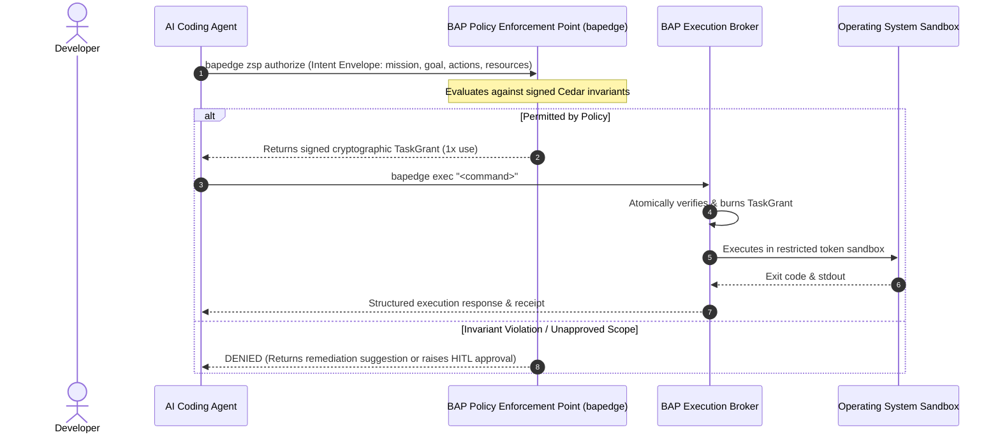

# BAP Zero-Trust: 5-Layer Defense-in-Depth & Policy Protection Architecture

This document provides a comprehensive specification of the **Bounded Authority Plane (BAP) 5-Layer Defense-in-Depth** model, the **Zero Standing Privileges (ZSP) JIT TaskGrant workflow**, and the **anti-tampering mechanisms** that protect policy and instruction files (`GEMINI.md`, `CLAUDE.md`, `AGENTS.md`, `CODEX.md`, `policy.cedar`).

---

## 1. Zero Standing Privileges (ZSP) for AI Coding Agents

In traditional environments, AI coding agents inherit the full permissions of the developer who launched them (ambient authority). If an agent is coerced by prompt injection, an untrusted repository, or hallucination, it can exfiltrate credentials, install malicious dependencies, or tamper with system files.

BAP enforces **Zero Standing Privileges (ZSP)**:
1. **Zero Ambient Write Authority**: An agent starts with zero standing write, execution, or network egress privileges.
2. **Local Read-Only Exemption**: Plain project inspection within the workspace (`git status`, `git log`, `git diff`, directory listings, file viewing, and code searches) is permitted automatically without a task grant (`IsLocalReadOnlyCommand`). This prevents latency and avoids blocking standard developer workflow inspection.
3. **Just-In-Time (JIT) TaskGrants**: Any mutating operation (file edits, builds, git commits, package installations, tests) requires an active, cryptographically signed `TaskGrant`.

### The JIT TaskGrant Authorization Protocol

When an agent needs to perform a mutating action or encounters a `ZeroStandingPrivilegeViolation`:



#### Why `bapedge zsp authorize` is NOT Self-Approval
* Autonomous agents are strictly forbidden from bypassing security or toggling developer overrides (`bapedge dev-override on`).
* `bapedge zsp authorize` is **NOT** a self-approval or override. It is the sanctioned protocol for the agent to declare its intent envelope to the **Policy Enforcement Point (PEP)**.
* The PEP independently evaluates the envelope against immutable Cedar invariants and cryptographic policy bundles before minting a single-use grant.

---

## 2. Multi-Layer Defense-in-Depth: Protecting Policy & Instruction Files

Corporate security policies and LLM system prompt instructions (`GEMINI.md`, `CLAUDE.md`, `AGENTS.md`, `CODEX.md`, `policy.cedar`, `.bap/pins.json`) define the security perimeter of the workspace.

If an attacker, untrusted third-party pull request, prompt injection, or rogue agent attempts to modify, rewrite, delete, or weaken these files, **five independent defense layers** actively protect them:

```text
+-------------------------------------------------------------------------------+
|  LAYER 1: In-Harness Pre-Tool Execution Hooks & Adapters                      |
|  - Intercepts file write/edit tool calls in agent runtime                     |
|  - Hard-blocks any tool write targeting policy, .bap*, or credential paths    |
+-------------------------------------------------------------------------------+
                                      │
                                      ▼
+-------------------------------------------------------------------------------+
|  LAYER 2: Zero-Trust Execution Broker (bapedge exec)                          |
|  - Decomposes all shell commands into canonical (action, resource) pairs       |
|  - Cedar policy invariants reject file redirection/deletion on policy assets  |
+-------------------------------------------------------------------------------+
                                      │
                                      ▼
+-------------------------------------------------------------------------------+
|  LAYER 3: Cryptographic File Integrity Monitoring (FIM & Asset Pinning)       |
|  - SHA-256 cryptographic attestation manifest (.bap/pins.json)                |
|  - Real-time disk attestation on every exec; triggers HashMismatchError fail-closed |
+-------------------------------------------------------------------------------+
                                      │
                                      ▼
+-------------------------------------------------------------------------------+
|  LAYER 4: Anomaly Risk Engine & Threat Correlation                            |
|  - Detects repeated alternative tampering attempts                            |
|  - Escalates session threat level to CRITICAL and emits DENIED_TAMPER alerts  |
+-------------------------------------------------------------------------------+
                                      │
                                      ▼
+-------------------------------------------------------------------------------+
|  LAYER 5: Central Control Plane Attestation & Identity Governance             |
|  - SPIFFE/SVID workstation enrollment verification                            |
|  - Cryptographic policy attestation & automatic remote session revocation     |
+-------------------------------------------------------------------------------+
```

---

### Detailed Layer Breakdown

### Layer 1: In-Harness Pre-Tool Execution Hooks
* **Mechanism**: Native agent plugins (Claude Code PreToolUse hooks, Antigravity MCP interceptors, Copilot language server middleware).
* **Defense**: When an agent attempts to invoke a file writing tool (e.g. `write_file`, `edit_file`, `replace_file_content`) against a protected policy file (`GEMINI.md`, `CLAUDE.md`, `policy.cedar`), the hook intercepts the call before execution and returns an immediate authorization rejection.
* **Failure Mode Handled**: Catches benign hallucinated edits or prompt-injected tool calls directly inside the model's tool loop.

### Layer 2: Zero-Trust Execution Broker (`bapedge exec`)
* **Mechanism**: Every shell command executed in the workspace routes through `bapedge.exe exec`.
* **Defense**: The broker parses the AST of the command, identifying output redirection targets (`echo "hack" > GEMINI.md`), shell mutations (`rm -f CLAUDE.md`, `Remove-Item policy.cedar`), and subshell executions.
* **Cedar Invariants**: Evaluated against Cedar security invariants:
  ```cedar
  // Example invariant: Hard-deny any write/delete targeting policy assets
  forbid (
      principal,
      action in [Action::"fs:file:write", Action::"fs:file:delete"],
      resource in [Resource::"file://GEMINI.md", Resource::"file://CLAUDE.md", Resource::"file://policy.cedar"]
  );
  ```
* **Failure Mode Handled**: Defends against agents using the bash/pwsh terminal to bypass tool hooks.

### Layer 3: Cryptographic File Integrity Monitoring (FIM & Asset Pinning)
* **Mechanism**: All workspace policy files, skills, and configuration templates are cryptographically hashed and pinned into `.bap/pins.json` (or `.bapstate/pins.json`).
* **Attestation on Every Execution**: Before `bapedge exec` allows any command to run, `checkContentPinning` inspects the SHA-256 hash of all pinned files on disk.
* **Fail-Closed Drift Enforcement**:
  - If any policy or instruction file has been modified out-of-band (e.g., via a direct editor, script, or external process), BAP detects the content hash mismatch.
  - Execution is **immediately blocked fail-closed**:
    ```text
    HashMismatchError: instruction/policy file prompt:GEMINI.md on disk has drifted from pinned hash:
    expected sha256:0363190..., got sha256:4d5f97...
    ```
  - Legitimate administrator updates require running `bapedge pin scan` or updating the pinned manifest through verified corporate channels. Primary BAP instruction files containing valid BAP policy headers and broker references undergo automated reconciliation.

### Layer 4: Anomaly Risk Engine & Threat Correlation
* **Mechanism**: Local risk state machine (`risk_state.json`) tracking command denials, alternative attempts, and boundary escape heuristics.
* **Defense**:
  - Tampering attempts generate `DENIED_TAMPER` audit events.
  - If an agent or script tries repeated variations to overwrite policy (e.g., `Set-Content`, `Out-File`, `python -c "open('GEMINI.md','w')"`), the risk engine correlates these as `Repeated alternative attempts detected`.
  - The session threat level escalates to `CRITICAL`, and further autonomous operations are frozen pending human review.

### Layer 5: Central Control Plane & SVID Identity Governance
* **Mechanism**: Central BAP Control Plane with mTLS/OIDC enrollment and SPIFFE/SVID workstation credentials.
* **Defense**:
  - Every execution receipt and audit event is signed and streamed to the append-only control plane ledger.
  - Tampering alerts trigger automated webhook alerts to enterprise SOC/SIEM platforms.
  - Administrators can issue instantaneous session revocations (`bapedge session-end` or `/api/v1/sessions/revoke`), terminating rogue agent sessions fleet-wide.

---

## 3. Developer Overrides vs. Autonomous Agents

| Capability | Autonomous AI Agent | Human Developer |
|---|---|---|
| Request JIT TaskGrant (`bapedge zsp authorize`) | **PERMITTED** (Evaluated by PEP) | **PERMITTED** |
| Execute Governed Command (`bapedge exec`) | **PERMITTED** (With active grant) | **PERMITTED** |
| Developer Override (`bapedge dev-override on`) | **STRICTLY BLOCKED** | **PERMITTED** (Requires interactive terminal & OTP) |
| Inspect Workspace Status (`bapedge status`) | **PERMITTED** | **PERMITTED** |
| Pin Asset Updates (`bapedge pin scan`) | **BLOCKED** | **PERMITTED** |
| Emergency Session Revocation | **BLOCKED** | **PERMITTED** |

---

## 4. Verification and Attestation Commands

To verify workstation health, inspect content pinning, and test policy defenses:

```bash
# 1. Inspect workstation defense status
bapedge status

# 2. Verify all cryptographic asset pins
bapedge pin list

# 3. Re-scan and attest workspace assets (Developer only)
bapedge pin scan

# 4. Dry-run policy check on an operation
bapedge check "git status"
```
