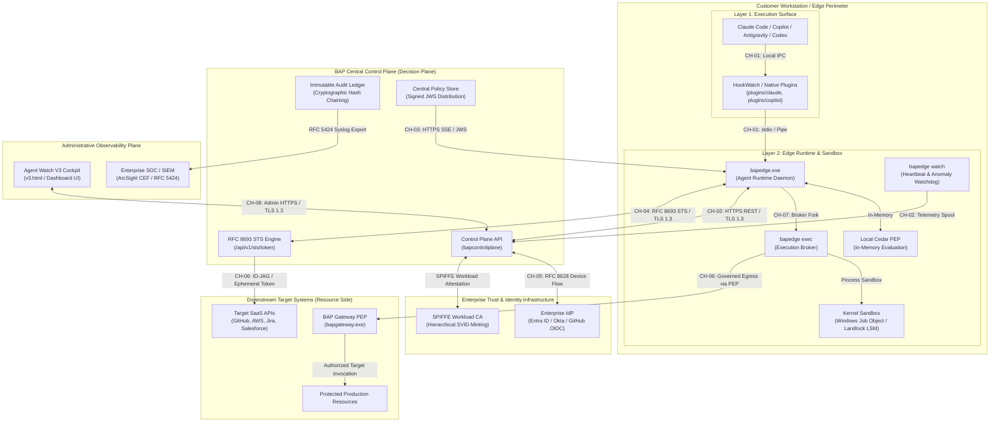
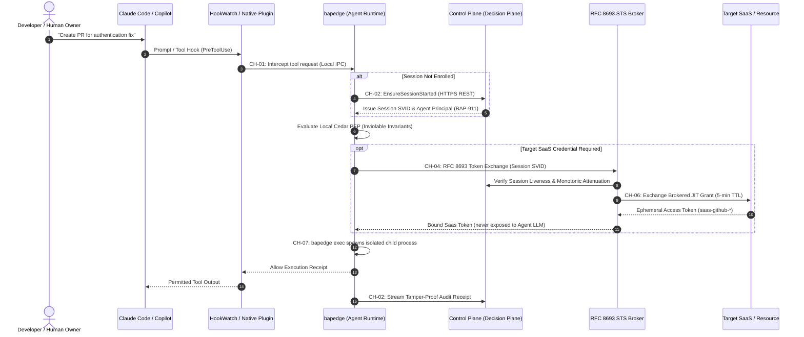

# Complete Network and Control Channel Architecture (BAP-912)

This document formalizes the complete network, communication, and control channel architecture across all subsystems of the **Bounded Authority Plane (BAP)**. It addresses security review requirements by providing verifiable channel topologies, dataflow paths, encryption mechanisms, authentication invariants, failure modes, revocation procedures, and restart semantics.

---

## 1. System Architecture Topology

---

## 2. Channel Communication Sequence Matrix

The following sequence details an agent task execution from declared prompt to target resource access:

---

## 3. Machine-Readable Channel Inventory Summary

| Channel ID | Subsystem Path | Protocol & Auth | Encryption | Failure Mode | Revocation & Restart |
|---|---|---|---|---|---|
| **CH-01** | HookWatch $\rightarrow$ Edge Runtime | Local IPC / Parent PID Verification | OS Memory Isolation | Fail-Closed | Immediate tool denial; re-attest on next lifecycle event. |
| **CH-02** | Edge Runtime $\rightarrow$ Control Plane API | HTTPS REST / Session Token | TLS 1.3 Pinning | Fail-Safe Cached (15-min TTL) | SSE disconnect freezes endpoint; re-verify enrollment. |
| **CH-03** | Control Plane $\rightarrow$ Edge Runtime | Server-Sent Events / JWS Signing | TLS 1.3 + RFC 7515 JWS | Fail-Safe Cached | Instant sub-second kill switch; exponential backoff reconnect. |
| **CH-04** | Edge Runtime $\rightarrow$ STS Token Service | RFC 8693 Token Exchange / SVID | TLS 1.3 | Fail-Closed | Atomic grant burn (`BurnGrantOnce`); re-attest session. |
| **CH-05** | Control Plane $\rightarrow$ Enterprise IdP | RFC 8628 Device Flow / OIDC | TLS 1.3 | Fail-Closed | Central IdP logout propagates kill; re-prompt device flow. |
| **CH-06** | Control Plane STS $\rightarrow$ Target SaaS | HTTPS REST / ID-JAG Exchanged Token | TLS 1.3 | Fail-Closed | Ephemeral grant expires in 300s; target token revoked. |
| **CH-07** | Broker $\rightarrow$ Local Sandbox Process | Windows Job Object / Landlock LSM | Kernel Virtualization | Fail-Closed | SIGKILL process tree; re-evaluate policy on next attempt. |
| **CH-08** | Cockpit UI $\rightarrow$ Control Plane API | HTTPS WebSockets / Admin Token | TLS 1.3 + CORS Origin Guard | Fail-Closed | Immediate session freeze; re-authenticate admin token. |

---

## 4. Architectural Invariants for Security Reviewers

1. **Separation of Decision and Execution**: The Control Plane makes policy decisions and notarizes audit events. It **never** executes commands directly on developer workstations and **never** retains raw customer target secrets.
2. **Zero Standing Privileges (ZSP)**: No long-lived downstream API keys are stored on developer endpoints. Target tokens are minted just-in-time with a maximum 5-minute lifespan and bound strictly to the specific `AgentPrincipal` and `SessionID`.
3. **Fail-Closed by Design**: If an agent attempts an action during a network partition that requires central elevation or approval, execution is strictly halted. Low-risk in-workspace developer actions continue under valid cached local Cedar bundles.
4. **Machine-Readable Audit Trail**: The full inventory is validated against `docs/control_channels.json`.
