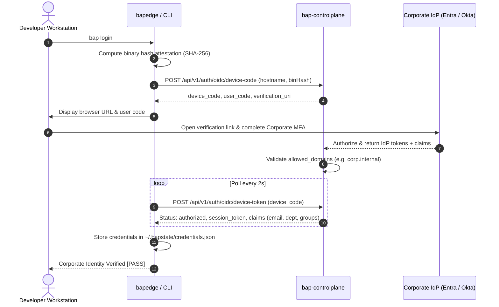

# 🚀 BAP Developer Onboarding & Quickstart Guide
## Zero-Trust Runtime Governance & Corporate Identity for AI Coding Agents

Welcome to the **Bounded Authority Plane (BAP)**. BAP is an enterprise-grade Zero-Trust runtime authorization and identity platform that secures, monitors, and audits autonomous AI coding agents—including **Claude Code**, **Google Antigravity**, **Cursor IDE**, **GitHub Copilot CLI**, and **custom Python agents**—running on developer workstations.

---

## ⚡ The 3-Minute Golden Path

Getting started takes less than 3 minutes and requires **zero administrative privileges** (`no UAC`, `no sudo`):

```bash
# Step 1: Install BAP CLI & auto-configure agent hooks
pip install bap-ltd
bap install

# Step 2: Authenticate via Corporate SSO / MFA (Microsoft Entra ID / Okta)
bap login

# Step 3: Run pre-flight health diagnostics & start coding!
bap doctor
```

---

## 1. Single-Click Installation (Zero-Privilege / User-Mode)

BAP installs directly into your user environment (`%LOCALAPPDATA%\BAP\bin` on Windows, `~/.local/bin` on macOS/Linux) and configures agent hooks automatically without system elevation.

### Option A: Via Python / PyPI (Recommended)
```bash
# 1. Install BAP CLI
pip install bap-ltd

# 2. Run automated user-mode installer
bap install

# 3. Authenticate with corporate identity
bap login

# 4. Run pre-flight health diagnostics
bap doctor
```

### Option B: Direct Script Execution (Without Pip)
```bash
python scripts/bap_install.py
bap login
python scripts/bap_doctor.py
```

### What the Installer Does Automatically
1. **Deploys Binaries** to user directory (`%LOCALAPPDATA%\BAP\bin` or `~/.local/bin`).
2. **Updates User PATH** persistently across shells without triggering UAC elevation or sudo prompts.
3. **Autodetects Installed Agents**:
   - **Claude Code**: Configures `.claude/settings.json` lifecycle hooks and `.claude/mcp.json`.
   - **Google Antigravity**: Configures zero-trust workspace invariants in `GEMINI.md` and registers the BAP MCP server.
   - **Cursor IDE**: Sets up `.cursorrules` and `.cursor/mcp.json` with terminal broker routing.
   - **GitHub Copilot**: Configures VS Code `CopilotSandbox` profile and terminal execution wrappers.
   - **Python SDK**: Links local `bap_sdk` libraries for autonomous Python agents.
4. **Connects to Control Plane**: Connects to the central control plane (`https://bap-controlplane.onrender.com` or your company's private server).
5. **Cryptographic AIR Pinning**: Scans and cryptographically pins workspace prompts (`CLAUDE.md`, `GEMINI.md`, `policy.cedar`) to detect prompt drift or supply-chain poisoning.

---

## 2. Identity Federation & SSO (`bap login`)

All autonomous agent actions in BAP must be cryptographically tied to a verified human developer. BAP implements the **RFC 8628 OAuth 2.0 / OpenID Connect (OIDC) Device Authorization Flow** to deliver seamless, browser-based Single Sign-On (SSO).

Whether you are an individual developer testing on our free hosted community plane (`https://bap-controlplane.onrender.com`) or a large enterprise with private infrastructure, you use the exact same frictionless command:

```bash
bap login
```

---

### 2.1 Free Community & Beta Testers (Google & GitHub Identity / Render.com)

If you are using the free public control plane on Render (`bap-controlplane.onrender.com`), you do **not** need any corporate IT accounts, Microsoft Entra ID, or Okta setup. You can authenticate instantly using your standard **Google Account** or **GitHub Account**:

1. Run `bap login` (optionally specifying `--type laptop`, `--type server`, or `--type desktop`):
```text
===========================================================================
   BAP Identity Provider Federation (RFC 8628 Device Flow)
===========================================================================
 Identity Provider: Community SSO (Google or GitHub) / Enterprise (Entra / Okta)
 To authenticate your local agent session:
   1. Open your browser and navigate to:
      https://bap-controlplane.onrender.com/device
   2. Enter the user code:
      WDJB-7942
   (Direct Link: https://bap-controlplane.onrender.com/device?user_code=WDJB-7942)
===========================================================================
[*] Waiting for browser authorization...
```
2. Click the **Direct Link**. The built-in device portal opens in your browser with your code prefilled.
3. Choose either **Sign in with Google** or **Sign in with GitHub**.
4. Your terminal unlocks instantly:
```text
[✓] Corporate Identity Verified via GitHub Developer Identity
    User Email:   developer@github.com
    Department:   Beta Community
    Workstation:  MY-LAPTOP (Laptop, IP: 192.168.1.45)
    Session ID:   inst-my-laptop-fa31b0
[✓] Enrolled credentials saved to: ~/.bapstate/credentials.json
[✓] Local agent session is now bound to your corporate identity and ready for Cedar governance.
[✓] Background supervisor daemon launched. Workstation is actively monitored in V3 Dashboard.
```

---

### 2.2 Enterprise Deployments (Microsoft Entra ID / Okta)

For enterprise organizations deploying their own private control plane on AWS, Azure, EKS, or on-premise, BAP federates with corporate identity systems:

```text
===========================================================================
   BAP Enterprise Identity Provider Federation (RFC 8628 Device Flow)
===========================================================================
 Corporate IdP: Microsoft Entra ID (MFA Enforced)
 To authenticate your local agent session:
   1. Open your browser and navigate to:
      https://microsoft.com/devicelogin
   2. Enter the user code:
      WDJB-7942
   (Direct Link: https://microsoft.com/devicelogin?user_code=WDJB-7942)
===========================================================================
[*] Waiting for corporate MFA authorization...

[✓] Corporate Identity Verified via Microsoft Entra ID
    User Email:  alice@corp.internal
    Department:  Engineering
    Groups:      [developers, ai-assist-users]
    Session ID:  sess-claude-91ab4e
[✓] Enrolled credentials saved to: ~/.bapstate/credentials.json
[✓] Local agent session is now bound to your corporate identity and ready for Cedar governance.
```

### 2.4 Managing the Background Supervisor Daemon (`bap daemon`)

BAP features a two-tier execution model:
1. **`STANDALONE_USER_SPACE`**: Policy Broker active. Evaluates Cedar policies locally on every command (`bap exec` or MCP `bap_execute`) with **zero admin rights** and **no background processes**.
2. **`ENTERPRISE_MANAGED`**: Background Supervisor Daemon (`bap daemon`) attached. Heartbeats to the central control plane, keeps the workstation live in the V3 dashboard fleet map, and syncs remote freeze/deregistration commands in real time.

You can manage the background supervisor directly using the unified CLI:
```bash
# Check daemon status and operating mode
bap daemon status
# or simply
bap status

# Start supervisor in background (user space, no admin rights required)
bap daemon start

# Stop background supervisor
bap daemon stop
```

---

### 2.5 Workstation Logout & Centralized Governance (`bap logout` & V3 Dashboard)

#### Local Workstation Logout
To cleanly end your authenticated corporate session and deregister your device:
```bash
bap logout
```
This revokes the session token on the central control plane and erases local credentials (`~/.bapstate/credentials.json`).

#### Centralized V3 Fleet Management
Administrators can govern enrolled workstations from the V3 Dashboard (`/dashboard/v3/`):
- **Freeze (Suspend)**: Temporarily suspends workstation execution without deleting local credentials. Shell commands invoked via `bapedge exec` are blocked with `EXECUTION BLOCKED: Workstation is currently FROZEN`.
- **Unfreeze (Restore)**: Resumes active policy enforcement and unblocks execution.
- **Deregister (Logout Device)**: Permanently ends the session and revokes credentials. When the workstation's background daemon or next CLI command syncs, it deletes `credentials.json` on disk and unenrolls the device.

---

### 2.3 Free Community vs. Enterprise Comparison

| Feature | Free Community & Beta (Render.com) | Enterprise Production |
| :--- | :--- | :--- |
| **Identity Provider** | **Google Identity** (`provider: google`), GitHub, or Free Web Portal | **Microsoft Entra ID** or **Okta Workforce Cloud** |
| **Account Required** | Any personal or work Google/Gmail account (`@gmail.com`) | Corporate SSO with Active Directory / Entra tenant |
| **Cost** | **$0 / Free** (Included with free Render deployment) | Enterprise IdP license + corporate cloud hosting |
| **Setup Overhead** | **Zero Setup** (1-click browser confirmation) | Azure App Registration / Okta API integration |
| **Domain Whitelist**| Unrestricted (any developer email accepted) | Strictly enforced domain restriction (`--oidc-allowed-domains`) |
| **MFA Enforcement** | Handled by Google Account Security | Handled by Enterprise Conditional Access Policies |
| **Agent Invariants**| Full Cedar zero-trust runtime protection | Full Cedar zero-trust runtime protection + SIEM audit |

### 2.2 How OIDC Works Under the Hood



1. **Attestation & Initiation**: The edge daemon computes its own binary hash (`attest.ComputeFileSHA256`) and requests a device authorization grant from the control plane.
2. **Device Flow (RFC 8628)**: BAP returns a user code and verification URI. Because this flow does not require local redirect ports or localhost web servers, it works reliably in remote SSH, WSL2, containerized workspaces, and corporate proxy environments.
3. **SSO & MFA Verification**: The developer logs into their corporate IdP (Entra ID, Okta, or Ping Identity) in their standard browser with enterprise MFA.
4. **Domain Enforcement**: The control plane validates that the user's email domain matches configured enterprise domains (e.g. `@corp.internal`).
5. **Cryptographic Binding**: Ephemeral agent SPIFFE IDs (`spiffe://bap.internal/app/.../instance/...`) and session tokens are bound to the engineer's corporate identity claims (`email`, `department`, `groups`).
6. **Cedar Policy Evaluation**: Every tool use or shell execution initiated by Claude Code, Google Antigravity, or Copilot automatically injects these claims into the Cedar authorization engine, enabling Attribute-Based Access Control (ABAC) and complete audit compliance.

### 2.4 How to Configure OIDC

#### A. Developer Workstation Configuration (`bap-config.json`)
By default, the edge client automatically discovers the enterprise IdP settings from the control plane. You can also explicitly specify settings in `bap-config.json`:

```json
{
  "controlplane_url": "https://bap-controlplane.internal.corp",
  "environment": "production",
  "enforcement_mode": "enforce",
  "oidc": {
    "enabled": true,
    "provider": "entra"
  }
}
```
*Supported provider values:* `"google"` (Google Identity / Free Community), `"github"`, `"entra"` (Microsoft Entra ID), `"okta"` (Okta Workforce Identity), or `"generic"`.

#### B. Control Plane Server Configuration (For Enterprise Admins)
When hosting `bapcontrolplane`, enable OIDC federation via CLI flags or environment variables:

```bash
bapcontrolplane start \
  --port 8443 \
  --mode prod \
  --oidc-provider entra \
  --oidc-client-id "00000000-0000-0000-0000-000000000000" \
  --oidc-tenant-id "contoso.onmicrosoft.com" \
  --oidc-allowed-domains "contoso.com,corp.internal" \
  --oidc-verification-uri "https://microsoft.com/devicelogin"
```

| Flag | Description | Default |
| :--- | :--- | :--- |
| `--oidc-provider` | IdP type (`entra`, `okta`, or `generic`) | `entra` |
| `--oidc-client-id` | Enterprise OAuth Application (Client) ID | `""` |
| `--oidc-tenant-id` | Azure Tenant ID or Okta organization domain | `""` |
| `--oidc-allowed-domains`| Comma-separated allowed user email domains | `""` (allow all) |
| `--oidc-issuer-url` | Base URL of OIDC discovery (`/.well-known/openid-configuration`)| IdP default |
| `--oidc-verification-uri`| Browser verification URL shown to developers | Provider default |

---

## 3. Pre-Flight Diagnostic Health Check (`bap doctor`)

Before starting work, run the built-in diagnostic doctor to verify system health and your corporate SSO identity:

```bash
bap doctor
```

Sample Output:
```text
===============================================================================
           BOUNDED AUTHORITY PLANE (BAP) - PRE-FLIGHT DOCTOR
===============================================================================
[*] Timestamp: 2026-10-27 17:25:00 | Host: WORKSTATION-01 | User: alice

[1/5] Core BAP Binaries & Client Tools...
  [PASS] bapedge (Edge Daemon)               : ~/.local/bin/bapedge (8.25 MB)
  [PASS] interceptor (Hook)                  : ~/.local/bin/interceptor (8.73 MB)
  [PASS] run_claude_bap (Launcher)           : /workspace/run_claude_bap.bat

[2/5] AI Agent Runtime Detection...
  [PASS] Claude Code CLI                     : ~/.local/bin/claude (2.1.289)
  [PASS] Google Antigravity Rule             : Active (GEMINI.md)

[3/5] Control Plane Connectivity & TLS...
  [PASS] BAP Config (bap-config.json)        : /workspace/bap-config.json (Mode: enforce)
  [PASS] TCP Listener (bap.corp.internal:443): Port open (Latency: 1.2 ms)
  [PASS] Corporate Identity (SSO)            : alice@corp.internal (ENTRA, Engineering)

[4/5] Cedar Policy Engine & Schema Invariants...
  [PASS] Cedar Policy (policy.cedar)         : 211 lines loaded
  [PASS] Local Policy Evaluation             : Safe command authorized in 1.1 ms

[5/5] Workspace & Recovery Custody...
  [PASS] Workspace .bap/ Isolation           : Isolated directory active (Zero root clutter)
  [PASS] Active Session Concurrency          : Idle (No lingering transactions or lockouts)

===============================================================================
  DOCTOR STATUS: ALL SYSTEMS HEALTHY! (11/11 passed)
===============================================================================
```

> [!TIP]
> If `Corporate Identity (SSO)` displays `[WARN] Not authenticated`, simply run `bap login` to complete your 1-click browser SSO login.

---

## 4. Using BAP with Your Coding Agents

Once installed and logged in, simply use your preferred AI tools as you always do—governance happens automatically in the background.

### 1. Claude Code
Run `claude` in your project terminal:
```bash
claude
```
- **SessionStart**: Automatically registers your session with an ephemeral SPIFFE ID tied to your corporate email.
- **PreToolUse**: Evaluates bash commands against Cedar invariants. Prohibited commands (e.g. dumping `.env`, accessing `~/.ssh`, exfiltration via `curl`) are intercepted and blocked before execution.

### 2. Google Antigravity
Pair program with Antigravity directly in your IDE:
- Antigravity follows the zero-trust invariants declared in `GEMINI.md`.
- Tool executions route through the `bap-zero-trust` MCP server or `bapedge exec`.
- Attempts to alter critical enterprise files outside the workspace root trigger structured step-up suggestions.

### 3. Cursor IDE
Open the project in Cursor:
- `.cursorrules` and `.cursor/mcp.json` automatically instruct Cursor to broker terminal executions via `bapedge exec`.
- Telemetry events stream directly to your enterprise security audit dashboard.

### 4. GitHub Copilot
In VS Code:
1. Open the Integrated Terminal (`Ctrl+\`` or `Cmd+\``).
2. The terminal defaults to the **`CopilotSandbox`** profile.
3. Outbound commands are automatically brokered and evaluated against Cedar invariants.

### 5. Custom Python Agents (LangChain, AutoGen, CrewAI)
```python
from bap_sdk import BAPSession

# Start a governed agent session
session = BAPSession(app_id="billing-migration-agent", user_id="alice@corp.internal")
session.start()

# Execute shell operations through the Zero-Trust broker
result = session.execute("pytest tests/")
print(f"Allowed: {result.allowed}, Exit Code: {result.exit_code}")

session.end()
```

---

## 5. Human Step-Up Approvals (Cross-Folder Operations)

When an agent attempts a mutating operation outside the workspace boundary (e.g. modifying code in a sibling repo `../shared-library/auth.py`):
```text
[!] STEP-UP REQUIRED: Agent requested write outside workspace root.
    Target: ../shared-library/auth.py
    [O] Approve Once
    [S] Remember for this Session
    [P] Remember for this Project
    [G] Remember Globally
    [D] Deny
```
- **Read-Only operations** (`cat`, `dir`, `git status`) across sibling directories are permitted automatically for build and navigation context.
- **Mutations** require explicit Human-in-the-Loop (HITL) approval, preventing agent runaway side-effects.

---

## 6. Enterprise Enforcement Modes: Audit vs Enforce

| Mode | Behavior | Best Used For |
| :--- | :--- | :--- |
| **`audit` (Shadow)** | Flags policy violations as `shadow_deny` in audit logs, prints warnings, but allows execution to proceed. | Initial onboarding, pilot baselining, zero-friction developer adoption. |
| **`enforce`** | Strictly blocks prohibited commands (`ExitCode: 1`) and isolates processes in restricted sandboxes. | Production security, hardened enterprise compliance. |

To toggle modes:
```bash
# Switch to audit mode
bapedge config set --mode audit

# Switch to enforce mode
bapedge config set --mode enforce
```

### 6.1 Developer Override (`bapedge dev-override`) for BAP Self-Development
When developing or modifying BAP itself (recompiling `bapedge.exe`, `interceptor.exe`, editing policies, or running test harnesses), BAP's built-in anti-tampering engine will detect modifications to its own binaries.

Developers can activate a time-boxed override window:
```bash
# Check override status
bapedge dev-override status

# Activate developer override (default 4 hours, max 12 hours)
bapedge dev-override on

# Disable override immediately
bapedge dev-override off
```

**Guardrails:**
- **Development Only**: Requires `"environment": "development"` in `bap-config.json` or `BAP_ENVIRONMENT=development`. Permanently locked out of production and staging.
- **Agent Immunity**: AI coding agents are strictly prohibited from activating this command. It requires human developer authorization.
- **Secret Protection Preserved**: Anti-tampering on BAP binaries is suspended, but secret protection (`.env`, AWS, SSH keys) remains 100% active.

---

## 7. Daily Verification & Diagnostic Commands

| Command | Action |
| :--- | :--- |
| `bap login` | Authenticate workstation session with corporate SSO (Entra ID / Okta OIDC) |
| `bap doctor` | Run comprehensive 5-point environment and pre-flight health check |
| `bap launch` | Start developer cockpit, verify hooks & monitor active agents |
| `bap status` | Check status of the local edge daemon and central control plane |
| `bapedge why "<cmd>"` | Direct terminal explanation of Cedar policy decisions ("Why Was It Blocked?") |
| `bapedge permissions` | View active cross-folder permissions across Session, Project, and Global scopes |
| `bapedge dev-override` | Inspect or manage time-boxed developer override for BAP self-development |
| `bap pin verify` | Verify cryptographic hashes of workspace prompts, rules, and skills |
| `bap exec "<cmd>"` | Manually execute a shell command inside the BAP Zero-Trust broker |

---

## 8. Troubleshooting & FAQ

### Q: Why did `bap doctor` show `[WARN] Corporate Identity (SSO): Not authenticated`?
**A:** You haven't run `bap login` yet. Simply run `bap login` in your terminal and follow the browser prompt. Once logged in, your corporate credentials are saved in `~/.bapstate/credentials.json`.

### Q: What if I am working offline or on an airplane?
**A:** BAP is built with **offline-first local resilience**. Once enrolled, `bapedge` caches your corporate claims and the Cedar `policy.cedar` file locally. Agent commands continue to execute and be evaluated at microsecond latency without network connectivity. Telemetry is spooled locally in `.bapstate/audit.jsonl` and synced when reconnected.

### Q: Why was a self-service registration blocked with `HTTP 403` in production?
**A:** In production mode (`--mode prod`), anonymous OTC self-service token generation is intentionally disabled to prevent unauthenticated access. Always use `bap login` to authenticate with your enterprise IdP.

### Q: A safe command was unexpectedly denied—what should I do?
**A:** Run `bapedge why "<command>"` to see the exact Cedar policy and explanation. If it is a safe cross-folder operation, authorize it via:
```bash
bapedge trust --path /path/to/folder --scope project --ops write
```

### Q: How do I cleanly uninstall BAP?
```bash
bap uninstall
```
All agent hooks (`.claude/settings.json`, VS Code configurations, environment variables) are cleanly restored to their original pre-install states in under 5 seconds.
