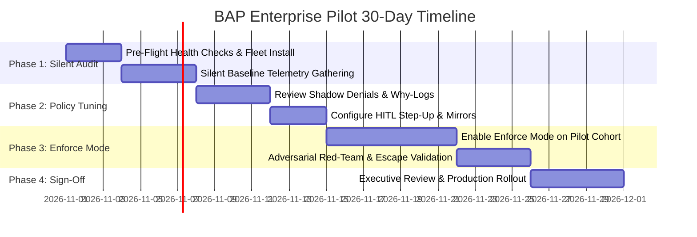

# 🚀 BAP Enterprise Pilot Runbook & Evaluation Protocol
## A 30-Day Implementation Guide for CISOs, Platform Engineering, and Dev Leads

**Version:** 1.3.0  
**Target Audience:** Enterprise Security Teams, Platform Engineers, Developer Productivity Leads  
**Document Custodian:** BAP Security Architecture Team (`security@bapltd.com`)

---

## 1. Executive Summary & Pilot Objectives

The **Bounded Authority Plane (BAP)** Enterprise Pilot is designed to evaluate runtime zero-trust governance across developer workstations running autonomous AI coding agents (**Claude Code**, **Google Antigravity**, **GitHub Copilot CLI**, **Cursor**, and **custom Python agents**).

### Primary Pilot Objectives
1. **Zero-Friction Visibility**: Gain 100% visibility into what AI agents are doing (prompts, shell executions, tool calls, file modifications) without altering developer workflows.
2. **Deterministic Risk Containment**: Prevent unauthorized credential exfiltration (`.env`, SSH keys), shadow package repository injection, and unmediated subshell evasion.
3. **Validate Velocity & Sub-Millisecond Performance**: Prove that BAP's local Cedar evaluation (<1.5ms) introduces zero perceptible latency into developer inner-loops.
4. **Phased Enterprise Rollout**: Transition safely from silent monitoring (**Audit/Shadow Mode**) to deterministic enforcement (**Enforce Mode**) with zero disruption to sprint commitments.

---

## 2. Pilot Cohort & Architecture Scope

### Recommended Pilot Cohort Size
| Role | Recommended Count | Primary Agents Evaluated | Focus Areas |
| :--- | :--- | :--- | :--- |
| **Backend Engineers** | 5 – 15 | Claude Code, Cursor | Terminal execution, DB migrations, API calls |
| **Fullstack Engineers** | 5 – 15 | Antigravity, Copilot | Package dependencies, build tools, frontend tests |
| **DevOps / Platform** | 3 – 5 | Python SDK, CLI | Terraform, script automation, cloud deployments |
| **SecOps / CISO Office** | 2 – 4 | Agent Watch V2 | Live fleet radar, audit trail, kill switch, HITL |

### Architecture Deployment Topology

```text
┌────────────────────────────────────────────────────────────────────────┐
│                   ENTERPRISE PILOT DEPLOYMENT TOPOLOGY                 │
│                                                                        │
│   DEVELOPER WORKSTATIONS (Pilot Cohort)                                │
│   ┌──────────────────────────────────────────────────────────────┐     │
│   │  AI Agents (Claude Code / Antigravity / Copilot / Cursor)    │     │
│   │                              │                               │     │
│   │                     [PreToolUse Hook]                        │     │
│   │                              ▼                               │     │
│   │  bapedge (Local Daemon) ──► Sub-2ms Cedar Cache             │     │
│   │          │ (Broker-Owned Restricted Token Execution)         │     │
│   │          │                                                   │     │
│   │          ▼ (TLS / mTLS Background Telemetry)                 │     │
│   └──────────┬───────────────────────────────────────────────────┘     │
│              │                                                         │
│              ▼                                                         │
│   CENTRAL PILOT CONTROL PLANE (Hosted on Render / Private Cloud)       │
│   ┌──────────────────────────────────────────────────────────────┐     │
│   │  bapcontrolplane (Port 8443)                                 │     │
│   │  ├─ Live Radar & Merkle Audit Log                            │     │
│   │  ├─ SPIFFE Identity & Dynamic Policy Distribution           │     │
│   │  └─ Agent Watch V2 (Mission Control & Trust Command)         │     │
│   └──────────────────────────────────────────────────────────────┘     │
└────────────────────────────────────────────────────────────────────────┘
```

---

## 3. The 30-Day Phased Pilot Schedule



### Phase 1 (Days 1–7): Fleet Onboarding & Silent Audit/Shadow Mode
**Target:** 100% of pilot developers onboarded with zero disruption.

1. **Deploy BAP Client**: Each developer executes user-mode setup (no admin / UAC required):
   ```bash
   pip install bap-ltd
   bap install
   ```
2. **Execute Pre-Flight Diagnostic**:
   ```bash
   bap doctor
   ```
   *Expected outcome:* `DOCTOR STATUS: ALL SYSTEMS HEALTHY (or OPERATIONAL)`
3. **Configure Audit Mode** in `bap-config.json`:
   ```json
   {
     "controlplane_url": "https://bap-controlplane.onrender.com",
     "enforcement_mode": "audit",
     "log_level": "info"
   }
   ```
4. **Normal Developer Activity**: Developers use Claude Code, Antigravity, Copilot, and Cursor as usual.
5. **Observability Review**: SecOps monitors the central dashboard (`/dashboard/v2/`) to observe command volume, agent personas, and `shadow_deny` warnings.

### Phase 2 (Days 8–14): Policy Calibration & Developer Ergonomics
**Target:** Calibrate policies to match your organization's specific toolchains and folder structures.

1. **Analyze Shadow Denials**: Run `bapedge why "<command>"` on any flagged operations to inspect matched Cedar rules.
2. **Configure Multi-Scope Approvals**: Test Human-in-the-Loop (HITL) step-up for cross-folder operations:
   ```bash
   # Pre-authorize shared internal libraries if needed
   bapedge trust --path "C:\Users\User\pyprj\shared-libs" --scope project --ops write
   ```
3. **Verify Supply-Chain Mirrors**: Ensure company npm/pip/maven mirror overrides function seamlessly via `.bapstate/mirrors/`.

### Phase 3 (Days 15–24): Deterministic Enforce Mode & Red-Team Testing
**Target:** Validate that real-world attacks are blocked while day-to-day work proceeds uninterrupted.

1. **Switch to Enforce Mode**:
   ```json
   {
     "enforcement_mode": "enforce"
   }
   ```
2. **Run Automated Red-Team Containment Tests**:
   SecOps executes the standing adversarial verification suite:
   ```powershell
   python tests/test_bap714_containment_redteam.py
   python tests/test_bounded_authority_matrix.py
   ```
3. **Verify Attack Mitigations**:
   - Attacking agent attempts to read `.env` or SSH keys $\rightarrow$ Blocked (`DENIED_CREDENTIAL`).
   - Attacking agent attempts to tamper with `.claude/` or `policy.cedar` $\rightarrow$ Blocked (`DENIED_TAMPER`).
   - Attacking agent attempts unmediated raw socket invocation $\rightarrow$ Blocked (`ANTI_BYPASS_VIOLATION`).
   - Honeytoken canary triggered $\rightarrow$ Session instantly quarantined on Radar.

### Phase 4 (Days 25–30): Evaluation Review & Production Sizing
**Target:** Review KPI scorecard and executive sign-off for enterprise-wide rollout.

1. **Generate Pilot Executive Summary**: Export audit logs and cryptographic receipts from Agent Watch V2.
2. **Developer Survey**: Collect feedback from pilot developers (friction score, responsiveness).
3. **Production Rollout Plan**: Plan GPO / Intune / Jamf automated rollout using `dist/` role packages.

---

## 4. Quantitative Pilot Success Criteria (KPI Scorecard)

| Category | Metric | Pilot Target | Measurement Method |
| :--- | :--- | :--- | :--- |
| **Security Containment** | Malicious credential/token exfiltration | **100% Blocked** | Red-team test suite & honeytoken canary tests |
| **Security Containment** | Tampering with hooks, Cedar rules, or BAP binaries | **100% Blocked** | FIM and `test_bap200_sole_executor.py` |
| **Developer Velocity** | Inner-loop policy evaluation latency overhead | **< 2.0 ms** | `bap doctor` / `bapedge exec` benchmarking |
| **Developer Velocity** | False-positive blockage rate on approved toolchains | **< 0.1%** | Shadow-deny logs and developer tickets |
| **Stability** | Host workstation process crashes or orphaned trees | **0 occurrences** | Windows Job Object & Linux namespace verification |
| **Resiliency** | Offline operation during network interruption | **100% operable** | Disconnected airplane-mode test |

---

## 5. Developer Pilot Verification & Daily Operations

### Daily Commands for Pilot Developers
```bash
# Verify system health before starting work
bap doctor

# Launch developer cockpit & monitor active sessions
bap launch

# Inspect reason if a tool execution is ever blocked
bapedge why "<blocked command>"

# Review active cross-folder permissions
bapedge permissions
```

---

## 6. Emergency Rollback & Safety Hatch Protocol

If a critical business workflow is impeded during the pilot, developers and administrators have access to three layers of fail-safe rollbacks:

### Level 1: Instant Switch to Audit Mode (Zero Interruption)
Set `enforcement_mode: "audit"` in `bap-config.json` or run:
```bash
bapedge config set --mode audit
```
All agent commands execute unblocked while continuing to emit security audit logs.

### Level 2: Project-Level Bypass
To temporarily run a specific command outside governance:
```bash
bapedge trust --path . --scope session --ops all
```

### Level 3: Clean Complete Uninstall (< 10 Seconds)
To completely remove all hooks and return the workstation to default:
```bash
python scripts/bap_install.py --uninstall
```
All agent hooks (`.claude/settings.json`, VS Code profiles, environment variables) are restored to their pristine pre-install states immediately.

---

## 7. Pilot Support & Escalation Cadence

- **Dedicated Pilot Slack/Teams Channel**: `#bap-pilot-support`
- **Weekly 30-Minute Office Hours**: Tuesdays & Thursdays at 10:00 AM
- **Urgent Escalations / SecOps Hotline**: `security@bapltd.com`
