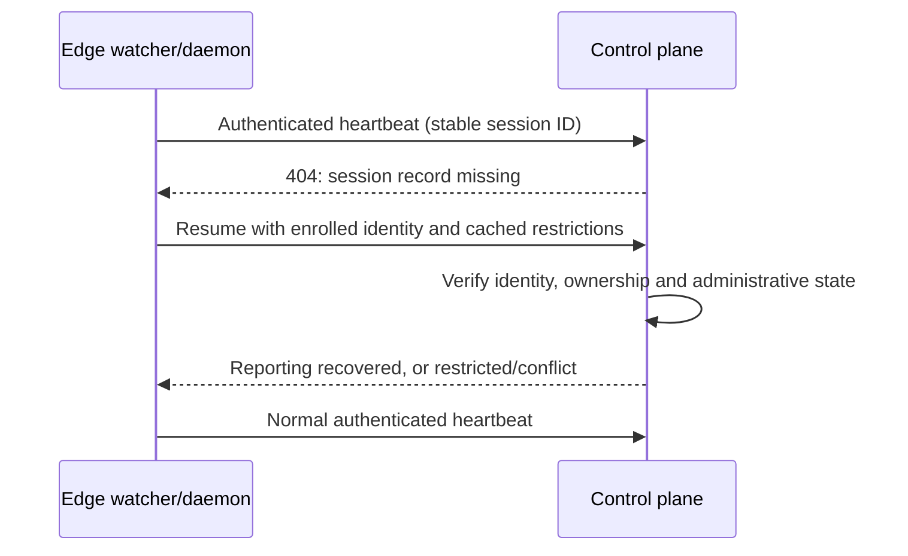

# Session identity, authenticated reporting, and deployment recovery

Updated: October 30, 2026. Implementation decision: [ADR-006](adr/ADR-006-Authenticated-Lifecycle-And-Recovery.md).

## Security boundaries

HTTPS authenticates the server and protects transport; it does not authenticate the workstation by itself. Session IDs, hostnames, email addresses, process IDs, and SPIFFE-shaped strings are identifiers, not credentials.

An enrolled workstation presents its signed enrollment credential on each lifecycle or telemetry write. The control plane verifies signature, expiry, issuer, credential purpose, current administrative restrictions, and the binding between the credential's instance ID and the stored session. New credentials carry `token_use=workstation`; execution grants carry `token_use=grant`. Historical one-year enrollment credentials are accepted for reporting/lifecycle compatibility only under the explicit legacy enrollment shape; they cannot acquire fresh execution grants without renewed typed enrollment. A bounded execution grant is not a lifecycle credential, and an enrollment credential is not an executable grant.

Authenticated administrative callers may manage sessions through their existing operator authority. The gateway has a separate ingestion-only service identity, configured with a distinct `BAP_TELEMETRY_TOKEN` of at least 32 characters on both services. That credential cannot create sessions, send heartbeats, recover identities, or execute operations. Gateway evidence is attributed to `bap-gateway-pep` and cannot create an unknown live session.

Gateway collector records can retain a claimed session correlation in the audit ledger, but cannot assert the workstation owner, advance session presence, or mutate that session's counters. The current enrollment proof is a bearer credential. This change does not implement mutual TLS, hardware proof of possession, or per-process SPIFFE certificates. A session SVID string is a server-derived identity label; its syntax alone is never proof.

## Authenticated API contract

The following writes require a workstation credential and session ownership, or explicit administrative authority:

- `/api/v1/sessions/start`, `/heartbeat`, `/end`, `/prompt`, `/response`.
- `/api/v1/instances/heartbeat` and the compatibility alias `/api/v1/control/heartbeat`.
- `/api/activity/ingest` and `/api/v1/activity/ingest`.

`/api/v1/audit/ingest` accepts authenticated workstation evidence, authorized gateway collector evidence, or explicit administrative evidence. A workstation cannot append evidence to another workstation's known session. Ownership and user identity are derived from verified claims rather than client-supplied labels. Unknown workstation-origin audit sessions are associated with the verified instance; replaying historical events does not make those sessions live.

Authentication precedes parsing large audit payloads. Rejected requests do not update heartbeat timestamps, counters, ownership, or administrative state.

| Response | Meaning | Edge action |
| --- | --- | --- |
| 200, `alive` | Known authenticated session | Continue normal heartbeat cadence |
| 200, `revoked` / `quarantined` | Administrative restriction | Preserve and enforce restriction |
| 401 | Missing, expired, invalid, or rejected identity | Report enrollment problem; do not try anonymous registration |
| 403 | Ownership mismatch or blocked operation | Do not alter identity or weaken local policy |
| 404 | Authenticated identity, missing session record | Attempt authenticated reporting recovery |
| 409 on resume | Existing closed/revoked/differently owned session | Never overwrite or reactivate it |
| Timeout / 5xx | Reporting unavailable | Continue cached local enforcement and retain pending telemetry |

## Recovery protocol

`POST /api/v1/sessions/resume` requires the existing enrolled workstation proof. The client supplies its original session ID, app ID, current live process ID, instance ID, and cached restriction flags. The server derives the owner and session SVID from verified identity, ignores supplied grant/lineage fields, and reconstructs reporting metadata atomically only when the session is missing.

Recovery runs only on explicit authenticated 404 responses. Retries have bounded exponential backoff and jitter; healthy heartbeats keep their existing cadence. Dead processes are not re-announced. Concurrent resume requests cannot reopen a session that was stopped or revoked.

Reconstructed registry records are marked `recovery_only`: they restore visibility, not fresh execution authority. New central grants require verified re-enrollment until authoritative enrollment storage is restored. Central grant verification binds execution grants to the issuing authority process epoch, so restarting an in-memory grant burner does not make old single-use grants reusable. Workstation enrollment proof remains usable across deployments when `BAP_SECRET_KEY` remains stable.

Resource PEPs must use central atomic consumption for stateful constraints. The gateway refuses enrollment credentials as execution grants and refuses constrained grants in explicitly configured stateless mode. Stateless signature/TTL verification cannot provide immediate central revocation or process-epoch awareness while disconnected; it must not be presented as atomic single-use enforcement.

Do not distribute the control-plane signing key to telemetry clients. A stateless HMAC verifier holding that key has issuer-equivalent cryptographic trust. Central consumption avoids requiring that issuer key at the gateway; its collector credential remains a separate, narrowly scoped secret.

## Local restrictions and explicit restoration

An empty fresh-server revocation snapshot is not proof that an administrator lifted an earlier restriction. Recovery-aware snapshots include explicit session, workstation and fleet restoration acknowledgements. The edge retains cached restrictions until an explicit applicable restoration is observed; a newly reported denial wins over a restoration marker.

Older control planes retain their previous snapshot behavior for compatibility. Deploy the paired server and client updates for the new recovery guarantees. Central freeze/revocation decisions that never reached any edge cannot be reconstructed from edge caches. Durable authoritative security state is still required; until then, ambiguous state remains restricted and an administrator may need to repeat a restoration after deployment.

## Verified delivery is not durable central storage

The current audit ledger is in memory. Its acknowledgements explicitly return `durable=false`, an instance epoch, and verified chain status. A valid chain acknowledgement alone does not authorize discarding the last durable event copy.

The edge moves acknowledged pending events into a retained, synchronized local recovery journal before removing them from the pending spool. Journals are partitioned by destination control plane. A persistent cursor skips records already delivered to the current instance. When the server epoch changes, background replay sends at most 50 historical events per flush; stable event IDs prevent duplicate ingestion and inflated counters. Live transmissions remain independent of historical backfill.

Recovery records are retained while central durability is absent; monitor `retained_recovery_bytes` and provision disk space. Cursor loss causes duplicate replay, not event deletion. The journal protects edge-originated events, not the control plane's independent administrative history. Missing/rotated enrollment credentials or signing keys can require re-enrollment before backfill. No central persistent database or journal compaction policy is introduced here.

Version-2 audit hashes bind session ID, instance ID, SPIFFE ID and user identity. Legacy hash links remain verifiable. Ingestion verifies the appended suffix of an already verified immutable chain prefix; independent full-chain verification remains available.

## Client and rollout requirements

- Update `bapedge`, the Claude interceptor, packaged launcher copies, and Python SDK together with the server. Old anonymous senders will receive 401; there is no anonymous fallback.
- Keep `BAP_SECRET_KEY` stable in the deployment secret manager. Planned signing-key rotation invalidates old enrollment proof and requires a separate renewal/rotation procedure.
- Go, hook and Python transports send enrollment proof only to the configured origin, require verified HTTPS remotely, and refuse authenticated cross-origin redirects. Loopback HTTP remains supported for isolated local testing.
- PowerShell launchers and the Python harness delegate lifecycle telemetry to `bapedge session-telemetry`, passing JSON through stdin. Tokens are not placed in command arguments or query strings. Prompt delivery failures are retained for retry.
- Configure the scoped gateway collector secret if gateway-to-control-plane audit collection is used. Missing collector configuration does not permit anonymous ingestion; gateway evidence remains local.
- Control-plane persistence, shared multi-replica identity/grant state, and production capacity/p95/p99 testing remain separate deployment work. Process-local stores and restoration receipts are not a distributed authority database.

## Verification

Tests cover anonymous and cross-workstation writes, execution-grant confusion, explicit administrative restrictions, quarantine preservation, identity grouping, credential origin/redirect handling, prompt retention, atomic recovery, retained-event replay and deduplication.

With `BAP_TELEMETRY_E2E=1`, control-plane tests start real edge test clients against a local HTTP control plane, replace the server state to model an ephemeral deployment, and check authenticated recovery, frozen recovery, acknowledged-event backfill, cursor behavior, and full-chain integrity. These are local state-loss E2E checks, not proof of Render persistence or production capacity.
