# Agent Watch V2 — Feature Preservation Matrix & Information Architecture Map

## 1. Executive Summary & Architecture Strategy

**Agent Watch V2** introduces a reimagined editorial enterprise operational experience organized into three purpose-built, interconnected workspaces:
1. **Mission Control (CIO)**: Enterprise agent activity map, workstreams (`build`, `operate`, `analyze`, `document`, `support`, `unknown`), enterprise outcomes & adoption, trust posture, exceptions, and evidence quality ratings.
2. **Trust Command (CISO / SecOps)**: Real-time agent fleet containment, policy decisions, blocked actions, SPIFFE/SVID identity validation, bounded single-use credential grants, coverage/bypass paths, and multi-layer drill-down (`Enterprise > Business Domain > Agent Session > Action > Cryptographic Receipt`).
3. **Capability Atlas (Architecture & Vendor Governance)**: 12-domain capability heatmap with rigorous evidence-backed vendor evaluation (Agent Watch / BAP, Keycard, Runlayer, AIR Security with AIR Defend module). Separates target state, designed, implemented, tested, deployed, and vendor claims without unsupported checkmarks or misleading single scores.

### Preservation Policy (Non-Negotiable)
- **Zero Functionality Lost**: Every screen, button, action handler, modal, and API call from V1 is mapped and preserved.
- **Side-by-Side Coexistence**: V1 Classic remains accessible at `/dashboard/?v=legacy` or via the top-bar workspace switcher toggle (`[ Switch to V1 Classic ]`).
- **Default V2 Experience**: Served at `/dashboard/v2/` and seamlessly selectable at `/dashboard/`.
- **Backend Parity**: All emergency controls (kill-switch, per-agent kill, revocation, quarantine) require scoped confirmation, RBAC verification, and audit receipt notarization.
- **Zero Mock Rule**: Production environments strictly show real telemetry; unavailable or uninstrumented metrics are displayed as "Pending Telemetry" or "Estimated", never filled with fabricated metrics.

---

## 2. Information Architecture (IA) Map

```mermaid
flowchart TD
    Root["Agent Watch V2 Gateway (/dashboard/ or /dashboard/v2/)"] --> Nav["Workspace Navigation Bar & Persona Selector"]
    Nav --> V1["Legacy V1 Classic (/dashboard/?v=legacy)"]
    Nav --> WS1["Workspace 1: Mission Control (CIO)"]
    Nav --> WS2["Workspace 2: Trust Command (CISO / SecOps)"]
    Nav --> WS3["Workspace 3: Capability Atlas (Enterprise Arch / Vendor Gov)"]

    WS1 --> MC1["Enterprise Agent Activity Map & Topology"]
    WS1 --> MC2["Workstream Distribution (Build, Operate, Analyze, Doc, Support, Unknown)"]
    WS1 --> MC3["Outcome & Adoption Funnel (L1-L5, Assisted Hours, Friction)"]
    WS1 --> MC4["Trust Posture & Evidence Quality Scorecard"]
    WS1 --> MC5["Intent Deviation & Execution Drift Alerts"]

    WS2 --> TC1["Live Agent Fleet & SVID Identity Attestation"]
    WS2 --> TC2["Decisions & Interception Stream (Edge, HookWatch, Gateway PEP)"]
    WS2 --> TC3["Blocked Actions & Plain-Language Remediation"]
    WS2 --> TC4["Credential Grants & Lineage Attenuation"]
    WS2 --> TC5["Progressive Drilldown: Org -> Domain -> Session -> Action -> Receipt"]
    WS2 --> TC6["Scoped Emergency Controls (Kill-Switch, Per-Agent Revoke, Quarantine)"]
    WS2 --> TC7["Reconciliation Queue (Rule R3 PEP Discrepancies)"]
    WS2 --> TC8["Tamper-Evident SHA-256 Audit Chain Inspector"]

    WS3 --> CA1["12-Domain Agent Security Heatmap"]
    WS3 --> CA2["Evidence-Backed Vendor Matrix (BAP, Keycard, Runlayer, AIR Security)"]
    WS3 --> CA3["Maturity State Tracking (Designed, Implemented, Tested, Deployed)"]
    WS3 --> CA4["Side-by-Side Vendor Compare & Domain Filtering"]
    WS3 --> CA5["Demo Requirements & Audit Telemetry Verification"]
```

---

## 3. Comprehensive Feature Preservation Matrix

| # | Existing Feature / Capability | Current V1 Route / View | Audience | V2 Route / Workspace | Data Source / Endpoint | Required Permission | Migration Status | Test Verification |
|---|---|---|---|---|---|---|---|---|
| 1 | **Executive Workforce Pulse** | `pulse` | CIO / Exec | **Mission Control** (`/dashboard/v2/#mission-control`) | `/api/activity/summary` | Read | Preserved & Enhanced | `test_mission_control_pulse` |
| 2 | **Enterprise Activity Topology Map** | `map` | CIO / Arch | **Mission Control** (`/dashboard/v2/#mission-control`) | `/api/activity/topology`, `/api/activity/business-units` | Read | Preserved with text alternative | `test_activity_topology_render` |
| 3 | **Intent-to-Action Correlation & Drift** | `contract` | CIO / CISO | **Mission Control** & **Trust Command** | `/api/activity/intents`, `/api/activity/deviation` | Read | Preserved with 8-stage breakdown | `test_intent_contract_view` |
| 4 | **Fleet Overview & Real-Time Pulse** | `overview` | CISO / Ops | **Trust Command** (`/dashboard/v2/#trust-command`) | `/api/activity/live`, `/api/v1/inspector/data` | Read | Preserved with live stream | `test_trust_command_overview` |
| 5 | **Decisions Evidence Table & Filter** | `decisions` | CISO / SecOps | **Trust Command** (`/dashboard/v2/#trust-command`) | `/api/v1/audit/events`, `/api/v1/inspector/data` | Read | Preserved with drilldown drawer | `test_decisions_evidence_table` |
| 6 | **Agent Runtimes & Identity Inventory** | `agents` | CISO / SecOps | **Trust Command** (`/dashboard/v2/#trust-command`) | `/api/v1/agents`, `/api/v1/spiffe/validate` | Read / `revoke` | Preserved with SVID details | `test_agents_identity_inventory` |
| 7 | **Workload Sessions & Traces** | `sessions` | Ops / SRE | **Trust Command** (`/dashboard/v2/#trust-command`) | `/api/v1/sessions`, `/api/v1/sessions/prompt` | Read / `kill` | Preserved with prompt history | `test_sessions_table_and_actions` |
| 8 | **Bounded Single-Use Grants** | `grants` | CISO / SecOps | **Trust Command** (`/dashboard/v2/#trust-command`) | `/api/v1/grants/consume`, `/api/v1/inspector/data` | Read / `revoke` | Preserved with PEP burn status | `test_grants_management` |
| 9 | **Cedar Policy Studio & Simulation** | `policies` | CISO / SecOps | **Trust Command** (`/dashboard/v2/#trust-command`) | `/api/v1/admin/inspector/data` | `publish` | Preserved with dry-run eval | `test_cedar_policy_studio` |
| 10 | **Cryptographic SHA-256 Audit Chain** | `audit` | CISO / Auditor | **Trust Command** (`/dashboard/v2/#trust-command`) | `/api/v1/audit/events`, `/api/v1/inspector/data` | Read / `audit` | Preserved with hash verifier | `test_audit_chain_verification` |
| 11 | **Endpoint Hardening (3-Layer A/B/C)** | `endpoint` | IT / SecOps | **Trust Command** (`/dashboard/v2/#trust-command`) | `/api/v1/inspector/data` | `enroll` | Preserved with containment check | `test_endpoint_hardening` |
| 12 | **HITL Step-Up Approvals Queue** | `approvals` | CISO / SecOps | **Trust Command** (`/dashboard/v2/#trust-command`) | `/api/v1/escalation/requests` | `approve` | Preserved with fail-close timer | `test_step_up_approvals` |
| 13 | **Add-on Supply Chain (MCP/Skills)** | `addons` | CISO / SecOps | **Trust Command** (`/dashboard/v2/#trust-command`) | `/api/v1/inspector/data` | `addons` | Preserved with hash vetting | `test_addon_supply_chain` |
| 14 | **Rule R3 Reconciliation Queue** | `recon` | Ops / SRE | **Trust Command** (`/dashboard/v2/#trust-command`) | `/api/v1/inspector/data` | `recon` | Preserved with receipt match | `test_reconciliation_queue` |
| 15 | **Why Was It Blocked? Helpdesk Tool** | `whyblocked` | IT / Helpdesk | **Trust Command** (`/dashboard/v2/#trust-command`) | Client diagnosis engine | Read | Preserved with plain language | `test_why_blocked_diagnostics` |
| 16 | **Rollout & Friction Funnel (L1-L5)** | `rollout` | IT Enablement | **Mission Control** (`/dashboard/v2/#mission-control`) | `/api/activity/summary` | Read | Preserved with adoption metrics | `test_rollout_funnel` |
| 17 | **Connection & Administrative Access** | `settings` | Admin / SRE | Global Drawer (`/dashboard/v2/#settings`) | `/dashboard-config`, `/dashboard-health` | Admin | Preserved with loopback check | `test_connection_settings` |
| 18 | **Emergency Global Kill-Switch** | Modal / Header | CISO / Ops | Global Command Bar | `/api/v1/control/kill-switch` | `kill` | Scoped double-confirmation | `test_kill_switch_action` |
| 19 | **Per-Agent Revocation & Quarantine** | Fleet table | CISO / Ops | Trust Command Fleet Action | `/api/v1/control/agent/kill`, `/api/v1/control/quarantine` | `revoke`, `quarantine` | Scoped confirmation modal | `test_agent_kill_and_quarantine` |
| 20 | **Live Event Stream (SSE/WebSocket)** | Background | All | Shared Live Pipeline | `/api/activity/stream` | Read | Auto-reconnect with fallback | `test_activity_stream_live` |
| 21 | **NEW: 12-Domain Capability Atlas** | None (New) | Enterprise Arch / Vendor Gov | **Capability Atlas** (`/dashboard/v2/#capability-atlas`) | Internal Schema & `/api/activity/categories` | Read | Brand-new workspace | `test_capability_atlas_matrix` |

---

## 4. Emergency Action Security Invariants

All high-impact operations enforce the following safeguards:
1. **Scoped Confirmation Dialog**: The operator must explicitly type the agent ID or confirm the blast radius (e.g. "REVOKE AGENT-042" or "ENGAGE GLOBAL KILL SWITCH").
2. **Role-Based Access Control (RBAC)**: Checks user persona and server-side authorization (`isAdminPath` enforcing loopback or authenticated remote admin header).
3. **Structured Audit Receipt**: Every emergency action writes an immutable event into the SHA-256 audit log containing `operator_id`, `client_ip`, `reason`, `blast_radius`, and `timestamp`.
4. **Deterministic Propagation Feedback**: The UI polls `/api/v1/control/kill-switch` and agent status to confirm edge runtime propagation before declaring success.

---

## 5. Visual System & Typography Specs

- **Background Canvas**: Editorial Deep Navy (`#060a12`, `#0a1120`, `#0f172a`)
- **Card & Panel Layer**: Subdued Slate-Navy (`#111d33`, `#16233f`) with 1px hairline border (`#1e293b` / `rgba(255,255,255,0.08)`)
- **Accent Palette**:
  - Electric Blue (`#38bdf8` / `#0284c7`): Primary brand, navigation, active states
  - Emerald / Teal (`#2dd4bf` / `#10b981`): Verified, governed, normal execution, attested SVID
  - Amber (`#f59e0b`): Step-up required, partial coverage, claimed/unverified, estimated metric
  - Coral / Crimson (`#f43f5e` / `#ef4444`): High-risk blocked, intent deviation, fail-close, revoked
  - Muted Violet (`#a78bfa`): JIT grant active, synthetic canary, testing state
- **Honest Telemetry Tagging**:
  - Any metric estimated from active agents carries an `[ESTIMATED]` pill with tooltip explaining calculation formula.
  - Any metric with zero active telemetry renders as `— Pending Telemetry —` rather than zero or mock values.
